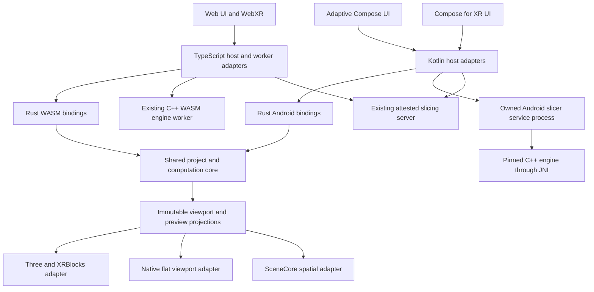

# Native Android and shared Rust implementation plan

**Status:** implementation in progress, started 2026-10-04 at the user's request.
The tasks below are unimplemented unless linked evidence says otherwise. This
document defines the required work; it does not change which platforms the
current release supports.

Initial Stage A evidence is maintained in [native-core build and evidence](engineering/native-core.md).
The development shell, bounded Rust canonicalizer, generated request bindings,
cross-language fixtures, migration inventory, artifact checks, and new CI workflow
exist. The canonicalization envelope requires named object fields and rejects
positional arrays and duplicate keys independently of inner JSON semantics.
Phases 0 and 1 remain open: physical baselines, complete transport/session
contracts, native offline manifests, and clean-runner qualification are still required.
No renderer, native slicing route, native project editing, or XR journey is
qualified by these foundation tests. Phase 2 now has a debug-only flat Filament
fixture workbench with bounded mesh uploads, picking, display paint ranges and
a Rust toolpath projection; see the [experiment contract](engineering/native-core.md#flat-renderer-experiment).
The separate SceneCore rc01 candidate now builds against the same mesh contract,
with SDK validation tests and non-XR startup checks. Spatial rendering and update
latency remain unverified; the Linux/SwiftShader XR-image diagnostic did not boot.
The SceneCore comparison, physical-device qualification and production Android
slicing route remain open. Neither renderer candidate closes a Phase 2 checklist item or exit.
The [native engine dependency probe](engineering/slicing.md#native-android-dependency-feasibility)
now builds the current pin's TBB runtime for both ABIs, verifies its packaged
dependency closure and ELF alignment, and executes allocator/task checks on an
x86_64 Android emulator. The full-engine port now passes clean builds for both
ABIs, ELF alignment/dependency checks and seven package mutation tests per ABI.
After fixing result transport and import staging, the final clean x86_64 package
passes actual constructor checks and all eleven native/reference comparisons
with unchanged oracle tolerances. There is no ARM64 execution or application
slicing route yet.
The [canonical slice reference corpus](engineering/native-slice-fixtures.md)
now verifies eleven real archive slices through the published WASM engine, covering
physical/mixed paint, scoped settings, support and wave paths. Its captured
inputs and output summaries now have matching x86_64 emulator slice comparisons;
ARM64 execution and the application capture/preflight workflow remain unqualified.

The first Phase 3 computation implementation now includes the Rust rich G-code
parser, immutable source/index ownership, bounded windows, cooperative native
cancellation, and generated packed-column layouts through WASM/JNI. The linked
engineering document records differential and resource evidence. The 12-mode Rust
preview projection, bounded inspection and playback now have development WASM/JNI
session bindings and independently generated source/window expectations. Generated
browser metadata validation and the bounded worker-side source owner now replay
the actual WASM corpus. Production browser preview now uses the Rust worker
adapter, with a fixed startup reference choice and verified offline asset pair; search,
production native rendering, native asset integration, and device budgets remain required to qualify
Stage B fully. No phase exit is closed by the browser integration alone.

The Android host now has validators generated from the same 26 metadata shapes,
strict bounded JSON parsing, model/arc/source checks and index-page continuity
checks. Projection, inspection and playback now bind their columns and metadata
to an explicit captured model from the same session and requested source window.
The renderer checks the capture identity before consuming the view. These
development bindings still require production integration and device qualification.
Source options and preview/inspection/playback requests now share a schema that
generates Rust decoders, TypeScript types/guards and Kotlin types/encoders/guards.
This covers the G-code computation transport. Project command coverage,
projection transport and actual worker/JNI session execution in Phases 1/4 remain open.

Phase 4 now has a local asynchronous facade over the existing TypeScript session,
with guarded FIFO mutation, ordered summary queries, bounded operation batches,
and authoritative acknowledgements. Production Undo/Redo and the seven plate
lifecycle operations await it through ActionRegistry. Plate controls retain their
busy state until acknowledgement; stale requests reject without edits. The seven
plate payloads now use a versioned shared schema generating TypeScript,
Rust and Kotlin types, bounded encoders/decoders and serializable command batches.
Generated session envelopes now carry connection generations, request IDs,
version negotiation, identity/history guards, bounded acknowledgements/errors,
ordered queries, cancellation and close. Production plate/history operations
exchange these strings through a local adapter; the TypeScript bus remains the
executor. Lost replies fail closed without automatic retries, and completed edits
whose summary exceeds the wire budget remain explicitly completed. Selection and
projection subscriptions are still local. Actual worker/JNI project execution,
revisioned projections, crash recovery and remaining workflows are still required. See
[project contracts](engineering/project-contracts.md).

The Rust project crate now also owns immutable asset records, read-only leases,
opaque rollback versions, transactional public restore and streaming bundle
fingerprints. Independent TypeScript traces and an allocation probe cover this
library boundary. The five-channel facet computation model now also validates
sparse assignments and version-2 split trees, normalizes and remaps them together,
and budgets temporary dense roots explicitly. Differential fixtures and sparse
allocation evidence are linked below. Lossless schema-1 typed candidates, immutable
graph ownership, streamed full-state fingerprints, empty-project construction and
basic graph/filament selectors now exist too. Eleven TypeScript-derived states,
record/literal drift checks and an allocation probe cover this model boundary.
Rust settings scope eligibility, strict layered resolution, import sanitization,
explanations and project configuration selectors now use the same pinned engine
table as the browser, with independent TypeScript comparisons. Compatibility
helpers now preserve pinned V8 timestamp parsing and exact layer-event rounding;
Node/Chromium reference corpora cover both V8 integer profiles and host timezone
conversion boundaries. Native timezone adapters, semantic graph and
option/profile validation, commands, history policy and native session execution
remain open; these libraries do not enable Android editing.

Build an adaptive native Android application for phones, tablets, Googlebook,
and Android XR while preserving the web application. Introduce Rust as a shared
implementation of selected computation and, subsequently, the canonical project
core. Keep the pinned Snapmaker Orca C++ slicing engine. Deliver the migration in
independently verifiable stages, with measured native performance and project
compatibility determining when each stage becomes the default.

This plan owns the Android and Rust migration sequence. [The parity plan](parity.md)
continues to own upstream feature scope and evidence. [GEMINI.md](../GEMINI.md)
and its engineering topic documents remain the authority for current behavior.
Implementation changes must update the relevant contracts in the same commit.

## Intended outcomes and boundaries

| Area | Intended outcome |
| --- | --- |
| Android phones and tablets | Native Compose interface, touch and keyboard input, native viewport, reliable open/save/recovery, local and external slicing |
| Googlebook | The same application adapted to resizable desktop windows, mouse, trackpad, keyboard, file handling, and multiple document sessions |
| Android XR headsets and supported wired XR glasses | Spatial panels and a spatial model workspace, with complete headset workflows and qualified input methods |
| Other browser and WebXR devices | Continue using the web application; Jetpack XR does not establish native support for every XR operating system |
| Audio and display glasses | A later, separately qualified companion experience for status and notifications; the full slicer workspace is not assumed appropriate |
| Shared behavior | One implementation per migrated capability, used through native Android bindings and browser WASM bindings |
| Slicing | The existing Snapmaker Orca v2.3.4 source pin, configuration semantics, and output provenance on every route |
| Printers | Snapmaker U1 and Elegoo Centauri Carbon through Moonraker, preserving existing command and submission safeguards |

The work does not include rewriting libslic3r in Rust, adopting a new upstream
slicer version, adding serial/USB/vendor-cloud printer backends, or implementing
native PCVR. A WebView wrapper would not satisfy the native rendering objective.
The old Android app is historical reference material; this is a new application
based on the current project and engine contracts.

## Platform evidence and decisions to validate

The following facts were checked on 2026-10-04. Recheck them when establishing
the build matrix; these are research observations, not a complete dependency lock.

| Observation | Consequence for this plan |
| --- | --- |
| Compose for XR lists `1.0.0-beta01`, released September 23, 2026, and a known problem when an Activity creates many panels | Pin a tested version and include repeated panel creation/disposal in qualification. [Release notes](https://developer.android.com/jetpack/androidx/releases/xr-compose) |
| SceneCore lists `1.0.0-rc01`, released September 9, 2026, and has custom mesh APIs | Evaluate native mesh rendering early; API availability does not prove efficient painting or toolpath rendering. [Release notes](https://developer.android.com/jetpack/androidx/releases/xr-scenecore) |
| Googlebook guidance emphasizes adaptive Android apps and desktop input/window behavior | Treat desktop usability as an acceptance surface from the beginning. [Developer guidance](https://developer.android.com/develop/adaptive-apps/guides/googlebook/overview) |
| Rust has Android and WebAssembly compilation targets | Share platform-neutral crates with separate bindings and scheduling adapters. [Target support](https://doc.rust-lang.org/rustc/platform-support.html) |
| Android native libraries must accommodate devices using 16 KB memory pages | Validate every packaged native dependency, including transitive renderer and engine libraries. [Android guidance](https://developer.android.com/guide/practices/page-sizes) |
| Android 17 enforces local-network protections for applications targeting SDK 37 or higher | Implement permission-aware Moonraker and external-slicer access; native networking is not permission-free. [Local network permission](https://developer.android.com/privacy-and-security/local-network-permission) |

Default architecture choices in this proposal are Kotlin/Compose for platform UI,
Rust for shared domain/computation, C++ for slicing, Filament as the first flat
viewport candidate, and SceneCore as the first spatial viewport candidate.
Filament provides an Android rendering API, but its suitability for our workload
still needs measurement. [Filament project](https://github.com/google/filament).

Keep renderer implementations behind a common projection contract. If SceneCore
cannot meet the spatial editing requirements, evaluate a custom OpenXR renderer
in a separate prototype with an explicit Compose/panel integration investigation.
Do not assume a custom renderer can replace SceneCore without affecting UI
composition, depth, input, or resource ownership. This decision must precede broad
XR feature implementation.

## Repository starting point

| Current implementation | Reuse and migration responsibility |
| --- | --- |
| `web/src/project/domain/`, `store.ts`, `assets.ts`, `history/`, `session.ts` | Behavioral reference for project schema, stable IDs, revision guards, immutable assets, transactions, history, and dirty checkpoints |
| `web/src/project/ports.ts` | Starting point for host-independent import, serialization, slicing, and persistence contracts |
| `web/src/project/import/`, `serialization/`, `migration/` | Authoritative import semantics, canonical envelope, BBS projection, preserved metadata, and old-schema recovery |
| `web/src/project/objects/`, `annotations/`, `painting/`, `filaments/` | Preparation, topology, painting, and FullSpectrum behavior to migrate by feature family |
| `web/src/slicer/RichGcodeModel.ts`, `GcodePreviewSession.ts`, `WorkerGcodePreviewSession.ts` | First bounded Rust extraction: parsing, indexing, windowing, and preview projections |
| `web/src/project/slicing/`, `web/src/slicer/CanonicalSlicerClientRoute.ts` | Preflight, immutable slice capture, job lifecycle, thumbnails, and artifact freshness |
| `web/src/actions/`, `web/src/settings/`, `web/src/l10n/` | Shared action identities, capability reasons, generated settings, and localization sources |
| `web/src/persistence/`, `web/src/printer/` | Recovery behavior and printer/session/submission state machines; platform I/O remains replaceable |
| `wasm/`, `server/patches/`, `wasm/artifact-provenance.json` | Current engine build inputs and provenance; preserve exact source and route-specific patch identities |
| `testdata/parity/`, `tools/parity-oracles/`, `tools/parity/` | Existing structural and semantic comparisons; extend coverage without relabeling synthetic fixtures as hardware evidence |
| `scripts/build_native.sh`, `docs/historical/android-slicer-notes.md` | Retired upstream-v2.3.2 Android work; inspect useful NDK/JNI lessons but do not run it as the production Snapmaker build |

At the plan baseline there was no active Gradle application or Cargo workspace.
The initial development implementations now exist under `android/` and `core/`;
their exact verification scope is recorded in the linked engineering document.
The project command bus is synchronous and accepts executable command objects;
introducing a worker-backed Rust core therefore requires an API migration, not
just replacing imports. Current browser slicing also has a fixed 256 MiB shared
heap and ten engine workers. Neither that allocation nor historical desktop
timings can be treated as a native-device memory or speed guarantee.

See [project contracts](engineering/project-contracts.md),
[large-model contracts](engineering/large-models.md),
[runtime contracts](engineering/runtime-and-deployment.md),
[XR contracts](engineering/xr-and-ui.md), and
[slicing constraints](engineering/slicing.md) before implementing their areas.

## Target architecture



The diagram describes code ownership, not one shared runtime across devices.
Each open project session has its own authoritative core. Browser workers,
Android processes, and separate devices communicate through versioned messages
or project files; they do not share raw pointers or implicitly synchronize edits.

### Proposed repository layout

The following paths are new deliverables, not existing commands or modules:

```text
core/
  Cargo.toml
  Cargo.lock
  rust-toolchain.toml
  crates/
    orcaxr-contracts/       # Protocol types, errors, capabilities
    orcaxr-project/         # Stable IDs, graph, history, settings, guards, sessions
    orcaxr-archive/         # Model import, canonical and BBS 3MF codecs
    orcaxr-geometry/        # Mesh representation, picking, paint computation
    orcaxr-gcode/           # Parser, index, bounded preview projections
    orcaxr-workflows/       # Shared slice and printer policy/state machines
    orcaxr-wasm/            # Browser bindings only
    orcaxr-android/         # Android JNI bindings only
android/
  app/                     # Application composition and distribution
  core-bridge/             # Kotlin API to the Rust session
  engine-service/          # Process ownership and IPC
  engine-jni/              # Narrow C++ entry points
  platform/                # Documents, recovery, permissions, networking
  renderer-flat/           # Native viewport implementation
  renderer-xr/             # SceneCore adapter and XR lifecycle
  ui-adaptive/             # Phone, tablet, desktop Compose screens
  ui-xr/                   # Spatial layouts and input
  benchmark/               # Device journeys and performance capture
  gradle/libs.versions.toml
contracts/                 # Versioned transport schemas and shared manifests
tools/cross-platform/       # Contract replay, artifact checks, benchmarks
testdata/cross-platform/    # Redistributable fixtures and expected traces
```

Create modules when their implementation starts. Keep the project and computation
crates free of Android, DOM, Three, networking clients, renderer objects, and
libslic3r linking requirements. The native engine remains a separate build so
changes to UI or Rust logic do not rebuild OrcaSlicer unnecessarily.

### State and command ownership

Every project mutation goes through one session command gateway. A request carries
protocol version, session generation, request ID, expected revision, and a typed
command payload. A response carries the committed revision, canonical identities,
history/dirty status, capability changes, and bounded projection deltas.

Use a versioned schema under `contracts/` as the wire-format authority, with
generated host types and runtime validators. Keep transport protocol version,
persisted project schema version, core ABI version, and engine identity distinct.
A core/host handshake checks their supported ranges before opening a session.
Host transports own authentication and I/O; the core returns typed effects and
consumes identity-bound results, keeping network availability out of domain tests.

Convert executable TypeScript commands into serializable intents incrementally.
First introduce an asynchronous facade backed by today's TypeScript command bus;
then implement the same facade over Rust. UI handlers must await acknowledgement
and handle rejection. A drag or stroke may display a temporary projection while
work is pending, but only the core can commit it. Cancel, stale revision, changed
topology, or failed validation discards that temporary projection.

Transactions carry a bounded list of typed operations. They cannot contain a
callback that crosses the worker/JNI boundary. Preserve atomic rollback,
selection restoration, command coalescing, history retention, no-op behavior,
dirty categories, and monotonic revisions, including failed-command behavior.

Never switch authoritative implementations in the middle of a live session.
Switch through a verified snapshot after pending work settles, or at application
startup. During migration a session uses either the TypeScript core or the Rust
core. Differential test runners may execute both on isolated fixtures; production
does not dual-write project state.

### Data and compatibility contracts

Document the existing canonical encoding before implementing it in Rust. Equality
must cover UTF-16 code-unit key ordering, JSON escaping and surrogate handling,
JavaScript-compatible finite-number formatting, negative zero, array order, IDs,
unit conventions, and binary mesh endianness. Rust's default string ordering and
JSON formatting are not sufficient evidence of compatibility.

Preserve the distinct FNV-1a64 semantic/source identities and SHA-256
project/configuration/artifact identities exactly where each is currently used.
Add cross-language fixtures for every identity boundary. Pass 64-bit values
through JavaScript as explicitly encoded values, never lossy Numbers.

Maintain the existing canonical envelope and BBS semantics, including unknown
members, component relationships, plate-local transforms, scoped overrides,
physical/mixed filament IDs, refined facet version 2, and authored profiles.
No file-format bump is required merely because implementation language changes.
If a genuinely incompatible feature requires one, introduce an explicit migration,
read compatibility, and recovery/rollback policy before publishing it.

Keep current archive bytes identical where deterministic writer bytes are part
of the contract. Where compression or nonsemantic container metadata changes,
require structural/semantic equality and an explicit reviewed change to byte-level
expectations; the output must still carry the digest of its actual bytes.

### Buffer ownership and concurrency

Use packed mesh and preview columns with checked lengths, strides, offsets, and
topology identities. Bulk data crosses a boundary once per owned operation where
possible. Measure copies explicitly; do not call a transfer zero-copy merely
because it uses a direct buffer or a typed array.

In Android, use generation-checked handles and explicit close/cancel lifetimes.
JNI retains a native buffer until its consumer and any GPU upload have finished.
Catch C++ exceptions at the C++ boundary, prevent Rust unwinding across JNI/C ABI,
and return bounded typed errors. Check callbacks arriving after session disposal.

In the browser, keep expensive computation in owned workers. WASM memory growth
invalidates borrowed views, so bindings must reacquire views or copy into owned
transfer buffers before returning. Ordinary ArrayBuffer transfers must work
without cross-origin isolation; optional shared-memory acceleration is separately
qualified. Rust WASM and the C++ WASM engine initially have separate heaps, so
budget archive transfer and peak coexistence explicitly.

Publish the Rust browser module and its binding glue as one versioned, verified
asset set. Extend the existing cache/update and provenance checks so a service
worker cannot combine a new host with stale WASM. Preserve the unsaved-work guard
on updates and test offline startup, missing assets, and rollback. Local Android
core/engine manifests must similarly identify the libraries actually packaged
and loaded, not unrelated build-directory copies.

The canonical session worker must not run an uninterruptible long parser or
geometry operation. Schedule bounded chunks or dispatch expensive work to owned
task workers operating on immutable captures. Cooperative cancellation handles
normal work; forced task-worker termination cannot discard the authoritative
project session. Limit concurrent import, preview, save, and slice work according
to a single host resource policy.

### Rendering contracts

Rendering consumes project projections and cannot modify authoritative geometry
or configuration. Use one explicit millimetre-to-metre and axis/handedness
conversion per platform adapter, with fixtures for transforms, normals, winding,
nonuniform scale, picking rays, and mirrored geometry.

Geometry assets have immutable topology IDs. Transforms, selection, and palette
changes update only the relevant projection. Painting previews update bounded
overlays or attribute ranges; avoid rebaking and reloading an entire GLB per
stroke. Validate the actual SceneCore buffer/material capabilities before
committing to that implementation. Flat rendering must work on non-XR devices
without initializing an XR session.

Qualify vertex/index limits, facet-color representation, GPU chunking, clipping
planes, transparency, and instancing on both renderer candidates. Pin any shader
or material compiler to its runtime version and package its generated assets for
offline use. Renderer simplification may reduce display detail, but must retain
selection/topology mapping and cannot alter the authoritative slice geometry.

G-code renderers consume the shared projection's colors, filters, semantic record
IDs, and bounded path data. They do not independently classify extrusion roles or
invent statistics. Keep thumbnail creation platform-specific, but attach its
bytes before final artifact hashing and preserve the engine sidecar binding to
the final published artifact.

### Engine and job contracts

Build Android from Snapmaker Orca v2.3.4 commit
`9fd12ffb2b1b80c9fb4c14564754d2ec1573a626`. Separate common behavior patches from
platform build adaptations in a reviewed build-input manifest. Android patches
must not be silently added to the exact CLI patch set expected by existing
clients. Define a new native-Android engine identity and explicit compatibility
rules while retaining fail-closed checks for older routes.

Use a narrow JNI adapter accepting an immutable canonical slice capture and its
verified BBS archive/configuration inputs. Return typed progress, cancellation,
diagnostics, G-code, and statistics sidecar. Do not substitute geometry-only STL
or the retired profile loader. FullSpectrum and all annotation channels must
reach the same pinned engine behavior as web/server slicing.

Run libslic3r in an application-owned, non-exported service process so an engine
crash does not take down the editor. This is process separation, not an assumed
Android isolated-process sandbox. Start with one local slicing job at a time.
Pass large input/output through private staged files or file descriptors; Binder
messages carry metadata and progress, not entire models or G-code.

Successful native return alone does not publish a file. Close/flush the owned
output, verify type/size/digest/sidecar, revalidate job and project identities,
then make the result available. On cancel, request cooperative engine stop, then
terminate only the owned service process after a bounded deadline if necessary.
Wait for that generation's process death before releasing capacity or starting
another job. Retain the editor's snapshot and distinguish interrupted, failed,
cancelled, and unknown outcomes.

A service is not a promise of unlimited background execution. Phase 6 must choose
and verify a permitted execution model for long local slices. Foreground-service
types and restrictions apply; `specialUse`, if needed, requires a documented use
case and Play review. Do not disguise slicing as media processing or assume
WorkManager removes those restrictions. If a distribution target cannot support
continued local work in the background, expose that limit and preserve explicit
external slicing. [Foreground service guidance](https://developer.android.com/develop/background-work/services/fgs/service-types).

### Persistence and transport contracts

Platform adapters own actual I/O. The core owns dirty state, exact save guards,
import transactions, and eligibility to publish or submit a slice.

Android uses document-provider APIs for user files and app-private storage for
recovery. Stage writes and atomically replace app-private records where supported;
arbitrary document providers cannot be assumed to support atomic replacement,
seek, fsync, or local filesystem paths. A failed save never clears dirty state.
A provider's successful write/close is reported as provider acknowledgement,
without promising physical disk durability beyond that provider's contract.

Preserve the existing five-second idle/thirty-second maximum recovery scheduling,
three snapshots per project/session, and initial 512 MiB recovery budget until
measured changes are deliberately specified. Preserve unknown future schemas,
validate identity before restore, and reopen recovered projects as dirty. Separate
sessions must not silently overwrite each other's document or recovery lineage.

Moonraker HTTP/WebSocket transport lives in Kotlin on Android and TypeScript on
the web. Shared workflow code owns session generations, readiness, tool mapping,
artifact freshness, command guards, and uncertain submission outcomes. Native
external-slicer requests authenticate as native clients; never fabricate browser
origin headers to claim the server's same-origin authorization.

## Migration stages

| Stage | Production authority | What changes |
| --- | --- | --- |
| A | Existing TypeScript project and C++ slicing | Add contracts, fixtures, native experiments, and measurements |
| B | TypeScript project, Rust leaf computation | Replace preview and measured geometry operations behind existing ports; Rust has no separate project state |
| C | TypeScript by default; Rust project in isolated qualification sessions | Replay identical command/import/save traces and compare every committed result |
| D | Rust project for complete, qualified sessions | Browser and Android use the same core implementation; TypeScript remains a controlled rollback adapter during a defined compatibility window |
| E | Rust project for supported production releases | Remove replaced runtime implementations after qualification; retain independent golden fixtures and oracles |

Do not activate Stage D for a project that needs an unimplemented command, import
format, setting scope, or recovery schema. Inventory that coverage before session
creation. During internal development, unsupported capabilities are explicit;
native production release requires the feature coverage described in Phase 10.

## Phase 0 Establish scope and measurable baselines

**Dependencies:** none. **Deliverables:** fixture inventory, device matrix,
baseline report, and resolved build/release assumptions.

- [ ] Inventory every implemented workflow and current explicit limitation from
  the action registry and parity evidence. Record the source commit so later web
  improvements cannot disappear from native scope unnoticed.
- [ ] Define reference devices: an ARM64 phone, tablet or large-screen device,
  Galaxy XR, Googlebook hardware when available, and an x86_64 emulator/desktop
  environment. Record OS, GPU, RAM, refresh rate, page size, and input devices.
  Emulator evidence never closes a physical-device gate.
- [ ] Select redistributable small, medium, and large fixtures, including roughly
  two million facets with substantial paint, repeated instances, multiple plates,
  FullSpectrum recipes, malformed archives, and large/arc-heavy G-code. Generate
  synthetic stress assets; keep private models outside Git.
- [ ] Record web load/import time, first useful frame, drag/paint latency, command
  commit time, preview indexing/window time, slice duration, cancellation,
  recovery duration, total process memory, and thermal behavior.
- [ ] Capture both local-WASM and external-slicer journeys. Compare native and
  web on the same physical device, files, profiles, engine inputs, and conditions.
- [ ] Fix a compatible AGP/Gradle/JDK/Kotlin/Compose/XR/NDK/Rust toolchain matrix
  after a minimal build; choose minimum/target SDK deliberately. Do not assume
  XR artifact versions align or let optional XR support exclude ordinary devices.
- [ ] Inspect historical application ID/signing/storage expectations before
  selecting upgrade versus separate-install behavior for retired APK users.
  Record the result without assuming old data is compatible.

**Exit gate:** published baseline inputs and repeatable measurement procedure;
numeric device memory ceilings and support limits are recorded before optimization.
Unowned hardware is an explicit qualification dependency, not simulated success.

## Phase 1 Add build foundations and shared contracts

**Dependencies:** Phase 0. **Deliverables:** minimal Android application, Rust
workspace, versioned protocol, CI jobs, and cross-language test runner.

- [ ] Add pinned Gradle wrapper/toolchain, version catalog, dependency verification,
  Cargo lockfile/toolchain, Android manifests, and release/debug configuration.
  Build `arm64-v8a` and `x86_64`; qualify each actual device ABI before claiming it.
- [ ] Create a minimal Compose Activity and an optional XR feature boundary.
  Verify installation and startup on a non-XR emulator without loading XR runtime
  services, model files, or the slicing engine. Check manifest feature declarations
  and package filtering so optional XR/camera capabilities do not exclude phones
  or Googlebook from installation.
- [ ] Implement a small Rust operation through Android JNI and browser WASM.
  Use direct JNI for the initial narrow Android boundary and wasm-bindgen for
  browser exports; pin binding tools and generated artifacts together. Validate
  error propagation, disposal, cancellation tokens, and buffer accounting.
- [ ] Define versioned command/result/error schemas and generate TypeScript and
  Kotlin types. Keep runtime validation at untrusted boundaries; generated types
  alone do not validate messages. Unknown protocol versions fail explicitly.
  Establish the schema generator's authority and require a clean regeneration
  diff, including Rust types, before either host can change its message shape.
- [ ] Add cross-language trace fixtures for IDs, number encoding, hashes, mesh
  layouts, and errors. Include non-BMP names, control characters, malformed
  surrogate input, empty payloads, large sizes, and stale generations.
- [ ] Extract action/settings/profile/localization manifests from current
  authorities for Android packaging. Check generated output instead of manually
  copying inventories. Package required assets for offline use.
- [ ] Extend CI with host Rust tests, WASM browser tests, Android assemble/lint/JVM
  tests, binding regeneration checks, dependency checks, and artifact provenance.
  Keep the existing web/server/WASM gates unchanged.

**Exit gate:** a clean checkout builds the minimal app and both Rust targets;
native/WASM contract vectors agree; incompatible binaries/messages are rejected.

## Phase 2 Prove native rendering and engine feasibility

**Dependencies:** Phase 1. **Deliverables:** measured viewport experiments,
Snapmaker NDK build proof, and an explicit renderer decision.

- [ ] Render the same packed mesh fixture in a flat Filament candidate and a
  SceneCore candidate. Include transforms, selection, clipping, instancing,
  per-facet colors, transparency, and a representative toolpath window.
- [ ] Exercise continuous picking and paint overlays on the large fixture.
  Measure upload size/count, draw calls, frame pacing, memory, and update latency.
  Inspect actual SceneCore APIs for mutable attribute/material support; do not
  infer update behavior from static model-loading demonstrations.
- [ ] Test context loss, Activity recreation, Home Space/Full Space transitions,
  panel creation/disposal, hidden UI, and repeated scene teardown. Account for
  CPU and GPU buffers retained by each renderer.
- [ ] Cross-compile the current pinned Snapmaker engine from a clean source tree
  for both initial ABIs. Audit the old TBB allocator, threading, POD initialization,
  JNI lifetime, and NDK compiler issues against this fork before reusing any patch.
- [ ] Slice fixed canonical fixtures through a minimal native adapter and compare
  outputs with the current routes. This fixture harness does not introduce a
  second editable project model or legacy profile implementation.
- [ ] Check 16 KB alignment and dependency loading in the installed APK. Confirm
  required geometry libraries and engine operations can be packaged within the
  selected distribution format.
- [ ] Record the flat/spatial renderer selection and any required alternative
  prototype. Resolve blockers before building the full XR interface.

**Exit gate:** real-device proof of usable mesh/toolpath updates and a valid slice
from the current engine. A cube render or successful linker invocation alone is
insufficient. Document measured benefits and remaining limits without promising
that native code automatically reduces total memory.

## Phase 3 Move G-code computation into Rust

**Dependencies:** Phase 1; use Phase 2 renderers for native integration.
**Deliverables:** shared parser/index/projection and production browser adapter.

- [ ] Port the current rich parser's modal state, source spans, tools, extrusion
  roles, layer handling, statistics observations, and bounded diagnostics.
  Preserve UTF-16 source-offset semantics where the existing browser API exposes
  them, or version an explicit byte/character offset translation.
- [ ] Preserve one semantic record per G2/G3 source command, exact Float32 operation
  order, bounded interpolation, cap failures without partial arcs, and unsupported
  metadata reporting. Do not enable compiler optimizations that change required
  floating-point behavior without differential proof.
- [ ] Implement streaming source/index ownership and checkpointed windows with
  the existing maximum of 240,000 rich records per window. Keep huge layers
  traversable and release previous sources on replacement.
- [ ] Port preview filtering/color projection and bounded inspection/search
  behavior. Keep engine-authoritative statistics distinct from parser observations.
- [ ] Replace the browser worker implementation behind its existing session
  interface; account for source conversion and WASM transfer overhead in benchmarks.
  Keep a startup-selectable reference adapter during qualification.
  Browser integration and packaged/offline loading now exist; the production
  regression exercises both adapters including conversion and transfer. This
  task remains open for the required repeated device performance measurements.
- [ ] Bind the same library to Android and render the resulting columns through
  the native viewport. Verify identical semantic IDs and projections across hosts.
- [ ] Add fuzz/property tests for malformed numbers, huge lines, truncated arcs,
  unsupported commands, invalid UTF-8, and allocation caps; retain independent
  expected results so both adapters cannot agree on the same new bug unnoticed.

**Exit gate:** differential fixtures and existing preview tests pass; memory and
latency budgets pass on browser and native targets; cancellation and repeated-open
tests show bounded resource use. Retire the old parser from production only after
the rollback window defined in Phase 11.

## Phase 4 Migrate project state and command execution

**Dependencies:** Phase 1 and the binding lessons from Phase 3.
**Deliverables:** asynchronous facade, Rust session, generated command bindings,
and replay coverage for the complete current command inventory.

- [ ] Introduce the asynchronous command/query facade over the current TypeScript
  implementation. Update action handlers, drag/stroke completion, imports,
  settings commits, undo/redo, autosave, and slice capture to await authoritative
  results. Keep all mutations behind ActionRegistry's invocation boundary.
  The local facade, production Undo/Redo and seven plate lifecycle routes exist,
  including acknowledgement-aware UI and guarded Objects reveal. Generated
  request/reply messages now serve these operations through an in-process string
  adapter with handshake, cancellation, close and bounded queue ownership. The
  remaining workflows, remote projections and worker/JNI execution are not migrated yet.
- [ ] Port domain schemas, validation, IDs, canonical formatting/hashing,
  immutable asset repository, selectors, and session lifecycle into Rust.
  Use immutable shared asset ownership and bounded history; transform/undo must
  not copy mesh payloads. The Rust project crate now ports stable UTF-16 IDs,
  branded entity families, injected UUID generation and immutable asset ownership
  with independent TypeScript fixtures. Asset traces compare public/internal
  restoration, metadata/content fingerprints, record/version identity and failures;
  an allocation probe verifies mesh bytes are shared through history snapshots.
  Five-channel facet validation, split lookup/visitation, normalization and
  paint-preserving remapping also exist in Rust, with independent TypeScript
  traces and a sparse-allocation probe. Typed schema-1 candidates now retain every
  modeled field and unknown metadata, share immutable child/paint allocations,
  stream full-state fingerprints and provide empty-project construction plus
  graph lookup, topology comparison and filament inheritance selectors. Independent
  references cover 33 record layouts, 11 literal domains, 11 full states, four
  factories and five direct candidate edits. These are not command traces.
  Project configuration selectors now also preserve engine precedence, ignored
  settings and local/inherited/source projections through the shared scope table.
  Semantic graph validation, bounded projections, history policy and session
  execution remain open.
- [ ] Port commands and transaction/history semantics by family, preserving
  rollback revision behavior, coalescing, checkpoint acknowledgement, selection,
  and history retention accounting. Test every command's failed and stale cases.
- [ ] Port settings resolution, physical/mixed filament identities, profile
  selection semantics, and canonical slice preflight. Consume the generated
  pinned schema/catalog rather than reconstructing defaults in Kotlin.
  Rust scope eligibility, strict layer validation/resolution, explanations,
  explicit import sanitization and project config selectors now exist. The table
  comes from the browser's pinned extractor; 3,439 layer cases and 100 graph
  queries compare reference results/errors. This is scope-policy computation,
  not option-value/profile validation, native settings commands or preflight.
- [ ] Provide bounded object-tree, inspector, capability, selection, and renderer
  projections. Subscribe to revisioned deltas; do not send the complete project
  or all geometry to every panel after each edit.
- [ ] Make worker/service generation changes invalidate pending replies. Implement
  explicit session disposal and recovery after the core worker fails; recover
  only from acknowledged snapshots/journal entries, never an optimistic UI view.
- [ ] Replay imports and command traces against TypeScript and Rust in isolated
  sessions. Compare state, semantic hashes, assets, dirty/history state,
  capabilities, errors, and exports after every step.

**Exit gate:** complete current command coverage with no unexplained semantic
differences. The browser still passes its full quality gate through the facade.
Rust remains an internal session choice until Phase 5 closes archive compatibility.

## Phase 5 Migrate archives and editing computation

**Dependencies:** Phase 4. **Deliverables:** shared import/export, geometry,
painting, and FullSpectrum operations that can support real native projects.

- [ ] Port signature-first STL/OBJ/AMF/ZIP import, 3MF component resolution,
  transaction preview/commit, deterministic imported IDs, and legacy schema
  migrations. Enforce archive expansion/member/depth/size limits and safe paths.
- [ ] Port canonical-envelope and BBS authoring, scoped overrides, plate origins,
  assembly transforms, custom G-code, modifier/negative volumes, annotations,
  mixed recipes, and unknown metadata preservation. A consumed metadata member
  cannot later overwrite a newly generated authoritative member.
- [ ] Verify web-to-native-to-web round trips and reverse round trips, including
  a real edit between each save. Compare untouched preserved members exactly and
  semantic structure independently; never use STL as the project interchange.
- [ ] Port measured geometry operations in order: packed mesh codec/bounds,
  picking and region selection, paint/refined-facet computation, then preparation
  operations required by the capability inventory. Reuse pinned native geometry
  kernels through an explicit adapter where they already own the algorithm.
- [ ] Preserve topology-change remap/rejection rules for every paint channel,
  stable filament assignments, one transaction per stroke, stale-preview guards,
  mirrored/instance transforms, and bounded overlay memory.
- [ ] Preserve current measurement, emboss/SVG, split/merge, simplify, assembly,
  variable-layer-height, brim-ear, and wipe-tower behavior and explicit limitations.
  Maintain the exact footprint/origin safety contract for placement/preflight.
- [ ] Route retained C++ geometry-kernel operations through the owned native job
  service, with the same input identity and cancellation checks as slicing.
  Serialize incompatible kernel/slice jobs and bound their shared resource use;
  do not load a second unbudgeted engine into the editor process.
- [ ] Run hostile-file and fuzz corpora against both native and WASM archive
  paths. Keep import failures transactional and diagnostics bounded.
- [ ] Enable complete Rust-backed browser sessions only after all current project
  operations, save/recovery, and old-file compatibility pass their gates.

**Exit gate:** edited projects survive cross-platform round trips without loss;
canonical identities match; large-model copy/resource budgets hold. The native
application now has a shared authoritative project implementation to build on.

## Phase 6 Integrate production native slicing

**Dependencies:** Phase 2 engine proof and Phase 5 project archives.
**Deliverables:** versioned Android engine artifacts, owned job service, local and
external slice routes, and verified output publication.

- [ ] Create reproducible clean-source build tooling under a new Android-specific
  entry point. Pin source, common/platform patches, NDK, dependency inputs,
  compiler flags, ABI, and every packaged library hash. Keep build concurrency
  conservative on the shared host.
- [ ] Implement the service/JNI contract described above, including bounded input
  staging, one-job admission, progress, thread-safe callbacks, cooperative cancel,
  hard-stop escalation, process-death observation, and cleanup after editor death.
- [ ] Reuse canonical preflight and exact captured configuration. Exercise U1
  toolchanges, CC profiles, FullSpectrum modes, support/seam/fuzzy/color painting,
  layer events, scoped overrides, and every engine feature currently claimed.
- [ ] Generate the statistics sidecar, render thumbnails from captured geometry,
  finalize the exact G-code bytes, and bind output to project/revision/config/
  assets/engine. Preview, save, and send reject stale output.
- [ ] Implement the native external-slicer client with explicit credentials,
  connection-generation capture, existing attestation, result digest/length
  validation, repeatable download, leases, and cancellation outcomes.
- [ ] Define local/external route selection using measured resource limits and
  user preferences. Show the selected route and reason; do not upload models or
  silently reroute work to a server the user has not configured and authorized.
- [ ] Qualify foreground/background execution for each SDK/distribution target.
  Test task switching, screen lock, thermal pressure, notification denial where
  relevant, service timeout, process death, and reopening an interrupted job.

**Exit gate:** qualified fixtures produce materially equivalent G-code across
Android, browser, and server; service crashes leave the editor/recovery usable;
cancelled or incomplete output cannot become a sendable artifact.

## Phase 7 Build the adaptive Android application

**Dependencies:** Phases 3–6; visual shell work can begin after Phase 1.
**Deliverables:** complete flat-device preparation, slicing, preview, and project
storage journeys on phone, tablet, and desktop-sized windows.

- [ ] Implement Prepare, Preview, Device, and Project navigation with the existing
  action names and semantics. Use ViewModels/coroutines as host adapters to the
  core; Compose state contains projections and drafts, never a second project.
- [ ] Adapt inspector/object tree, toolbars, menus, command palette, dialogs,
  settings, and progress states to narrow, medium, and wide windows. Support
  keyboard traversal, shortcuts, hover, context menus, trackpad navigation,
  touch gestures, stylus input when supported, and file drag/drop.
- [ ] Integrate the flat renderer with panel resizing, visibility, lifecycle,
  selection, painting, model tools, and preview controls. Keep CPU work and
  loading off the UI thread; avoid per-frame Compose recomposition for meshes.
- [ ] Implement document open/create/save-as/share, recent files, provider URI
  grants, externally revoked grants, nonseekable input, disk-full errors, and
  large-file streaming. Validate incoming open/share intents as untrusted input.
- [ ] Implement recovery storage and Save/Discard/Cancel guards for back,
  navigation, new/open/replace, window close where observable, and app updates.
  Test process death during capture, write, commit, and restore.
- [ ] Introduce document-session ownership for multiple windows. Different
  documents may coexist; reopening an already-owned document focuses its owner
  or opens an explicit read-only view. External changes require conflict handling
  before overwrite. Do not create two unsynchronized writers to one document.
- [ ] Generate Android localization resources and design tokens from maintained
  sources. Preserve placeholder/plural behavior and canonical locale independence.
  Test TalkBack, enlarged text, RTL/pseudo-locales, contrast, reduced motion,
  keyboard focus, edge-to-edge system bars, and IME insets.

**Exit gate:** open a large painted project, edit it, undo/redo, save/reopen,
slice locally or externally, inspect toolpaths, and recover after process death
on physical Android devices. Desktop resizing/input is verified separately from
touch behavior; Googlebook remains unqualified until tested on real hardware.

## Phase 8 Build complete Android XR workflows

**Dependencies:** Phase 2 renderer decision and Phase 7 shared workflows.
**Deliverables:** spatial workspace with complete authoring and output flows.

- [ ] Implement an XR capability adapter for session availability, space mode,
  supported input, anchors, and rendering lifecycle. Only initialize perception
  and request permissions when the selected feature requires them.
- [ ] Build spatial menus, tabs, inspector, object tree, tool rail, preview
  scrubber, dialogs, and notifications from the same action/capability inventory.
  Preserve labels and all paint channels; a button is unavailable until its full
  completion flow works inside the headset.
- [ ] Implement model/plate manipulation, ray picking, paint strokes, direct
  manipulation where supported, and modal gesture ownership. Cancel correctly
  on tracking loss, interrupted gestures, hidden panels, or disposed sessions.
- [ ] Preserve physical scale and ergonomic layout constraints from DESIGN.md
  while measuring the actual native density conversion. Implement recenter,
  pin/unpin, panel movement, readable text, and collision/occlusion behavior.
- [ ] Make project opening, save destination selection, credentials, settings,
  error recovery, and print confirmation completable in XR. Test system panels
  and transitions instead of assuming flat Android dialogs are sufficient.
- [ ] Qualify Home Space/Full Space transitions, repeated XR entry/exit,
  passthrough/perception permission denial, panel disposal, headset removal,
  and long sessions. Release hidden renderer/camera work.
- [ ] Test every advertised hand/controller/gaze/keyboard method on hardware that
  actually supports it. Separate headset and wired-glasses capability records;
  keep browser/WebXR regressions in the existing gate.

**Exit gate:** the representative end-to-end workflow succeeds wholly in-headset
with recorded latency, readability, reach, error handling, and fatigue review.
An emulator or spatial screenshot cannot close this phase.

## Phase 9 Integrate printers and platform services

**Dependencies:** Phase 7; shared policy extraction can start after Phase 4.
**Deliverables:** native Moonraker integration, shared command policy, camera,
credential storage, and explicit permission/error flows.

- [ ] Port printer/session/submission state machines into shared workflow code
  and run the browser transport through the same policy. Preserve authoritative
  query versus partial-notification merging, reconnection generations, unknown
  readiness, tool mapping, and immutable command/job identities.
- [ ] Implement Kotlin HTTP/WebSocket transport, explicit endpoint management,
  credential entry, and optional discovery. Discovery proposes verified endpoints
  and cannot overwrite preferences while a stale probe completes.
- [ ] Support intentional HTTP LAN connections through an explicit transport
  policy. Android configuration must allow the intended user-entered endpoints;
  application routing restricts cleartext requests to those selected local
  services. Do not send credentials across unexpected redirects or disable TLS
  certificate validation to make arbitrary HTTPS endpoints work.
- [ ] Handle local-network permission grant, denial, revocation, and re-entry,
  including SDK 37 behavior. Keep manual endpoint entry and platform-supported
  discovery distinct; avoid indiscriminate subnet scanning.
- [ ] Store remembered printer/slicer secrets using Android Keystore-backed
  encryption and clear them on explicit forget. Keep AI credentials memory-only
  unless a separate preference is deliberately introduced. Exclude secrets and
  private model contents from logs, backups, crash attachments, and test fixtures.
- [ ] Implement upload/prepare/start with digest and artifact checks, random
  non-overwriting names, post-upload revalidation, explicit overwrite handling,
  and unknown-outcome recovery. Never blindly retry an uncertain print start.
- [ ] Implement status/history/storage/console/camera features matching current
  scope. Camera subscriptions stop when hidden/disposed; emergency stop and the
  distinct firmware-restart action remain reachable without successful status
  queries. Preserve existing operator confirmations and supervised print gates.
- [ ] Test with the existing printer simulator before qualified, supervised U1
  and CC trials. Automated tests do not issue commands to real printers.

**Exit gate:** identical simulator traces produce equivalent policy decisions
on web and Android; permissions and reconnects are handled correctly; supervised
printer evidence closes only the specific behaviors actually observed.

## Phase 10 Complete feature coverage and optional experiences

**Dependencies:** Phases 7–9. **Deliverables:** native capability/evidence matrix,
remaining product workflows, and explicitly scoped companion support.

- [ ] Extend parity tooling to distinguish web DOM, WebXR, Android flat, and
  Android XR support and evidence. Generate manifests/reports through tooling;
  an implemented web handler cannot automatically mark Android implemented.
- [ ] Close native UI and shared-core coverage for all current implemented
  feature families: object/part/instance tools, FullSpectrum, painting channels,
  preparation/geometry, settings/profiles, slicing/preview/statistics, calibration,
  printer operations, recovery/help/diagnostics, localization, and accessibility.
- [ ] Port calibration definition binding, prerequisites, generated resources,
  preview/application, and history. Carry current unsupported firmware/automatic
  execution cases forward visibly; native packaging does not make them valid.
- [ ] Port Smart Paint proposal validation and operator correction through the
  shared transaction pipeline. Adapt provider transport, camera/voice features,
  and consent per provider/payload where they exist in the current app. Optional
  services remain lazy and cannot gate core startup.
- [ ] Inventory existing automation and platform-specific integrations. Preserve
  action IDs and implement deliberate native adapters where applicable; document
  browser-only integrations explicitly rather than claiming automatic portability.
- [ ] Qualify Googlebook file, window, keyboard, trackpad, DPI, and lifecycle
  behavior on actual hardware. Reassess package ABI coverage from that hardware.
- [ ] Design the display/audio-glasses companion as a separate feature package
  using a host-device connection: printer state, progress, completion/failure,
  and a handoff into the main application. Verify current glasses APIs/devices
  before implementation. Do not project a full editor or expose unqualified
  destructive voice/gesture commands.
- [ ] Complete companion disconnect/reconnect, notification privacy, permission,
  battery, and device-availability tests when hardware is available. Track this
  target independently; its absence does not block a qualified headset release.

**Exit gate:** every current product capability has per-target implementation
evidence or an explicit reviewed platform limitation. Upstream parity work still
open in docs/parity.md stays open. Companion support is marked complete only with
its own implementation and device evidence.

## Phase 11 Qualify releases and retire replaced implementations

**Dependencies:** all required gates for the target being released.
**Deliverables:** reproducible release candidates, compatibility/rollback proof,
hardware evidence, and maintained operating documentation.

- [ ] Run the complete web/server/WASM gate plus Rust, Android, cross-language,
  archive round-trip, engine route, hostile-input, lifecycle, and performance
  suites. Perform a fresh native source build for each shipped ABI.
- [ ] Verify installed APK/AAB artifacts, dependency and license notices,
  corresponding engine source/patch availability, native symbols, 16 KB loading,
  signing configuration, permissions, and current distribution requirements.
  No signing keys or release credentials enter the repository.
- [ ] Measure download/install size by ABI and package the native engine and
  required profiles through the chosen signed distribution artifacts. Verify a
  fresh installation can perform the promised offline workflow. Any later
  optional asset-delivery design needs its own missing/update/rollback behavior;
  do not rely on fetching arbitrary executable libraries at runtime.
- [ ] Run repeated import/edit/save/slice/preview/delete and cancellation/crash
  soaks on real devices. Verify recovery under low storage, memory pressure,
  thermal throttling, renderer failure, application upgrade, and process death.
- [ ] Conduct independent project/engine review and supervised U1/CC print
  qualification for the release corpus. Preserve existing outstanding operational,
  credential, security, and Galaxy XR gates until new evidence closes them.
- [ ] Use internal candidates, then a limited tester release, then production
  publication under the repository's release authorization. Artifact creation is
  separate from uploading/publishing it or commanding a real printer.
- [ ] Keep the previous compatible app and Rust/TypeScript adapter selection
  available for one full release qualification cycle. Exercise downgrade/open
  and restore from snapshots; never discard future-schema recovery data.
- [ ] Remove replaced TypeScript implementations only after the shared core has
  passed the full cycle and the rollback strategy no longer depends on them.
  Retain contract fixtures, semantic oracles, and regression traces independently
  of the new implementation. Remove obsolete Android build paths or label/archive
  them explicitly when the replacement is usable.
- [ ] Update GEMINI.md, topic contracts, README, user help, recovery guidance,
  generated capability reports, and release limitations to describe what shipped.
  Record exact commit, toolchain, artifact hashes, devices, measurements, and
  reviewers for each closed milestone.

**Exit gate:** a new user can install a qualified artifact and complete the
supported workflow, existing users retain their projects/recovery, and every
published support/performance claim has reproducible evidence.

## Performance and correctness acceptance

These are proposed engineering targets, not measured results. Phase 0 must name
the fixture/device combinations and memory ceilings. A failed target triggers
optimization or an explicit product-scope decision; it must not be hidden by
raising a threshold until a check passes.

| Area | Acceptance requirement |
| --- | --- |
| Interactive flat viewport | Sustain the chosen 60 Hz baseline within its 16.7 ms frame budget for the standard interaction trace; record p50/p95/p99 and missed frames |
| Interactive XR viewport | Meet the tested device's active refresh budget; record compositor/application metrics separately and observe missed-frame streaks |
| Gesture feedback | Proposed p95 input-to-visible-preview target of 50 ms; measure end-to-end, including host/binding/GPU work |
| Command completion | Proposed p95 250 ms for ordinary transforms/settings on the large fixture; longer geometry operations show progress and remain cancellable |
| Native benefit | Demonstrate a material improvement on the same hardware; initial target is at least 20% lower p95 interaction latency on the large painted fixture, with no unexplained memory regression |
| Memory | Respect the Phase 0 per-device ceiling across editor, engine process, workers, and reported GPU allocations; no low-memory kills in the supported corpus |
| Resource lifetime | Twenty repeated open/edit/preview/close cycles return to the documented bounded cache baseline without growing live handles, threads, or model buffers |
| Asset copies | Preserve the existing zero-payload-copy transform/undo contract; measure copy volume for import/export and JNI/WASM/renderer transfers |
| Cancellation | UI acknowledges cancellation within 100 ms; each worker/job has a documented completion/termination deadline, with a proposed five-second local-engine escalation bound |
| Recovery | Preserve acknowledged project state and save identity across the enumerated failure points; observe the five-/thirty-second scheduling contract during active execution |
| Engine output | Exact bindings and required sidecar identities; semantic G-code comparison with reviewed existing tolerances, not assumed byte equality across architectures |
| Cross-platform project behavior | Exact canonical identities and equivalent command traces; structural 3MF equality and exact preserved payloads |
| Web regression | Full existing quality and bundle gates pass; Rust startup/download/transfer costs are included, and optional modules load only when needed |

Use at least five cold/warm operation runs and sufficiently long interaction
traces for percentile measurements; save raw traces, not only averages. Run
sustained sessions of at least thirty minutes to reveal thermal changes. Record
charging/power mode, concurrent load, and instrumentation overhead. Compare
release builds and separate instrumented memory experiments from uninstrumented
latency measurements.

## Verification interfaces

Existing repository commands remain mandatory according to the affected area:

```sh
npm --prefix web run quality
npm --prefix web run bench:assets
npm --prefix web run bench:preview
npm --prefix web run test:recovery-storage
npm --prefix server test
npm --prefix server run test:integration
npm --prefix server run test:deployment
npm --prefix wasm run verify:artifacts
npm --prefix web run parity:oracles
npm --prefix web run parity:report
npm --prefix web run parity:report:check
./scripts/quality.sh
```

Phase 1 must add documented entry points for the following new checks. These are
interfaces to implement, not commands that work in the current checkout:

| Proposed check | What it proves |
| --- | --- |
| Rust format/lint/host tests | Workspace quality and deterministic domain behavior |
| WASM browser suite | Actual browser bindings, worker scheduling, buffer lifetime, and ordinary/non-isolated execution |
| Android JVM and device suites | Host policy plus real JNI, native libraries, document providers, process lifecycle, and rendering |
| Contract replay | Matching command traces and identities across TypeScript, native Rust, and browser Rust |
| Archive interchange | Edited web/native round trips, preservation, schema compatibility, and malformed-input rejection |
| Engine route comparison | Pinned Android/browser/server behavior for the same captured project/configuration |
| Artifact verifier | Source/patch/toolchain identity, packaged ABI set, binary hashes, native dependency alignment, and coherent bindings |
| Device performance suite | Repeatable workload/trace capture against the fixed device budgets |
| Capability report | Per-target handler, end-to-end test, hardware evidence, and explicit unavailable reason |

Layer tests so quick domain/binding checks run on every relevant change and
expensive clean engine builds run whenever engine/build inputs change and for
release candidates. Device availability failures must report unverified rather
than silently skipping required release tests. Existing audits and redacted
secret scans continue; add Rust/Gradle dependency auditing appropriate to the
locked toolchains.

## Milestones and dependency order

| Milestone | Required phases | Concrete review artifact |
| --- | --- | --- |
| M0 Baseline and build contracts | 0–1 | Reproducible minimal app, shared binding tests, baseline report |
| M1 Native feasibility | 2 | Real-device viewport traces and a correct pinned-engine slice |
| M2 Shared preview | 3 | The same parser/projection running in the web release and native harness |
| M3 Shared project core | 4–5 | Complete command replay and edited cross-platform project round trips |
| M4 Native flat workflow | 6–7 | Installable candidate that imports, edits, saves, slices, previews, and recovers |
| M5 Native spatial and printer workflow | 8–9 | Complete headset journey and qualified printer policy/transport |
| M6 Supported native release | 10–11 | Capability coverage, device evidence, reproducible artifacts, rollback proof |
| M7 Glasses companion | Relevant Phase 10 tasks and Phase 11 gates | Separately qualified status/handoff experience on supported glasses |

After Phase 1, rendering/engine feasibility and the first Rust extraction can
proceed independently. Shared project migration is the critical dependency for
production native editing. Adaptive UI scaffolding may develop against immutable
fixture projections, but real mutations must wait for the shared command contract.
Do not treat the early renderer experiment as a nearly finished application.

Estimate and schedule each milestone after measuring its predecessor. The largest
uncertainties are full command/archive migration, native renderer update behavior,
the current engine's Android dependency build, and access to target hardware.
Calendar commitments before M1 would conceal those uncertainties. Track engineering
effort separately from device availability and external distribution review.

## Risks and required decisions

| Risk | Required response and evidence |
| --- | --- |
| SceneCore cannot update large painted meshes efficiently | Resolve in Phase 2; compare a custom-renderer experiment before expanding XR UI |
| Rust and TypeScript canonicalization disagree | Block session cutover; extend explicit number/string/hash vectors and independent oracles |
| Async commands change editing semantics | Land the TypeScript facade first and exercise stale completion, undo, cancel, and transaction failure |
| Two project models emerge | Keep one authority per session; Kotlin/UI data is projection only; production has no dual writes |
| Additional WASM/JNI copies erase the expected gain | Measure peak coexistence and copy volume; redesign buffer/session boundaries before rollout |
| Retired Android patches alter the current engine | Reproduce the defect against the current pin and compare route output before accepting a patch |
| Native engine crashes or ignores cancellation | Owned service process, bounded stop escalation, generation-safe cleanup, and recovery tests |
| SDK background restrictions interrupt slices | Qualify the supported execution model; preserve captured jobs and explicit external routing |
| Desktop windows overwrite one project | Document ownership, revision/URI guards, external-change checks, and conflict tests |
| Android permissions recreate LAN failures | Distinguish permission, authentication, TLS, timeout, and unavailable-printer states in tested flows |
| Native support is mistaken for full upstream parity | Generate per-target coverage and retain all unresolved upstream/hardware evidence gates |
| Googlebook or glasses hardware is unavailable | Continue host/emulator work and hold the affected device claim open |
| Migration grows beyond bounded Rust extraction | Require performance or shared-authority value for each crate; keep UI/platform transport in their native languages |

## First implementation tranche

The first implementation change should establish Phase 0 evidence capture and
Phase 1 contracts. It should include the fixture/device inventory, minimal
Android/Rust builds, one verified JNI/WASM operation, canonical encoding vectors,
and CI wiring. The next changes should prove the current engine and both viewport
candidates, followed by the G-code extraction. Broad native authoring begins only
once the shared command and archive foundations can preserve real projects.

Track completion using the existing parity evidence convention: task, commit,
date, fixture hashes, commands, device/OS/toolchain, result artifacts, reviewer,
and unresolved limits. This plan starts with every implementation task unchecked.
