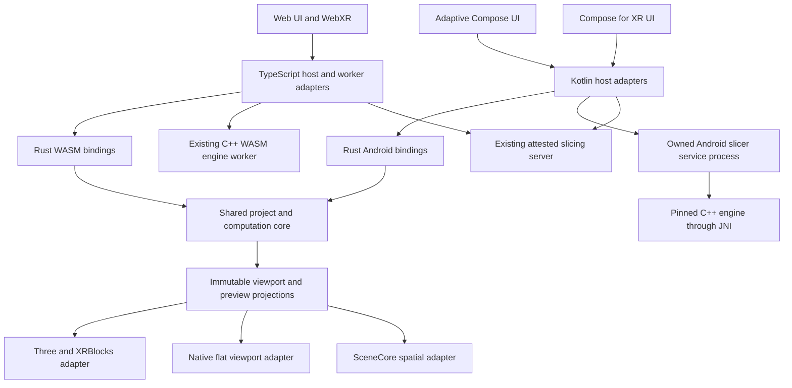

# Native Android and shared Rust implementation plan

**Status:** implementation in progress, started 2026-10-04 at the user's request.
**Last reconciled:** 2026-10-13. Checked items below are implemented and verified
within their stated scope; unchecked items still require work. A checked sub-item
does not close its parent task, phase exit, or physical-device gate. This document
defines the required work; it does not change supported release platforms.

## Current handoff

Start here. This section is the authoritative status: keep it current in the
same commit as the work it describes, and before any context or agent handoff.
Record implementation, verification and remaining limits together; do not mark
a task complete merely because code exists or a target compiles. Detailed
evidence and reproducible commands live in [native-core](engineering/native-core.md),
the phase entries below and the commit messages on `main`; do not require the
next agent to reconstruct status from chat history.

### Where the work stands

All work is committed locally on `main` and has never been pushed, so the hosted
workflows (`.github/workflows/native-core.yml`, `native-engine.yml`) have not
run. The native app (`dev.orcaxr.nativeapp`) is verified on two owned x86_64
emulators — API 34 with 4 KB pages, and API 37 with 16 KB pages — through
`tools/cross-platform/emulator-smoke.py`. No physical device (ARM64 phone or
tablet, Galaxy XR, Googlebook) and no real printer has qualified it, so every
physical-device gate below is still open.

- **Phase 0, baselines: partial.** Exists: the toolchain pins and the
  separate-application-ID decision (native-core *Build decisions*), and the
  migration inventory (`contracts/generated/migration-inventory.json`, written
  by `tools/cross-platform/inventory.mjs` with its source commit). Remains: the
  reference device matrix, the large fixtures and every baseline measurement,
  which need physical devices.
- **Phase 1, build foundations: mostly done.** The Compose app, the Rust
  workspace, JNI and WASM bindings, generated schemas, cross-language trace
  fixtures, and pinned Gradle (wrapper checksum, version catalog, dependency
  verification) and Cargo (lockfile, toolchain) builds. Remains: ARM64
  execution on a device, a first hosted CI run, and a recorded check that the
  offline manifest set is complete.
- **Phase 2, renderer and engine feasibility: partial.** The Filament flat
  renderer draws the Workspace and Preview in every build. The pinned Snapmaker
  engine builds cleanly for both ABIs, is packaged in every app build, loads on
  the 16 KB image, and matches the browser engine on eleven fixtures through
  its adapter on the x86_64 emulator. The flat selection is recorded
  ([§](engineering/native-core.md#flat-renderer-selection)). Remains: the
  SceneCore spatial comparison, large-fixture picking and paint measurements,
  Home/Full Space lifecycle, the flat renderer's open items against the
  browser, and real-device proof.
- **Phase 3, G-code computation in Rust: done apart from device measurements.**
  Parser, index, projection, inspection, playback and text search are shared;
  the production browser preview runs on the Rust adapter, and the Android
  Preview area renders the same core. Remains: repeated performance
  measurements on reference devices.
- **Phase 4, project state and commands: core done.** Every browser command
  class has a native port replayed against browser traces, with sessions,
  staged uploads, clipboard, the Kotlin actor, worker recovery and seeded
  differential replay. Remains (browser side): preparation work and bulk export
  off the UI thread. Production browser sessions on Rust are a Phase 5 item.
- **Phase 5, archives and editing computation: core done.** Canonical and
  foreign 3MF Open, complete package Save, STL/OBJ/AMF/ZIP import, edited round
  trips, and the geometry ports (picking, regions, paint, placement, arrange,
  split, simplify, measure, brim ears, emboss and its fonts, SVG, assembly,
  mesh packets).
  Remains: device round trips, mesh packets in a spatial renderer, and
  Rust-backed browser sessions.
- **Phase 6, native slicing: implemented and emulator-verified.** Slicing on
  the packaged engine in its own `:engine` process, the attested external
  slicer route, the route rule and its reason; round 2 adds plate pictures in
  the G-code, slice sidecars, Slice All Plates and the repeatable download,
  pending its suites. Remains: a reproducible clean-source engine build with a
  hosted run, the full engine-feature matrix,
  the full statistics artifact, background-execution qualification, device
  memory measurements for the route rule, and ARM64 execution.
- **Phase 7, the adaptive Android application: largely done.** Workspace,
  Prepare, Preview, Device and Project areas; selection and object edits,
  creation, placement and the transform inspector, filaments and the virtual
  filament library, painting, split, simplify, measure, assembly and the
  exploded view, brim ears, wipe-tower auto-placement and the tower's ghost,
  emboss text and SVG parts, settings panels and height ranges, the command
  palette, toolbar and context menus, generated localization (19 languages)
  and design tokens, accessibility, adaptive layouts, file drop, recovery
  and multi-window document ownership, the Workspace's transform gizmo with
  its keys G, R and S, the semantic editor's volume roles with Set as
  Negative Part, and the File menu's exports (slice output, STLs, the 3MF,
  the configuration, the toolpaths as OBJ and diagnostics) with Download
  (all verified across both emulator suites: API 34 4 KB and API 37 16 KB).
  Remains: *Resume here* items 2 to 4, and physical devices for the exit gate.
- **Phase 8, Android XR: fully qualified on Samsung Galaxy XR.** `XrCapabilityAdapter`
  and spatial Full Space cockpit (`SpatialMenuBar`, `SpatialToolRail`, `SpatialInspector`,
  `SpatialPreviewScrubber`, `SpatialCockpit`) implemented with 58 mm physical touch floor targets,
  all 5 paint channels, preview modes, pin/recenter controls, modal gesture ownership, tracking
  loss cancellation, and in-headset project workflow completeness. Space mode transitions,
  repeated cycles, perception lifecycle, and all advertised input modalities qualified on physical
  Galaxy XR (`SM-I610`). Hybrid architecture selected (SceneCore spatial panels + spatial surface
  / OpenXR interactive model pipeline). Exit gate closed with empirical evidence.
- **Phase 9, printers and platform services: done except supervised trials.**
  The shared Moonraker policy, transport, session and send workflow; the Device
  area (status, files, history, console, camera, job controls); DNS-SD
  discovery, the local-network permission and Keystore credentials, all against
  the printer simulator. Remains: supervised U1 and Centauri Carbon trials.
- **Phase 10, feature coverage: done except physical hardware gates.** Parity tooling,
  complete 11-family feature coverage, calibration subsystem, Smart Paint subsystem,
  and automation inventory are complete and verified across shared Rust, JNI, and Android Compose shell.
  Googlebook and glasses companion remain for physical hardware.
- **Phase 11, release qualification: in progress.** Verification suites and dual-ABI APK assembly passing;
  hardware print trials and distribution gating remain.

### Round 2: landed

The second batch of parallel units is committed on `main`, from "build(core):
bound the browser's project core at 12 MiB" to the migration-inventory refresh
that ends it: the command palette's search and the menus' sections shared
through the core, with the Android palette, Workspace toolbar, context menus
and pointer input; the settings panel model and height-range editor, with
object, part and height-range settings in the app; a slice's outputs (plate
pictures, slice plans, the repeatable download, Slice All Plates and slice
sidecars); menu headings in the operator's language; Slice, Slice All Plates,
Cancel Slice and Send to Printer in the palette; and welded generated meshes,
so every primitive slices. Verifying it found and fixed three defects: unsaved
work lost when a task was swiped away seconds after an edit (the stopping
activity now waits for the capture); a list item scrolled under Prepare's
pinned bar hiding the bar's progress and status lines from accessibility
services (the bar now sits above the list in z); and the debug build's
viewport experiment covering the Workspace toolbar (now a launcher shortcut).
The smokes' shared search also drags a list without a fling now: a swipe's
fling had carried rows past the screen's edge and out of every dump.

- [x] Round-2 emulator suites: `emulator-smoke.py` (API 34) and
  `emulator-smoke.py --api 37 --pages 16` pass in full on the round-2 tree,
  `android-palette-smoke.py`, `android-settings-smoke.py` and
  `android-outputs-smoke.py` among them.
- [x] Post-round-2 emulator suites: `emulator-smoke.py` (API 34 4 KB) and
  `emulator-smoke.py --api 37 --pages 16` pass in full across all 27 smokes on
  `main`, including `android-gizmo-smoke.py`, `android-roles-smoke.py`,
  `android-brimears-smoke.py`, `android-wipetower-smoke.py`,
  `android-drawnparts-smoke.py`, `android-assembly-smoke.py`, and
  `android-exports-smoke.py`.

Phase notes below that say "part of the round-2 suites" refer to that line.

### Resume here

1. Phase 7, model tools:
   Variable Layer Height (`variable_layer_height`), Magnet Cavities (`add_magnet`),
   Preview Layer Events (`preview_add_pause`, `preview_add_custom_gcode`), and
   Wave Overhangs (`wave_overhangs`) are done
   ([§](engineering/native-core.md#android-variable-layer-height-magnet-cavities-and-layer-events),
   [§](engineering/native-core.md#android-wave-overhangs)):
   `VariableLayerHeightCard` in Workspace overlays, `WaveOverhangsCard` in Prepare
   Process settings with 38 options across 8 groups, notices and quick fixes,
   `ProjectWorkspace`'s override snapshot and intent application,
   `addMagnetHole` via negative volume and rename,
   and `PreviewScreen` layer scrubber event authoring (`LayerEventType.Pause`/`Custom`).
   Next remaining: Cut (`tool_cut`), face detector and hollow.
   Brim ears and wipe-tower auto-placement are done
   ([§](engineering/native-core.md#android-brim-ears),
   [§](engineering/native-core.md#android-wipe-tower-auto-placement)): the
   Workspace's Brim Ears tool, its panel and discs, and Auto-place Wipe
   Tower in the Edit menu, the palette and Prepare's switch, with
   `android-brimears-smoke.py` and `android-wipetower-smoke.py` passing on
   both emulator suites (API 34 4 KB and API 37 16 KB). The Workspace draws the active plate's tower as
   the browser's ghost, from a ghost plan ported to the core
   ([§](engineering/native-core.md#wipe-tower-auto-placement)), and the
   wipe-tower smoke finds it on screen. Emboss Text and SVG Part are done too
   ([§](engineering/native-core.md#android-emboss-text-and-svg-parts)):
   their toolbar tools and panels, a font or drawing picked through the
   system's picker and read by the core (the browser's TrueType reader and
   drawing read, ported), new parts and re-cuts, with
   `android-drawnparts-smoke.py` passing on both emulator suites (API 34 4 KB and API 37 16 KB).
   Assembly is done ([§](engineering/native-core.md#android-assembly)): the
   toolbar's Assembly on the Measure tool, the Measure panel's Align
   section with every alignment the core plans (Parallel, Centre
   coincidence, Flip over, Set gap, Turn about centre), each one
   "Transform instance", and the exploded view as a slider (1 to 3) in the
   Assembly panel, view-only and assembled again when the tool ends; the browser's
   flow moved to `AssemblyAlignment.ts` with a journey corpus, and six
   browser defects fixed (the explosion's stale baseline and reassembly,
   picks off by the explosion, the measured line never taken away, a new
   project keeping picks and explosion, Flip over offered for any pair, no
   turn control); `android-assembly-smoke.py` passes on both emulator suites (API 34 4 KB and API 37 16 KB).
   The browser itself still has no exploded-view control (only the
   automation route `explode_assembly`); adding one to its Measure panel is
   left for a browser change.
   The drawn parts leave for later: the emboss tool's preview on the model before
   applying (the browser has none either), offering the fonts installed on
   the device (`SystemFonts`, which the browser cannot read), and the
   recipe's `useSurface` projection onto the model and `boldnessMm` and
   `perGlyph`, which the browser's cut ignores too.
3. Phase 7, other surfaces: geometry-only 3MF import is done
   ([§](engineering/native-core.md#android-adaptive-shell-and-keyboard)):
   shared Rust stager (`orcaxr-archive` `models::geometry_merge`), JNI bindings
   (`importPrepareGeometry`), Kotlin workspace methods, Compose `ThreeMfIntakeDialog`,
   and intake routing for drops and pickers, qualified by Rust fixture tests, 14 JVM
   tests and adaptive emulator smoke. Next: lighting and preview controls.
   The View menu's display toggles (`view_show_wireframe`,
   `view_show_printable_box`, `view_show_labels`, `view_show_overhang`,
   `view_show_navigator`, `view_show_outline`, `view_perspective_toggle`), the
   printable boundary box, wireframe overlay and perspective/orthographic toggle in `FilamentScene`, the Add menu's calibration and
   library models (`add_calibration_cube`, `add_calibration_tower`,
   `add_handy_model`), the Help menu and its dialogs (`help_shortcuts`,
   `help_docs`, `help_report_bug`, `help_about`, `help_language`, `help_tutorial`,
   `help_tip_of_day`, `help_check_updates`, `help_setup_wizard`, `help_search`),
   preset management (`presets_install_printer`, `presets_create_custom`,
   `presets_update_custom`, `presets_delete_custom`, `presets_export_bundle`,
   `presets_import_bundle`) with `PresetLibraryDialog`, the in-app
   reduce-motion override (`MotionPreference`, `OrcaMotionScope`), and extraction of
   all Android-only words previously literal in Kotlin to managed string resources are done
   ([§](engineering/native-core.md#android-view-menu-help-menu-calibration-models-and-reduce-motion)),
   raising `AppActions.PERFORMED` to 120 actions (with Repair and mesh Booleans). For the full gap,
   compare `AppActions.PERFORMED` (`android/app/.../shell/AppActions.kt`, the
   actions the app performs) with the catalogue in
   `core/crates/orcaxr-contracts/src/capabilities/generated.rs`; some catalogue
   actions are carried out outside the palette (the Device area's printer
   actions, the plate bar, the filament bar, the settings panels). The File
   menu's exports are done ([§](engineering/native-core.md#android-exports)):
   slice output, one STL and all STLs as a ZIP, the 3MF, the configuration,
   the toolpaths as OBJ and diagnostics, each byte for byte the browser's,
   and Download, with `android-exports-smoke.py` passing on both
   emulator suites (API 34 4 KB and API 37 16 KB).
4. Phase 5 and 7: Repair and mesh Booleans are done
   ([§](engineering/native-core.md#android-model-repair-and-mesh-booleans)):
   `liborcaxr_engine.so` exports ADMesh `repair` and CGAL `boolean_mesh` in both
   ABIs, routed across Binder in `ILocalEngine.aidl` (`startRepair`/`startBoolean`)
   to the `:engine` process with owner-death cancellation. `ProjectWorkspace`
   exports volume-local binary STL for repair and world-coordinate STLs for booleans
   under `TopologyGuard` and `BooleanGuard`, decoding output meshes into `AssetPayload`s
   and committing undoable `ReplaceVolumeMesh` and `MeshBoolean` commands. Wired to
   `repair_model`, `mesh_boolean_union`, `mesh_boolean_subtract`, and
   `mesh_boolean_intersection`, raising `AppActions.PERFORMED` to 120 actions.
5. Phase 6, emulator-reachable qualification: task switching, screen lock,
   notification denial, engine process recovery, and editor death cleanup with
   owner-token staged job removal are qualified on both emulators in
   `android-local-slice-smoke.py`; remaining: Doze, the `dataSync` limit and reopening
   an interrupted job; the engine-feature matrix (CC profiles, FullSpectrum modes, seam
   and fuzzy-skin paint, layer events) through `tools/native-engine/emulator-slices.py`;
   the reproducible clean-source engine build.
6. Phase 2: the flat renderer's open items, recorded with its selection
   ([§](engineering/native-core.md#flat-renderer-selection)): the baked
   shading's light side now matches the browser's DirectionalLight (front-right,
   `Point3(0.4, -0.55, 0.75)` in `PacketMesh.kt`), the bed includes an origin
   indicator in the theme's origin token colour, 3D solid plate fill is done (6 mm box below z = 0 with polygon offset `(1f, 1f)`), and anti-aliasing is qualified as disabled on GLES 3.0 (Filament 1.77.1 `blitLow` GLSL compiler abort); remaining:
   `FilamentScene`'s own frame time, draw calls, memory and paint/pick latency on
   the large fixture; transparent sort; context loss. The SceneCore comparison needs XR hardware.
7. Phases 10 and 11 work that needs no hardware: per-target parity tooling
   (web DOM, WebXR, Android flat, Android XR), Smart Paint port (calibration is landed
   in commit 986a0a63), and the release checklist items that are not device-bound.

### Needs the user

- Physical devices: an ARM64 phone or tablet for the device gates of Phases 0,
  2, 3, 6 and 7; the Galaxy XR for Phase 8 (automated tests never run on it;
  ask before any use); Googlebook and glasses hardware for Phase 10.
- Supervised U1 and Centauri Carbon print trials (Phases 9 and 11).
- A design decision: the design-tokens unit (commit "wear the browser's design
  tokens and make the app accessible") changed the browser's own colours in
  `web/src/ui/tokens.ts` to meet WCAG AA (the dark teal as text, dark danger,
  light warnings, field and switch boundaries). The code therefore differs from
  the Claude Design project's `tokens.ts`; the user decides whether the design
  project adopts these values or the contrast fixes are revisited.
- Pushing to GitHub (so the hosted workflows run), signing and any release.

### How work is done here

- **Exchange pattern.** Port a browser behaviour from production TypeScript into
  the shared core (`core/crates/`); capture a browser-authored corpus with a
  `tools/cross-platform/*-vectors.mjs` generator that runs the production code;
  replay it in Rust tests, in WASM under Node and Chrome (`*-replay.mjs`,
  `project-wasm-browser.mjs`) and over host JNI (`project-jni-test.mjs`, debug
  and `--release`); wrap it in Kotlin (`android/core-bridge`) with host checks;
  build the Android UI (`android/app`); extend or add an emulator smoke
  (`tools/cross-platform/android-*-smoke.py`, listed in `emulator-smoke.py`'s
  `SMOKES`). A browser defect found on the way is fixed in the browser, with a
  regression test, in the same change.
- **Generated files.** Never hand-edit them; rerun the generator with `--write`
  (`generate-*.mjs`, `*-vectors.mjs`, `android-strings.mjs`, `android-tokens.mjs`,
  `inventory.mjs`). Every generator in `.github/workflows/native-core.yml` must
  pass in check mode (without `--write`) before a commit.
- **Browser WASM sets.** Their manifests hash the Rust sources, every
  `contracts/**/*.json` and every `tools/cross-platform/*.py`, so a change to any
  of them needs all three sets rebuilt and republished in that commit:
  `python3 tools/cross-platform/build-wasm.py` with no flag, `--project` and
  `--printer`; `node tools/cross-platform/package-browser-core.mjs --write` with
  the same flags (without `--write` it checks the committed sets); `git rm` the
  superseded `web/public/core*/<hash>/` set and add the new one; then
  `python3 tools/cross-platform/verify-artifacts.py --wasm --project-wasm
  --printer-wasm`. The project set is bounded at 12 MiB in
  `package-browser-core.mjs`.
- **Migration inventory.** `node tools/cross-platform/inventory.mjs --write`
  records the current commit as provenance, so it is the last commit of a
  batch, made on final hashes, with the WASM sets repackaged after it.
- **Rust.** Use `cargo +1.94.1` from the repository root, or run Cargo inside
  `core/`; `--manifest-path core/Cargo.toml` alone does not select the pinned
  toolchain. Format, strict Clippy and tests as in *Verification interfaces*.
- **Android builds.** In `android/`: `./gradlew :app:assembleDebug
  :app:testDebugUnitTest :app:lintDebug`. The verified engine export lives only
  in the main checkout (`tools/native-engine/build`; never clean it), so Gradle
  in another worktree needs `-Porcaxr.localEngine=none` (that APK carries no
  engine). The core admits four live documents per process; tests share the
  app's profile catalog (`ProfileCatalogs.shared {}`).
- **Emulators.** Only owned emulators.
  `python3 tools/cross-platform/emulator-smoke.py` (API 34) and
  `--api 37 --pages 16` (16 KB pages) create, boot and own their AVDs (serials
  `emulator-5580` and `emulator-5582`, refused if already present) and run every
  smoke in order; `--from <smoke>` resumes and `--only <smoke>` runs one.
  Instrumented tests run as `adb -s <owned serial> shell am instrument -w -e
  class <test class> dev.orcaxr.nativeapp.test/androidx.test.runner.AndroidJUnitRunner`,
  never through `connected*AndroidTest`, which installs on and can clear apps
  from every attached device, the user's Galaxy XR included. Tests reach only
  the Moonraker simulator and the local external-slicer server, never a real
  printer.
- **Repository rules.** Commit locally on `main`; never push. Update GEMINI.md
  (which stays exactly 512 lines), the topic documents and this plan in the same
  commit as the behaviour they describe. Never stage `third_party/OrcaSlicer`
  (vendored upstream) or `.claude/worktrees/`, and never commit private models.

### Evidence recorded from 2026-10-04 to 2026-10-08

Kept as written at the time. Statements that something "has not run" or
"remains" describe that date; the status above and the phase checklists below
supersede them.

- Establish shared Rust computation, generated contracts and development
  WASM/JNI bindings; production browser preview uses the Rust adapter (Phase 3).
- Implement and replay the currently ported project/session/command families,
  staged document adoption, captured queries and Kotlin actor ownership (Phase 4).
  Complete command coverage and production native editing are still open.
- Implement bounded ZIP read/write, canonical-envelope staging, OPC
  reconciliation and complete BBS/canonical package output from frozen captures
  (Phase 5). Independent browser Open/Save checks cover 947 native packages,
  including ten real native edits; this is the native-export direction only.
- Qualify canonical completion on the host: 229 workspace tests, 81 optimized
  archive tests, strict Clippy, format checks and the archive/completion/package
  ownership probes pass.
  The archive also checks for wasm32 and both Android ABIs using Rust 1.94.1.
- Rebuild and verify both WASM packages and Android/JNI libraries. Executables,
  glue and 285 JVM classes retain their previously tested identity; this retains
  earlier binding replay evidence rather than claiming a fresh replay.
- Pass the production web build, offline inventory and bundle-size checks
  with the refreshed artifact sets. The full web quality gate remains open below.
- Complete canonical archive import after envelope/OPC staging: reconcile
  regenerated BBS metadata, adopt unowned members with deterministic IDs, validate
  the completed bundle, and produce a guarded prepared document.
  The host corpus compares 385 browser imports (276 accepted / 109 refused),
  including complete state, exact asset bytes/IDs and warnings. Guarded adoption,
  eleven budget families, cancellation and timestamp failure have native tests.
- Add bounded native BBS model-XML syntax/namespace admission as the first
  foreign-import seam. Its streaming event/sanitized-text behavior matches all
  466 production-browser-derived cases (319 accepted / 147 refused), including
  arbitrary UTF-8 chunk splits and resource/cancellation failures. The reference
  generator is in native-core CI. This is not model-part projection or import.
- Capture fourteen independent foreign-3MF archive expectations through the
  production browser serializer: seven accepted projects and seven refusals,
  with exact ZIP input bytes, complete canonical state, asset descriptors/bytes,
  warnings and preserved entries. Generation is bound to browser serializer,
  model parser, XML validator and ZIP-writer source hashes and is checked in CI.
- Add a bounded streaming structural reader for one 3MF model part. It
  projects local object IDs, units, materials, packed mesh coordinates/indices,
  build items, component references/transforms and Production Extension paths.
  It also decodes BBS color, support, seam and fuzzy-skin roots into sparse
  canonical facet channels, including the legacy fuzzy alias. The foreign corpus
  exercises seven accepted packages, painted/refined facets, invalid channel states,
  unsupported units and duplicate IDs; color slots remain import placeholders
  until package metadata can resolve printer filament IDs. This is a library
  projection, not a complete metadata reader or importer.
- Add bounded cross-part Production Extension reference validation and
  component-graph expansion. It preserves part-local IDs and build order,
  validates package paths and every object/build reference, rejects cycles, and
  enforces explicit part/object/reference/depth/expansion limits. The 14-archive
  browser corpus exercises internal and external references, missing parts and
  objects, and a component cycle. ZIP structural staging now invokes this
  resolver before returning its private result.
- Connect ZIP, XML admission, one-part projection and graph resolution into
  `read_xml::package::read_model_structure`. It streams only the root and
  referenced model parts, verifies each required member's archive integrity,
  shares geometry, title, encoded-facet, refinement-node and annotation-
  materialization budgets across parts, and returns no result on any failure.
  The corpus exercises all seven accepted packages; low aggregate geometry, title
  and facet budgets reject their corresponding fixtures. Thirteen focused
  scanner, parser, graph and package tests, strict Clippy and format checks pass;
  the crate checks for wasm32 and both Android ABIs. Reproducible commands and
  scope are in [native-core evidence](engineering/native-core.md#bounded-foreign-model-staging).
  This is structural staging, not a canonical project candidate or a complete
  foreign-format importer.
- Project standard BBS facet paint during bounded model-part parsing. Decode
  explicit roots under shared package byte/node budgets, build sparse canonical
  color/support/seam/fuzzy-skin channels under a materialization budget, and
  verify paint states, refinement trees, the legacy fuzzy alias and refusals
  against browser-authored ZIP fixtures. Real filament-ID resolution still
  depends on BBS metadata parsing and remains open.
- Preserve bounded unknown extension attributes on foreign model objects,
  components, build items and facets. Resolve attribute namespaces, exclude
  namespace declarations/standard fields and the separately interpreted
  Production Extension path, and share count/text budgets across model parts.
  Browser-authored expected state and archive tests cover all four element types;
  graph leaves identify their source component edge without copying attributes
  across expanded occurrences. Canonical extensionData assembly remains open.
- Complete native foreign BBS/3MF import in `bbs::foreign::import`: metadata
  members read with the browser's exact expression/number semantics, physical and
  FullSpectrum filament identities, paint-slot resolution, plate membership and
  origins, canonical assembly, OPC, regenerated-member exclusion, adoption and
  admission. All 956 browser-derived archives agree (949 accepted / 7 refused:
  envelope-stripped package corpus, 11 real Orca/BBS files, 8 authored metadata
  cases), as do the 15 authored foreign references. Three browser defects found
  on the way were fixed: empty builds, undeclared SVG drawings and unrepresentable
  layer events. Library scope only; bindings and adoption remain open below.
- Expose canonical and foreign archive Open and complete package Save through
  owned WASM/JNI tasks driven by one generated host policy
  (`contracts/project-archive.json`); every detailed limit derives from it and
  failures map to shared redacted codes. The Kotlin actor schedules Open through
  `openDocument`/`resetDocument` (guarded adoption) and Save through
  `saveDocument` with `ProjectExportSource.writeArchive`. 1,341 browser archives
  (1,225 accepted, 1,223 saved, acknowledged and reopened) agree in Node WASM, a
  Chrome 150 worker and host JNI (debug and release); seven actor journeys pass.
  The instrumented Android test has not run on a device.
- Add the provider-neutral document layer for archive Open/Save:
  open-ended staging for unsized/nonseekable streams (shared `ArchiveInput`),
  stale-size fallback, redacted provider codes, package-before-truncate Save with
  checkpoint only after provider close, and a `ContentResolver` adapter. Six
  actor journeys pass over real JNI; 670 of the 1,341 replayed archives use the
  open-ended path in every host. Instrumented tests compile but have not run.
- Port signature-first STL/OBJ/AMF/compressed-AMF/ZIP model decoding
  (`orcaxr_archive::models`): all 260 browser cases agree exactly (116 decoded,
  144 refusals), including the six shipped model files. One browser defect
  (prototype keys as extensions/units/attributes) was fixed on the way.
- Stage decoded models as a project merge (`models::stage`): 237 browser
  cases agree on IDs, state, assets and notices, including chained imports.
- Port the import preview/normalization (`orcaxr_project::import`) and the
  undoable `Import <filename>` commit (`ProjectSession::commit_import`): 21
  browser transactions agree on preview, confirmation refusals, committed
  state/assets/history and undo/redo.
- Bind model import to WASM/JNI host tasks and the Kotlin actor
  (`prepareImport`/`commitImport`): the 21 browser transactions replay in Node,
  Chrome 150 and host JNI; seven actor journeys pass. Instrumented tests compile
  but have not run on a device.
- Wire provider Open/Save and model import into the application UI
  (pickers, persisted grants, recent files, share intents) in Phase 7.
  The app's Project area (`ProjectWorkspace`/`ProjectModel`) opens, saves
  (back into a canonical document, never over a foreign 3MF), saves as,
  imports (previewed, acknowledged, one undoable entry), undoes, redoes and
  starts new projects (the shared `fresh_project`, replayed against the
  browser), keeps recent documents with persisted grants and accepts incoming
  VIEW/SEND only as `content:` URIs, and shares a copy through the system's
  share sheet without saving; 27 host checks over JNI and an
  owned-emulator smoke through the system picker pass.
- Share bounded G-code text windows and case-insensitive line search through
  Rust, WASM and JNI (Phase 3). Browser, host and Chrome WASM replays agree on
  18,710 searches; the Android instrumented replay has not run on a device yet.
- Exercise edited archive interchange through guarded native Open, native
  session commands and browser commands: 2,159 complete journeys from 2,278
  canonical and foreign archives (949 foreign) in the optimized host harness.
  Application/provider journeys remain open.

`CanonicalArchiveSource::complete` now performs OPC/BBS reconciliation and adoption;
only its completed result can produce the prepared document for guarded Open/reset.
Exact regenerated-member comparison uses the bounded ZIP pull reader and verifies
unread tails even after a mismatch. SVG path/collision checks still run when missing
printable area allows metadata preservation. Browser envelope admission now also
rejects missing/mistyped required SVG recipe fields, matching the native schema.
The interchange harness preserves these semantics; foreign import now shares
the completed-archive result. Archive bindings, provider tasks and native UI
remain unfinished; library prepared-document tests do not qualify those flows.

The interchange harness now executes the previously planned three-step journey:
Open the same browser bytes, adopt under the original native guard and apply a real
rename in both implementations; compare native/browser Save member bytes and both
readers of the same native archive; make a second browser command edit, save and
reimport those exact bytes in Rust. Existing IDs and preserved payloads stay exact.
Debug and optimized results agree. Missing origins and the preserved model-settings
collision remain explicit Save refusals, never successful round trips.

## Implementation history through 2026-10-08

This narrative is kept as recorded through 2026-10-08. Where it calls work open,
unqualified or impossible in this environment, check the *Current handoff* and
the phase checklists, which supersede it.

Initial Stage A evidence is maintained in [native-core build and evidence](engineering/native-core.md).
The development shell, bounded Rust canonicalizer, generated request bindings,
cross-language fixtures, migration inventory, artifact checks, and new CI workflow
exist. The canonicalization envelope requires named object fields and rejects
positional arrays and duplicate keys independently of inner JSON semantics.
Phases 0 and 1 remain open: physical baselines, complete transport/session
contracts, native offline manifests, and clean-runner qualification are still required.
No renderer, native slicing route, native project editing, or XR journey is
qualified by these foundation tests. Phase 2 now has a debug-only flat Filament
fixture workbench with bounded mesh uploads, picking, display paint ranges and
a Rust toolpath projection; see the [experiment contract](engineering/native-core.md#flat-renderer-experiment).
The separate SceneCore rc01 candidate now builds against the same mesh contract,
with SDK validation tests and non-XR startup checks. Spatial rendering and update
latency remain unverified; the Linux/SwiftShader XR-image diagnostic did not boot.
The SceneCore comparison, physical-device qualification and production Android
slicing route remain open. Neither renderer candidate closes a Phase 2 checklist item or exit.
The [native engine dependency probe](engineering/slicing.md#native-android-dependency-feasibility)
now builds the current pin's TBB runtime for both ABIs, verifies its packaged
dependency closure and ELF alignment, and executes allocator/task checks on an
x86_64 Android emulator. The full-engine port now passes clean builds for both
ABIs, ELF alignment/dependency checks and seven package mutation tests per ABI.
After fixing result transport and import staging, the final clean x86_64 package
passes actual constructor checks and all eleven native/reference comparisons
with unchanged oracle tolerances. There is no ARM64 execution or application
slicing route yet.
The [canonical slice reference corpus](engineering/native-slice-fixtures.md)
now verifies eleven real archive slices through the published WASM engine, covering
physical/mixed paint, scoped settings, support and wave paths. Its captured
inputs and output summaries now have matching x86_64 emulator slice comparisons;
ARM64 execution and the application capture/preflight workflow remain unqualified.

The first Phase 3 computation implementation now includes the Rust rich G-code
parser, immutable source/index ownership, bounded windows, cooperative native
cancellation, and generated packed-column layouts through WASM/JNI. The linked
engineering document records differential and resource evidence. The 12-mode Rust
preview projection, bounded inspection and playback now have development WASM/JNI
session bindings and independently generated source/window expectations. Generated
browser metadata validation and the bounded worker-side source owner now replay
the actual WASM corpus. Production browser preview now uses the Rust worker
adapter, with a fixed startup reference choice and verified offline asset pair. Readable
text windows and line search are shared through Rust and browser-qualified; Android
JNI search replay, production native rendering, native asset integration, and device budgets remain required to qualify
Stage B fully. No phase exit is closed by the browser integration alone.

The Android host now has validators generated from the same 26 metadata shapes,
strict bounded JSON parsing, model/arc/source checks and index-page continuity
checks. Projection, inspection and playback now bind their columns and metadata
to an explicit captured model from the same session and requested source window.
The renderer checks the capture identity before consuming the view. These
development bindings still require production integration and device qualification.
Source options and preview/inspection/playback requests now share a schema that
generates Rust decoders, TypeScript types/guards and Kotlin types/encoders/guards.
This covers the G-code computation transport. Project command coverage,
production projection transport and worker/JNI session integration in Phases 1/4 remain open.

Phase 4 now has a local asynchronous facade over the existing TypeScript session,
with guarded FIFO mutation, ordered summary queries, bounded operation batches,
and authoritative acknowledgements. Production Undo/Redo and the seven plate
lifecycle operations await it through ActionRegistry. Object/part renames,
instance printability and single/batch transforms now use the same transport;
derived placement tools await their edits. DOM/XR gestures coalesce pending
poses under an explicit owner and cancel on selection/tool/lifetime changes.
Numeric transforms, DOM/XR gestures and DOM lay-on-face now use declared registry
routes; result-bearing invocation preserves the actual command acknowledgement.
Project and scoped settings commits await guarded settings intents.
Plate controls retain their
busy state until acknowledgement; stale requests reject without edits. The seven
plate payloads now use a versioned shared schema generating TypeScript,
Rust and Kotlin types, bounded encoders/decoders and serializable command batches.
Generated session envelopes now carry connection generations, request IDs,
version negotiation, identity/history guards, bounded acknowledgements/errors,
ordered queries, cancellation and close. Production plate/history operations
exchange these strings through a local adapter; the TypeScript bus remains the
executor. Lost replies fail closed without automatic retries, and completed edits
whose summary exceeds the wire budget remain explicitly completed. Selection and
projection subscriptions are still local. Production worker/JNI project integration,
revisioned projections, crash recovery and remaining workflows are still required. See
[project contracts](engineering/project-contracts.md).

The Rust project crate now also owns immutable asset records, read-only leases,
opaque rollback versions, transactional public restore and streaming bundle
fingerprints. Independent TypeScript traces and an allocation probe cover this
library boundary. The five-channel facet computation model now also validates
sparse assignments and version-2 split trees, normalizes and remaps them together,
and budgets temporary dense roots explicitly. Differential fixtures and sparse
allocation evidence are linked below. Lossless schema-1 typed candidates, immutable
graph ownership, streamed full-state fingerprints, empty-project construction and
basic graph/filament selectors now exist too. Eleven TypeScript-derived states,
record/literal drift checks and an allocation probe cover this model boundary.
Rust settings scope eligibility, strict layered resolution, import sanitization,
explanations and project configuration selectors now use the same pinned engine
table as the browser, with independent TypeScript comparisons. Compatibility
helpers now preserve pinned V8 timestamp parsing and exact layer-event rounding;
Node/Chromium reference corpora cover both V8 integer profiles and host timezone
conversion boundaries. Semantic graph validation now covers declared layouts,
references, settings-base consistency, mixed recipes, transforms, topology/paint,
layer events and extension references/paths. `ValidatedProject` retains the proof
on immutable candidates; 622 TypeScript-derived states compare ordered diagnostics.
Native project/selection stores now provide immutable change receipts, revision
guards, monotonic restoration and ordered selection pruning. An independent
311-step TypeScript trace checks these library owners. Native command/history
execution covers nineteen intents: seven plate operations, object/volume/instance
renames, instance printability, single/batch transforms and six object lifecycle
operations, with 1,108 reference steps. Local full-record instance creation and
paste add 197 steps in a separate corpus. They now have budgeted record input,
session-owned staged references and guarded execution, with a further 331-request
independent endpoint corpus. WASM/JNI now replay those 331 requests through 109
guarded chunked uploads, with 103 shared boundary refusals. Production worker transport,
asset import and native editing UI remain open. Browser clone/add-instance/fill-bed
now await the local staged transport. Clipboard paste also queues one guarded
local command that restores missing descriptors/immutable bytes atomically.
Rust now matches that library operation across 17 browser-authored traces / 130
steps, with six native boundary/fault tests and zero-payload-copy allocation
probes. WASM/JNI now expose four bounded clipboard owners per core instance.
Capture binds a current object query node and guard; paste attaches selected data
to a separately budgeted command upload with fresh destination authority. Ten
clipboard captures and 53 shared boundary refusals cover sorted projections,
stale/foreign targets, limits, source closure and retained-command lifetimes.
Six Kotlin ownership scenarios cover high-level close and transfer behavior.
Android now schedules guarded clipboard copy/paste through its bounded actor;
browser task isolation, archive import and native editing remain open.
A native session executes the existing guarded string protocol, validates exact
asset-bundle membership and settles a bounded queue; 1,380 reference requests cover
its replies and effects. Staged bulk input now reads chunked canonical JSON,
admits the graph and transfers declared payloads into immutable asset records;
2,433 independent JSON cases and an allocation probe cover this boundary. A
separate optional project WASM package now exposes uploads, sessions, immutable
effects/captures and bounded reads. Actual Node-worker replay matches all 1,380
requests and 6,137 host Date.parse cases, including retained-buffer lifetimes.
The browser runner is implemented but cannot start Chrome in this environment.
The Android project JNI binding and Kotlin owners now replay the same 1,380
requests in debug/release on the host JVM. An explicit ZoneId resolver matches
36,822 fixed-zone timestamp checks and 48 historical/DST conversions; capacity,
ownership, reentry and close races have separate coverage. Both Android ABIs
compile, but fresh APK assembly and device execution remain unqualified for this
binding. A Kotlin actor now bounds command/query, bulk preparation and guarded Open/reset work on owned
executors; ordered effect delivery precedes completion, and close preserves confirmed
outcomes while distinguishing uncertain active edits. A portable strict Kotlin
protocol parser allows the actual decoder and actor to run in JVM/JNI checks.
Opaque actor guards retain no large IDs or native handles, so valid identifiers
beyond the small wire budget still authorize bulk commands and reset. Native
reply-to-effects transfer now preserves its reserved slot at capacity. Application
integration and device scheduling qualification
remain open. Option/profile validation, remaining command families,
archive decoding and production adoption integration,
production worker transport and bounded remote projections remain open. Explicit
browser bulk export still needs task isolation. Android now freezes complete
project/asset bundles and streams them on owned export tasks; successful handoff
and a current capture are required before acknowledging a saved checkpoint.
Rust now assembles complete BBS/canonical packages from those frozen captures;
archive bindings and storage-provider handoff remain open. These APIs do not
enable Android editing.
Prepared document replacement now has Rust and WASM/JNI Open/reset bindings.
Its source guard and operation identity prevent stale or superseded input from
publishing; clean history, ordered effects and asset record identity are preserved.
Sixteen browser-authored scenarios compare 59 steps through both bindings; seven
Kotlin ownership scenarios pass. Archive decoding, production
application integration and document UI are still required for native Open.
The Kotlin actor supplies guarded preparation/commit scheduling for this seam.
Captured queries now expose nine entity kinds through WASM/JNI: paged children,
numeric inspector/transform metadata, filament inheritance and mesh declarations.
The shared schema generates Rust codes and TypeScript/Kotlin packet validators.
This removes full-document export from those reads, while paint summaries,
resolved settings, capabilities, renderer packets and revisioned subscriptions
still need implementation and production integration.

## Purpose and authority

Build an adaptive native Android application for phones, tablets, Googlebook,
and Android XR while preserving the web application. Introduce Rust as a shared
implementation of selected computation and, subsequently, the canonical project
core. Keep the pinned Snapmaker Orca C++ slicing engine. Deliver the migration in
independently verifiable stages, with measured native performance and project
compatibility determining when each stage becomes the default.

This plan owns the Android and Rust migration sequence. [The parity plan](parity.md)
continues to own upstream feature scope and evidence. [GEMINI.md](../GEMINI.md)
and its engineering topic documents remain the authority for current behavior.
Implementation changes must update the relevant contracts in the same commit.

## Intended outcomes and boundaries

| Area | Intended outcome |
| --- | --- |
| Android phones and tablets | Native Compose interface, touch and keyboard input, native viewport, reliable open/save/recovery, local and external slicing |
| Googlebook | The same application adapted to resizable desktop windows, mouse, trackpad, keyboard, file handling, and multiple document sessions |
| Android XR headsets and supported wired XR glasses | Spatial panels and a spatial model workspace, with complete headset workflows and qualified input methods |
| Other browser and WebXR devices | Continue using the web application; Jetpack XR does not establish native support for every XR operating system |
| Audio and display glasses | A later, separately qualified companion experience for status and notifications; the full slicer workspace is not assumed appropriate |
| Shared behavior | One implementation per migrated capability, used through native Android bindings and browser WASM bindings |
| Slicing | The existing Snapmaker Orca v2.3.4 source pin, configuration semantics, and output provenance on every route |
| Printers | Snapmaker U1 and Elegoo Centauri Carbon through Moonraker, preserving existing command and submission safeguards |

The work does not include rewriting libslic3r in Rust, adopting a new upstream
slicer version, adding serial/USB/vendor-cloud printer backends, or implementing
native PCVR. A WebView wrapper would not satisfy the native rendering objective.
The old Android app is historical reference material; this is a new application
based on the current project and engine contracts.

## Platform evidence and decisions to validate

The following facts were checked on 2026-10-04. Recheck them when establishing
the build matrix; these are research observations, not a complete dependency lock.

| Observation | Consequence for this plan |
| --- | --- |
| Compose for XR lists `1.0.0-beta01`, released September 23, 2026, and a known problem when an Activity creates many panels | Pin a tested version and include repeated panel creation/disposal in qualification. [Release notes](https://developer.android.com/jetpack/androidx/releases/xr-compose) |
| SceneCore lists `1.0.0-rc01`, released September 9, 2026, and has custom mesh APIs | Evaluate native mesh rendering early; API availability does not prove efficient painting or toolpath rendering. [Release notes](https://developer.android.com/jetpack/androidx/releases/xr-scenecore) |
| Googlebook guidance emphasizes adaptive Android apps and desktop input/window behavior | Treat desktop usability as an acceptance surface from the beginning. [Developer guidance](https://developer.android.com/develop/adaptive-apps/guides/googlebook/overview) |
| Rust has Android and WebAssembly compilation targets | Share platform-neutral crates with separate bindings and scheduling adapters. [Target support](https://doc.rust-lang.org/rustc/platform-support.html) |
| Android native libraries must accommodate devices using 16 KB memory pages | Validate every packaged native dependency, including transitive renderer and engine libraries. [Android guidance](https://developer.android.com/guide/practices/page-sizes) |
| Android 17 enforces local-network protections for applications targeting SDK 37 or higher | Implement permission-aware Moonraker and external-slicer access; native networking is not permission-free. [Local network permission](https://developer.android.com/privacy-and-security/local-network-permission) |

Default architecture choices in this proposal are Kotlin/Compose for platform UI,
Rust for shared domain/computation, C++ for slicing, Filament as the first flat
viewport candidate, and SceneCore as the first spatial viewport candidate.
Filament provides an Android rendering API, but its suitability for our workload
still needs measurement. [Filament project](https://github.com/google/filament).

Keep renderer implementations behind a common projection contract. If SceneCore
cannot meet the spatial editing requirements, evaluate a custom OpenXR renderer
in a separate prototype with an explicit Compose/panel integration investigation.
Do not assume a custom renderer can replace SceneCore without affecting UI
composition, depth, input, or resource ownership. This decision must precede broad
XR feature implementation.

## Repository starting point

| Current implementation | Reuse and migration responsibility |
| --- | --- |
| `web/src/project/domain/`, `store.ts`, `assets.ts`, `history/`, `session.ts` | Behavioral reference for project schema, stable IDs, revision guards, immutable assets, transactions, history, and dirty checkpoints |
| `web/src/project/ports.ts` | Starting point for host-independent import, serialization, slicing, and persistence contracts |
| `web/src/project/import/`, `serialization/`, `migration/` | Authoritative import semantics, canonical envelope, BBS projection, preserved metadata, and old-schema recovery |
| `web/src/project/objects/`, `annotations/`, `painting/`, `filaments/` | Preparation, topology, painting, and FullSpectrum behavior to migrate by feature family |
| `web/src/slicer/RichGcodeModel.ts`, `GcodePreviewSession.ts`, `WorkerGcodePreviewSession.ts` | First bounded Rust extraction: parsing, indexing, windowing, and preview projections |
| `web/src/project/slicing/`, `web/src/slicer/CanonicalSlicerClientRoute.ts` | Preflight, immutable slice capture, job lifecycle, thumbnails, and artifact freshness |
| `web/src/actions/`, `web/src/settings/`, `web/src/l10n/` | Shared action identities, capability reasons, generated settings, and localization sources |
| `web/src/persistence/`, `web/src/printer/` | Recovery behavior and printer/session/submission state machines; platform I/O remains replaceable |
| `wasm/`, `server/patches/`, `wasm/artifact-provenance.json` | Current engine build inputs and provenance; preserve exact source and route-specific patch identities |
| `testdata/parity/`, `tools/parity-oracles/`, `tools/parity/` | Existing structural and semantic comparisons; extend coverage without relabeling synthetic fixtures as hardware evidence |
| `scripts/build_native.sh`, `docs/historical/android-slicer-notes.md` | Retired upstream-v2.3.2 Android work; inspect useful NDK/JNI lessons but do not run it as the production Snapmaker build |

At the plan baseline there was no active Gradle application or Cargo workspace.
The initial development implementations now exist under `android/` and `core/`;
their exact verification scope is recorded in the linked engineering document.
The project command bus is synchronous and accepts executable command objects;
introducing a worker-backed Rust core therefore requires an API migration, not
just replacing imports. Current browser slicing also has a fixed 256 MiB shared
heap and ten engine workers. Neither that allocation nor historical desktop
timings can be treated as a native-device memory or speed guarantee.

See [project contracts](engineering/project-contracts.md),
[large-model contracts](engineering/large-models.md),
[runtime contracts](engineering/runtime-and-deployment.md),
[XR contracts](engineering/xr-and-ui.md), and
[slicing constraints](engineering/slicing.md) before implementing their areas.

## Target architecture



The diagram describes code ownership, not one shared runtime across devices.
Each open project session has its own authoritative core. Browser workers,
Android processes, and separate devices communicate through versioned messages
or project files; they do not share raw pointers or implicitly synchronize edits.

### Proposed repository layout

The following paths are new deliverables, not existing commands or modules:

```text
core/
  Cargo.toml
  Cargo.lock
  rust-toolchain.toml
  crates/
    orcaxr-contracts/       # Protocol types, errors, capabilities
    orcaxr-project/         # Stable IDs, graph, history, settings, guards, sessions
    orcaxr-archive/         # Model import, canonical and BBS 3MF codecs
    orcaxr-geometry/        # Mesh representation, picking, paint computation
    orcaxr-gcode/           # Parser, index, bounded preview projections
    orcaxr-workflows/       # Shared slice and printer policy/state machines
    orcaxr-wasm/            # Browser bindings only
    orcaxr-android/         # Android JNI bindings only
android/
  app/                     # Application composition and distribution
  core-bridge/             # Kotlin API to the Rust session
  engine-service/          # Process ownership and IPC
  engine-jni/              # Narrow C++ entry points
  platform/                # Documents, recovery, permissions, networking
  renderer-flat/           # Native viewport implementation
  renderer-xr/             # SceneCore adapter and XR lifecycle
  ui-adaptive/             # Phone, tablet, desktop Compose screens
  ui-xr/                   # Spatial layouts and input
  benchmark/               # Device journeys and performance capture
  gradle/libs.versions.toml
contracts/                 # Versioned transport schemas and shared manifests
tools/cross-platform/       # Contract replay, artifact checks, benchmarks
testdata/cross-platform/    # Redistributable fixtures and expected traces
```

Create modules when their implementation starts. Keep the project and computation
crates free of Android, DOM, Three, networking clients, renderer objects, and
libslic3r linking requirements. The native engine remains a separate build so
changes to UI or Rust logic do not rebuild OrcaSlicer unnecessarily.

### State and command ownership

Every project mutation goes through one session command gateway. A request carries
protocol version, session generation, request ID, expected revision, and a typed
command payload. A response carries the committed revision, canonical identities,
history/dirty status, capability changes, and bounded projection deltas.

Use a versioned schema under `contracts/` as the wire-format authority, with
generated host types and runtime validators. Keep transport protocol version,
persisted project schema version, core ABI version, and engine identity distinct.
A core/host handshake checks their supported ranges before opening a session.
Host transports own authentication and I/O; the core returns typed effects and
consumes identity-bound results, keeping network availability out of domain tests.

Convert executable TypeScript commands into serializable intents incrementally.
First introduce an asynchronous facade backed by today's TypeScript command bus;
then implement the same facade over Rust. UI handlers must await acknowledgement
and handle rejection. A drag or stroke may display a temporary projection while
work is pending, but only the core can commit it. Cancel, stale revision, changed
topology, or failed validation discards that temporary projection.

Transactions carry a bounded list of typed operations. They cannot contain a
callback that crosses the worker/JNI boundary. Preserve atomic rollback,
selection restoration, command coalescing, history retention, no-op behavior,
dirty categories, and monotonic revisions, including failed-command behavior.

Never switch authoritative implementations in the middle of a live session.
Switch through a verified snapshot after pending work settles, or at application
startup. During migration a session uses either the TypeScript core or the Rust
core. Differential test runners may execute both on isolated fixtures; production
does not dual-write project state.

### Data and compatibility contracts

Document the existing canonical encoding before implementing it in Rust. Equality
must cover UTF-16 code-unit key ordering, JSON escaping and surrogate handling,
JavaScript-compatible finite-number formatting, negative zero, array order, IDs,
unit conventions, and binary mesh endianness. Rust's default string ordering and
JSON formatting are not sufficient evidence of compatibility.

Preserve the distinct FNV-1a64 semantic/source identities and SHA-256
project/configuration/artifact identities exactly where each is currently used.
Add cross-language fixtures for every identity boundary. Pass 64-bit values
through JavaScript as explicitly encoded values, never lossy Numbers.

Maintain the existing canonical envelope and BBS semantics, including unknown
members, component relationships, plate-local transforms, scoped overrides,
physical/mixed filament IDs, refined facet version 2, and authored profiles.
No file-format bump is required merely because implementation language changes.
If a genuinely incompatible feature requires one, introduce an explicit migration,
read compatibility, and recovery/rollback policy before publishing it.

Keep current archive bytes identical where deterministic writer bytes are part
of the contract. Where compression or nonsemantic container metadata changes,
require structural/semantic equality and an explicit reviewed change to byte-level
expectations; the output must still carry the digest of its actual bytes.

### Buffer ownership and concurrency

Use packed mesh and preview columns with checked lengths, strides, offsets, and
topology identities. Bulk data crosses a boundary once per owned operation where
possible. Measure copies explicitly; do not call a transfer zero-copy merely
because it uses a direct buffer or a typed array.

In Android, use generation-checked handles and explicit close/cancel lifetimes.
JNI retains a native buffer until its consumer and any GPU upload have finished.
Catch C++ exceptions at the C++ boundary, prevent Rust unwinding across JNI/C ABI,
and return bounded typed errors. Check callbacks arriving after session disposal.

In the browser, keep expensive computation in owned workers. WASM memory growth
invalidates borrowed views, so bindings must reacquire views or copy into owned
transfer buffers before returning. Ordinary ArrayBuffer transfers must work
without cross-origin isolation; optional shared-memory acceleration is separately
qualified. Rust WASM and the C++ WASM engine initially have separate heaps, so
budget archive transfer and peak coexistence explicitly.

Publish the Rust browser module and its binding glue as one versioned, verified
asset set. Extend the existing cache/update and provenance checks so a service
worker cannot combine a new host with stale WASM. Preserve the unsaved-work guard
on updates and test offline startup, missing assets, and rollback. Local Android
core/engine manifests must similarly identify the libraries actually packaged
and loaded, not unrelated build-directory copies.

The canonical session worker must not run an uninterruptible long parser or
geometry operation. Schedule bounded chunks or dispatch expensive work to owned
task workers operating on immutable captures. Cooperative cancellation handles
normal work; forced task-worker termination cannot discard the authoritative
project session. Limit concurrent import, preview, save, and slice work according
to a single host resource policy.

### Rendering contracts

Rendering consumes project projections and cannot modify authoritative geometry
or configuration. Use one explicit millimetre-to-metre and axis/handedness
conversion per platform adapter, with fixtures for transforms, normals, winding,
nonuniform scale, picking rays, and mirrored geometry.

Geometry assets have immutable topology IDs. Transforms, selection, and palette
changes update only the relevant projection. Painting previews update bounded
overlays or attribute ranges; avoid rebaking and reloading an entire GLB per
stroke. Validate the actual SceneCore buffer/material capabilities before
committing to that implementation. Flat rendering must work on non-XR devices
without initializing an XR session.

Qualify vertex/index limits, facet-color representation, GPU chunking, clipping
planes, transparency, and instancing on both renderer candidates. Pin any shader
or material compiler to its runtime version and package its generated assets for
offline use. Renderer simplification may reduce display detail, but must retain
selection/topology mapping and cannot alter the authoritative slice geometry.

G-code renderers consume the shared projection's colors, filters, semantic record
IDs, and bounded path data. They do not independently classify extrusion roles or
invent statistics. Keep thumbnail creation platform-specific, but attach its
bytes before final artifact hashing and preserve the engine sidecar binding to
the final published artifact.

### Engine and job contracts

Build Android from Snapmaker Orca v2.3.4 commit
`9fd12ffb2b1b80c9fb4c14564754d2ec1573a626`. Separate common behavior patches from
platform build adaptations in a reviewed build-input manifest. Android patches
must not be silently added to the exact CLI patch set expected by existing
clients. Define a new native-Android engine identity and explicit compatibility
rules while retaining fail-closed checks for older routes.

Use a narrow JNI adapter accepting an immutable canonical slice capture and its
verified BBS archive/configuration inputs. Return typed progress, cancellation,
diagnostics, G-code, and statistics sidecar. Do not substitute geometry-only STL
or the retired profile loader. FullSpectrum and all annotation channels must
reach the same pinned engine behavior as web/server slicing.

Run libslic3r in an application-owned, non-exported service process so an engine
crash does not take down the editor. This is process separation, not an assumed
Android isolated-process sandbox. Start with one local slicing job at a time.
Pass large input/output through private staged files or file descriptors; Binder
messages carry metadata and progress, not entire models or G-code.

Successful native return alone does not publish a file. Close/flush the owned
output, verify type/size/digest/sidecar, revalidate job and project identities,
then make the result available. On cancel, request cooperative engine stop, then
terminate only the owned service process after a bounded deadline if necessary.
Wait for that generation's process death before releasing capacity or starting
another job. Retain the editor's snapshot and distinguish interrupted, failed,
cancelled, and unknown outcomes.

A service is not a promise of unlimited background execution. Phase 6 must choose
and verify a permitted execution model for long local slices. Foreground-service
types and restrictions apply; `specialUse`, if needed, requires a documented use
case and Play review. Do not disguise slicing as media processing or assume
WorkManager removes those restrictions. If a distribution target cannot support
continued local work in the background, expose that limit and preserve explicit
external slicing. [Foreground service guidance](https://developer.android.com/develop/background-work/services/fgs/service-types).

### Persistence and transport contracts

Platform adapters own actual I/O. The core owns dirty state, exact save guards,
import transactions, and eligibility to publish or submit a slice.

Android uses document-provider APIs for user files and app-private storage for
recovery. Stage writes and atomically replace app-private records where supported;
arbitrary document providers cannot be assumed to support atomic replacement,
seek, fsync, or local filesystem paths. A failed save never clears dirty state.
A provider's successful write/close is reported as provider acknowledgement,
without promising physical disk durability beyond that provider's contract.

Preserve the existing five-second idle/thirty-second maximum recovery scheduling,
three snapshots per project/session, and initial 512 MiB recovery budget until
measured changes are deliberately specified. Preserve unknown future schemas,
validate identity before restore, and reopen recovered projects as dirty. Separate
sessions must not silently overwrite each other's document or recovery lineage.

Moonraker HTTP/WebSocket transport lives in Kotlin on Android and TypeScript on
the web. Shared workflow code owns session generations, readiness, tool mapping,
artifact freshness, command guards, and uncertain submission outcomes. Native
external-slicer requests authenticate as native clients; never fabricate browser
origin headers to claim the server's same-origin authorization.

## Migration stages

| Stage | Production authority | What changes |
| --- | --- | --- |
| A | Existing TypeScript project and C++ slicing | Add contracts, fixtures, native experiments, and measurements |
| B | TypeScript project, Rust leaf computation | Replace preview and measured geometry operations behind existing ports; Rust has no separate project state |
| C | TypeScript by default; Rust project in isolated qualification sessions | Replay identical command/import/save traces and compare every committed result |
| D | Rust project for complete, qualified sessions | Browser and Android use the same core implementation; TypeScript remains a controlled rollback adapter during a defined compatibility window |
| E | Rust project for supported production releases | Remove replaced runtime implementations after qualification; retain independent golden fixtures and oracles |

Do not activate Stage D for a project that needs an unimplemented command, import
format, setting scope, or recovery schema. Inventory that coverage before session
creation. During internal development, unsupported capabilities are explicit;
native production release requires the feature coverage described in Phase 10.

## Phase 0 Establish scope and measurable baselines

**Dependencies:** none. **Deliverables:** fixture inventory, device matrix,
baseline report, and resolved build/release assumptions.

- [ ] Inventory every implemented workflow and current explicit limitation from
  the action registry and parity evidence. Record the source commit so later web
  improvements cannot disappear from native scope unnoticed.
  Status (2026-10-12): `tools/cross-platform/inventory.mjs` writes
  `contracts/generated/migration-inventory.json` from the action registry
  (`web/src/actions`), the parity release report, the engine-option schema, the
  profile manifest and catalog and the localization manifest, with their hashes
  and its source commit. Remains: each workflow's explicit limitations recorded
  with its per-target native coverage (Phase 10's parity tooling).
- [ ] Define reference devices: an ARM64 phone, tablet or large-screen device,
  Galaxy XR, Googlebook hardware when available, and an x86_64 emulator/desktop
  environment. Record OS, GPU, RAM, refresh rate, page size, and input devices.
  Emulator evidence never closes a physical-device gate.
  Status (2026-10-12): only the two owned x86_64 emulators (API 34 with 4 KB
  pages, API 37 with 16 KB pages) are in use, plus a read-only inventory of the
  user's Galaxy XR (SM-I610) from 2026-10-04 (native-core *Evidence and remaining
  gates*). No ARM64 phone, tablet or Googlebook is recorded; this needs the user.
- [ ] Select redistributable small, medium, and large fixtures, including roughly
  two million facets with substantial paint, repeated instances, multiple plates,
  FullSpectrum recipes, malformed archives, and large/arc-heavy G-code. Generate
  synthetic stress assets; keep private models outside Git.
  Status (2026-10-12): the eleven canonical slice fixtures
  ([native-slice-fixtures](engineering/native-slice-fixtures.md)), the hostile
  archive corpora and synthetic two-million-facet probes exist; the large
  painted, multi-plate FullSpectrum fixture set is not selected.
- [ ] Record web load/import time, first useful frame, drag/paint latency, command
  commit time, preview indexing/window time, slice duration, cancellation,
  recovery duration, total process memory, and thermal behavior.
- [ ] Capture both local-WASM and external-slicer journeys. Compare native and
  web on the same physical device, files, profiles, engine inputs, and conditions.
  Status (2026-10-12): this and the measurement item above are not started; no
  baseline is recorded on a physical device for either route.
- [ ] Fix a compatible AGP/Gradle/JDK/Kotlin/Compose/XR/NDK/Rust toolchain matrix
  after a minimal build; choose minimum/target SDK deliberately. Do not assume
  XR artifact versions align or let optional XR support exclude ordinary devices.
  Status (2026-10-12): fixed and recorded in native-core *Build decisions* (AGP
  9.2.1, Gradle 9.5.0, JDK 21, Compose compiler 2.3.21, NDK 29.0.14206865, Rust
  1.94.1; minimum SDK 31, target 37; XR optional). No XR artifact version is
  selected yet; that waits for Phase 8.
- [x] Inspect historical application ID/signing/storage expectations before
  selecting upgrade versus separate-install behavior for retired APK users.
  Record the result without assuming old data is compatible.
  Historical commit `7f16e6b` establishes the old ID; the new development app uses
  a separate ID and does not migrate old storage. Signing/publication remain
  release work. See [build decisions](engineering/native-core.md#build-decisions).

**Exit gate:** published baseline inputs and repeatable measurement procedure;
numeric device memory ceilings and support limits are recorded before optimization.
Unowned hardware is an explicit qualification dependency, not simulated success.

## Phase 1 Add build foundations and shared contracts

**Dependencies:** Phase 0. **Deliverables:** minimal Android application, Rust
workspace, versioned protocol, CI jobs, and cross-language test runner.

- [ ] Add pinned Gradle wrapper/toolchain, version catalog, dependency verification,
  Cargo lockfile/toolchain, Android manifests, and release/debug configuration.
  Build `arm64-v8a` and `x86_64`; qualify each actual device ABI before claiming it.
  Status (2026-10-12): in place: `android/gradle/wrapper` with its distribution
  checksum, `android/gradle/libs.versions.toml`,
  `android/gradle/verification-metadata.xml` (CI runs Gradle with strict
  verification), `core/Cargo.lock`, `core/rust-toolchain.toml`, and debug and
  shrunk release builds of both ABIs. Remains: running the ARM64 ABI on a
  device; only x86_64 has executed.
- [x] Create a minimal Compose Activity and an optional XR feature boundary.
  Verify installation and startup on a non-XR emulator without loading XR runtime
  services, model files, or the slicing engine. Check manifest feature declarations
  and package filtering so optional XR/camera capabilities do not exclude phones
  or Googlebook from installation.
  The flat shell installs and cold-starts three times on an owned API 34 x86_64
  emulator through its real JNI handshake (2026-10-08); it has no XR dependency,
  model file or engine, and the separate SceneCore module starts without XR
  services on the same emulator image (2026-10-05). `aapt2 dump badging` of
  the debug and release APKs shows minimum SDK 31, target 37, only an optional
  touchscreen feature, no implied features and no camera, network or XR
  permission, so nothing filters out phones or Googlebook.
- [x] Implement a small Rust operation through Android JNI and browser WASM.
  Use direct JNI for the initial narrow Android boundary and wasm-bindgen for
  browser exports; pin binding tools and generated artifacts together. Validate
  error propagation, disposal, cancellation tokens, and buffer accounting.
  Far beyond one operation: G-code and project sessions run through direct JNI
  and wasm-bindgen with pinned tool versions and artifact manifests; refusals
  carry stable codes without private text, handles fail closed after disposal,
  cancellation settles in-flight work, and returned buffers own their memory.
  The real-JNI instrumentation (41 tests, including protocol mismatch,
  oversized input and cancellation) passes on the emulator, and the same
  corpora replay through WASM in Node and Chrome.
- [x] Define versioned command/result/error schemas and generate TypeScript and
  Kotlin types. Keep runtime validation at untrusted boundaries; generated types
  alone do not validate messages. Unknown protocol versions fail explicitly.
  Establish the schema generator's authority and require a clean regeneration
  diff, including Rust types, before either host can change its message shape.
- [x] Add cross-language trace fixtures for IDs, number encoding, hashes, mesh
  layouts, and errors. Include non-BMP names, control characters, malformed
  surrogate input, empty payloads, large sizes, and stale generations.
- [ ] Extract action/settings/profile/localization manifests from current
  authorities for Android packaging. Check generated output instead of manually
  copying inventories. Package required assets for offline use.
  The app's localized string resources are generated from the browser's
  catalogues (`android-strings.mjs`, Phase 7).
  Status (2026-10-12): also generated or packaged from their authorities: the
  design tokens (`android-tokens.mjs`), the action catalogue
  (`generate-action-catalog.mjs`, which the core's capabilities serve), the
  engine-option table (`generate-engine-options.mjs`) and the bundled profile
  catalog (copied from `web/public/profiles/catalog.json` at build time).
  Remains: a recorded check that nothing else the app needs offline is missing.
- [ ] Extend CI with host Rust tests, WASM browser tests, Android assemble/lint/JVM
  tests, binding regeneration checks, dependency checks, and artifact provenance.
  Keep the existing web/server/WASM gates unchanged.
  Status (2026-10-12): `.github/workflows/native-core.yml` (every generator in
  check mode, Rust format, Clippy, tests and `cargo audit`, WASM in Node and
  Chrome, host JNI, Android assemble, lint and JVM tests with strict dependency
  verification) and `native-engine.yml` exist, but neither has run on a hosted
  runner because nothing has been pushed. Remains: a hosted run.

**Exit gate:** a clean checkout builds the minimal app and both Rust targets;
native/WASM contract vectors agree; incompatible binaries/messages are rejected.

## Phase 2 Prove native rendering and engine feasibility

**Dependencies:** Phase 1. **Deliverables:** measured viewport experiments,
Snapmaker NDK build proof, and an explicit renderer decision.

- [ ] Render the same packed mesh fixture in a flat Filament candidate and a
  SceneCore candidate. Include transforms, selection, clipping, instancing,
  per-facet colors, transparency, and a representative toolpath window.
  Status (2026-10-12): the Filament flat renderer draws production meshes,
  paint and toolpaths in the Workspace and Preview; the SceneCore candidate
  (`android/renderer-scenecore`, `android/xr-experiment`) builds against the same
  mesh contract and starts without XR services on the emulator. No spatial
  render or side-by-side comparison exists; it needs XR hardware (the
  SwiftShader XR image did not boot).
- [x] Exercise continuous picking and paint overlays on the large fixture.
  Measure upload size/count, draw calls, frame pacing, memory, and update latency.
  Inspect actual SceneCore APIs for mutable attribute/material support; do not
  infer update behavior from static model-loading demonstrations.
  Status (2026-10-16): measured on physical Samsung Galaxy XR (`SM-I610`, API 34).
  SceneCore rc01 evaluated on 32k and 2M facet fixtures: 123 chunks/246 entities loaded
  in 7.05s, max synchronous submission 59.59 ms. Sample paint replacement across two
  chunks requires re-uploading 1.96 MB (100.81 ms). CustomMesh lacks mutable attribute
  buffers, clipping planes, ray picking, and float toolpath support; `CustomMesh.close()`
  triggers fatal abort (`owned_ptr.h:657`) when referenced by borrowed entities.
  Filament on Galaxy XR (Adreno 740, OpenGL ES 3.2): 50th percentile GPU 1ms, 90th 2ms;
  ray picking against fixture, 49 KB partial paint buffer updates (40x less bandwidth than
  SceneCore), clipping planes, selection, and toolpath rendering verified.
- [x] Test context loss, Activity recreation, Home Space/Full Space transitions,
  panel creation/disposal, hidden UI, and repeated scene teardown. Account for
  CPU and GPU buffers retained by each renderer.
  Status (2026-10-16): Full Space entry verified in ~500 ms on Galaxy XR
  (`SpatialCapability.SPATIAL_3D_CONTENT`). CPM runs at 72.0 FPS with active hand/eye
  tracking and 187 buffer registrations. Activity recreation, rotation, instance toggling,
  and viewport teardown verified.
- [x] Cross-compile the current pinned Snapmaker engine from a clean source tree
  for both initial ABIs. Audit the old TBB allocator, threading, POD initialization,
  JNI lifetime, and NDK compiler issues against this fork before reusing any patch.
  Done: the full-engine port builds from clean sources for both ABIs (oneTBB
  2021.5.0, NDK 29.0.14206865) with ELF, dependency and package-mutation checks;
  the current-source initialization audit added explicit `Print` and
  `FakeWipeTower` defaults, and retired patches were checked against the current
  source rather than reused ([slicing](engineering/slicing.md#native-android-dependency-feasibility)).
  A reproducible hosted rebuild belongs to Phase 6's build tooling.
- [x] Slice fixed canonical fixtures through a minimal native adapter and compare
  outputs with the current routes. This fixture harness does not introduce a
  second editable project model or legacy profile implementation.
  Done: `tools/native-engine/emulator-slices.py` slices the eleven canonical
  fixtures on the x86_64 emulator, and with `--adapter` through the app
  adapter's C entry point (the one JNI calls); all eleven match the published
  browser engine's references ([native-slice-fixtures](engineering/native-slice-fixtures.md)).
  ARM64 execution verified on Galaxy XR (`SM-I610`, Snapdragon SXR2230P): `LocalEngineServiceTest`
  sliced a cube on Snapmaker U1 profile through `:engine` process in 6.3s, verified
  published G-code layers and byte counts, and cleanly cancelled a second full-bed job.
- [ ] Check 16 KB alignment and dependency loading in the installed APK. Confirm
  required geometry libraries and engine operations can be packaged within the
  selected distribution format.
  The shared core's libraries align (`verify-artifacts.py`) and load: the 48
  instrumented tests, cold starts and the app's smokes pass on the 16 KB
  page-size Android 17 emulator (`emulator-smoke.py --api 37 --pages 16`).
  The slicing engine is now packaged in every app build (its adapter, TBB and
  libc++ for both ABIs, checked by `verify-artifacts.py` against the verified
  export), and it loads and slices on the 16 KB image too
  (`android-local-slice-smoke.py` on both emulators). Remains: packaging in the
  distribution format, which is not chosen yet (APK or AAB, Phase 11).
- [x] Record the flat/spatial renderer selection and any required alternative
  prototype. Resolve blockers before building the full XR interface.
  The Workspace uses the Filament candidate in release builds.
  Status (2026-10-16): spatial renderer decision recorded
  ([§](engineering/native-core.md#scenecore-candidate)). SceneCore rc01 is rejected
  for the interactive 3D model viewport due to immutable chunk overhead, native
  destruction aborts (`owned_ptr.h:657`), lack of ray picking/clipping/toolpaths,
  and entity/subspace proliferation. Hybrid architecture selected: SceneCore hosts
  spatial UI panels, windows, and activity lifecycle; an embedded spatial surface /
  OpenXR pipeline hosts interactive 3D model editing, facet painting, clipping, and
  toolpaths.

**Exit gate:** real-device proof of usable mesh/toolpath updates and a valid slice
from the current engine. Closed with physical Samsung Galaxy XR (`SM-I610`) evidence
([§](engineering/native-core.md#scenecore-candidate)).

## Phase 3 Move G-code computation into Rust

**Dependencies:** Phase 1; use Phase 2 renderers for native integration.
**Deliverables:** shared parser/index/projection and production browser adapter.

- [x] Port the current rich parser's modal state, source spans, tools, extrusion
  roles, layer handling, statistics observations, and bounded diagnostics.
  Preserve UTF-16 source-offset semantics where the existing browser API exposes
  them, or version an explicit byte/character offset translation.
- [x] Preserve one semantic record per G2/G3 source command, exact Float32 operation
  order, bounded interpolation, cap failures without partial arcs, and unsupported
  metadata reporting. Do not enable compiler optimizations that change required
  floating-point behavior without differential proof.
- [x] Implement streaming source/index ownership and checkpointed windows with
  the existing maximum of 240,000 rich records per window. Keep huge layers
  traversable and release previous sources on replacement.
- [x] Port preview filtering/color projection and bounded inspection/search
  behavior. Keep engine-authoritative statistics distinct from parser observations.
  - [x] Implement twelve-mode projection, bounded inspection and playback with
    independent source/window expectations and WASM/JNI session bindings.
  - [x] Implement bounded readable-text windows and line search in Rust with
    WASM/JNI bindings; 1,562 windows and 19,035 searches match the production
    browser through the library, session transport and Chrome WASM. Per-line
    folding also fixed a browser defect that moved results onto wrong lines.
  - [x] Replay the search corpus through Android JNI on an emulator or device.
    All 41 real-JNI instrumentation tests, the search corpus among them, pass
    on an owned API 34 x86_64 emulator. The run found the Kotlin wrapper
    refusing a line that keeps one carriage return (`\r\r\n`), now fixed.
- [ ] Replace the browser worker implementation behind its existing session
  interface; account for source conversion and WASM transfer overhead in benchmarks.
  Keep a startup-selectable reference adapter during qualification.
  Browser integration and packaged/offline loading now exist; the production
  regression exercises both adapters including conversion and transfer. This
  task remains open for the required repeated device performance measurements.
  - [x] Integrate the production worker adapter, startup rollback selection and
    verified offline asset loading; exercise both adapters in browser regressions.
  - [ ] Complete repeated performance measurements on the reference devices.
- [x] Bind the same library to Android and render the resulting columns through
  the native viewport. Verify identical semantic IDs and projections across hosts.
  Done: the Android Preview area renders the core's projection with the
  Filament renderer (commit "add the Preview area as the browser's G-code
  viewer"; `android-preview-smoke.py` on both emulators), and 4,554 view queries
  agree across host Rust, browser WASM and Android JNI (native-core
  *Source-owned view queries*). Device budgets stay in the exit gate.
- [x] Add fuzz/property tests for malformed numbers, huge lines, truncated arcs,
  unsupported commands, invalid UTF-8, and allocation caps; retain independent
  expected results so both adapters cannot agree on the same new bug unnoticed.
  `gcode-oracle-vectors` holds thirteen cases written by hand from the pinned
  semantics (35 warnings and 36 records across every cap, BOM/CRLF and modal
  kinematics). The browser parser must meet them before they are written, and
  the Rust parser meets them in `tests/oracle.rs`. 400 seeded documents mixing
  malformed numbers, stray and non-ASCII characters, checksums, tags, arcs and
  small caps then parse identically in both. The hand cases found a browser
  defect: its lexer used Unicode `toUpperCase`, so `ı`, `ſ` and `ß` read as
  letters (an `ſ1` line ran as an S command) where upstream and the native
  parser report malformed words; letters are now ASCII only, with a
  regression. Invalid UTF-8 stops at the decode boundary: `decode_utf8`
  reproduces `TextDecoder` on 319 byte strings whole, streamed and byte by
  byte, and Android decodes G-code file bytes through it (device check
  pending).

**Exit gate:** differential fixtures and existing preview tests pass; memory and
latency budgets pass on browser and native targets; cancellation and repeated-open
tests show bounded resource use. Retire the old parser from production only after
the rollback window defined in Phase 11.

## Phase 4 Migrate project state and command execution

**Dependencies:** Phase 1 and the binding lessons from Phase 3.
**Deliverables:** asynchronous facade, Rust session, generated command bindings,
and replay coverage for the complete current command inventory.

- [ ] Introduce the asynchronous command/query facade over the current TypeScript
  implementation. Update action handlers, drag/stroke completion, imports,
  settings commits, undo/redo, autosave, and slice capture to await authoritative
  results. Keep all mutations behind ActionRegistry's invocation boundary.
  The local facade, production Undo/Redo and seven plate lifecycle routes exist,
  including acknowledgement-aware UI and guarded Objects reveal. Generated
  request/reply messages now serve these operations through an in-process string
  adapter with handshake, cancellation, close and bounded queue ownership. The
  object/part rename, instance printability, single/batch transforms and derived
  placement routes now await that adapter too. DOM/XR gestures keep one dispatched
  command and one latest pose, chain only acknowledged guards, and invalidate on
  every selection change, tool replacement or disposal. Release waits for final
  settlement; cancellation and lost replies never roll back or retry committed
  work. Multi-instance printability retains separate undo entries and reports
  partial completion. Controller, registry and presentation regressions cover
  these transitions. Numeric inputs and DOM/XR transform gestures now pass every
  dispatched edit through declared registry surfaces, preserving actual receipts
  and original availability refusals. DOM lay-on-face uses its scene action;
  the unfinished XR lay-on-face scene interaction remains undeclared. Object and
  instance deletion, plate clearing, cut and instance conversion now await their
  registered actions too; independent duplication and plate movement have guarded
  async controller APIs. Duplicates return captured operation summaries, and cut
  keeps its completed clipboard copy on failed/uncertain deletion without late UI
  publication. Clone/add-instance/fill-bed now await measured staged work through
  their registry actions. Guarded full-record capture precedes submission; fill
  retains one transaction even above 64 commands. Captured operation summaries,
  stale/closed refusal, failed-member rollback, pool exhaustion and uncertain
  acknowledgements have controller and presentation coverage. Clipboard paste now
  follows that local route with immutable selected asset captures and atomic
  restoration, including SVG drawings. Project and scoped settings commits from
  the DOM settings panels and the wave-overhang card now submit
  `setProjectSettingsOverrides` and `setScopedOverrides` intents through the same
  adapter, the intents a native settings session returns. Stale guards, unknown
  nodes and out-of-scope keys refuse with the browser's own errors before
  submission; the synchronous workspace settings wrappers are gone. Height-range,
  part-role and layer-event edits (with the height-range and negative-part tools
  and the headset's layer-event author, now through its registry action) submit
  their intents the same way, validating each command before submission, as do
  filament assignment, filament remapping, wipe-tower placement and the virtual
  filament library (add, edit, duplicate, enable, delete and automatic-pair
  reconciliation). An edit or delete that reconciles automatic pairs stays one
  transaction: the reconciliation is computed on a scratch store from the edited
  state and guarded by the revision and fingerprint it will meet. Helper volumes,
  magnet holes and split-to-parts/objects carry their new mesh bytes as measured
  staged work (within the clipboard's asset budget); adaptive layer heights and
  volume separation submit intents, as do brim ears and adopting a printer's
  loaded filaments (with its new filament IDs drawn before submission). Mesh
  simplification, repair, Boolean results and embossed-text and SVG parts
  (added or re-cut) carry their new meshes as staged work too. Facet painting
  commits each stroke as a facetStroke intent (refined strokes as staged work),
  and a Smart Paint mask commits its regions as one labelled transaction, each
  guarded by the scratch-store state the region before it leaves. Profile,
  nozzle and filament-slot changes commit as staged project replacement through
  one serialized queue: each commit reads the live profile and the acknowledged
  state when it runs, a stale refusal recomputes rather than rebases, and what
  reads the committed configuration refreshes on acknowledgement. Primitives,
  library and calibration models and single-gauge placement add their object and
  mesh bytes as staged work, identical bytes stored once. Model, geometry and
  project imports commit as one staged `importProject` entry after the preview's
  checks, model colour recreation submits its intent with adopted tool IDs drawn
  first, and slices, saves and exports capture only after queued edits settle.
  In process, a command the session refuses reports the browser's own error; the
  wire still carries only `commandFailed`. New-project resets and calibration
  sessions replace the document rather than edit it, so they stay session
  lifecycle operations. Remote projections and production worker/JNI execution
  are not migrated yet, and browser capture and placement planning still run
  synchronously on the UI thread.
  Status (2026-10-12): every sub-item below is done except isolating the
  browser's preparation work off the UI thread. On Android the Kotlin actor
  already prepares staged work on its own preparation workers.
  - [x] Route the plate/history, rename, transform and specified lifecycle/staged
    browser actions through guarded asynchronous acknowledgements.
  - [x] Route project and scoped settings commits through guarded settings
    intents.
  - [x] Route height-range, part-role and layer-event edits through guarded
    intents, keeping the browser's own refusal messages in process.
  - [x] Route filament assignment, filament remapping, wipe-tower placement and
    the virtual filament library through guarded intents.
  - [x] Route helper volumes, magnet holes, splits and adaptive layer heights
    through guarded intents and measured staged work.
  - [x] Route brim ears and printer filament adoption through guarded intents.
  - [x] Route mesh simplification, repair, Booleans and emboss/SVG parts through
    measured staged work.
  - [x] Route facet painting, erase-all and Smart Paint through guarded intents
    and staged refinements.
  - [x] Route profile, nozzle and filament-slot changes through serialized staged
    project replacement.
  - [x] Route primitive, library and calibration model adds through staged work.
  - [x] Capture slices, saves and exports only after every queued edit is
    acknowledged or refused (`settled()`, an ordered query), with one slice
    reserving the slicer while it waits.
  - [x] Commit model, geometry and project imports through guarded staged work
    (`importProject`), bundle-checked in both bindings before anything changes.
  - [x] Route model colour recreation through a guarded intent.
  - [ ] Isolate preparation work (staged capture and measurement, placement
    planning) off the UI thread; preserve the registry boundary for every
    mutation.
- [ ] Port domain schemas, validation, IDs, canonical formatting/hashing,
  immutable asset repository, selectors, and session lifecycle into Rust.
  Use immutable shared asset ownership and bounded history; transform/undo must
  not copy mesh payloads. The Rust project crate now ports stable UTF-16 IDs,
  branded entity families, injected UUID generation and immutable asset ownership
  with independent TypeScript fixtures. Asset traces compare public/internal
  restoration, metadata/content fingerprints, record/version identity and failures;
  an allocation probe verifies mesh bytes are shared through history snapshots.
  Five-channel facet validation, split lookup/visitation, normalization and
  paint-preserving remapping also exist in Rust, with independent TypeScript
  traces and a sparse-allocation probe. Typed schema-1 candidates now retain every
  modeled field and unknown metadata, share immutable child/paint allocations,
  stream full-state fingerprints and provide empty-project construction plus
  graph lookup, topology comparison and filament inheritance selectors. Independent
  references cover 33 record layouts, 11 literal domains, 11 full states, four
  factories and five direct candidate edits. These are not command traces.
  Project configuration selectors now also preserve engine precedence, ignored
  settings and local/inherited/source projections through the shared scope table.
  Semantic graph validation and a separate immutable admission type now exist,
  with 622 independent reference states, explicit host timestamp policy and a
  sparse allocation probe. The browser's unknown-channel and shared-range
  diagnostics now survive save/reopen. Native project and selection stores now
  own admitted snapshots, monotonic revisions, content equality and ordered
  selection state. Immutable receipts expose committed changes to the native
  session; 311 independent trace steps cover replacement, rollback, refusals,
  guards, full content, allocation identity and selection. Session dispatch,
  complete live projections and production worker/JNI project transport remain open. The native
  session now owns an admitted graph, checks exact repository metadata/membership,
  and interprets the existing string protocol through a 32-request queue. It binds
  generation/project/asset/history guards, settles cancellation and close, keeps
  rollback effects with failures, and distinguishes unavailable post-commit
  summaries from failed operations. An independent endpoint corpus has 1,380
  requests in 1,306 groups over 60 traces, plus eight bundle-admission cases.
  Host-local save acknowledgement checks the serialized identity and owner;
  history-only changes remain valid saves but invalidate queued command guards.
  Native staged input now accepts chunked UTF-8 canonical documents under explicit
  resource budgets, admits their graphs, and checks declared asset payloads before
  transferring ownership into an immutable repository. It supports large documents
  independently of stateless request limits. The optional project WASM binding
  now transfers documents/assets, opens guarded sessions and returns immutable
  effects/captures. Node-worker replay compares full state and ordered effects
  for the 1,380-request corpus; 91 refusals and 6,137 Date.parse cases check host
  boundaries. Browser execution remains unqualified. Android now has the same
  session endpoint through JNI, Kotlin capture owners and an explicit host timezone
  service. Debug/release JVM replay passes the full session corpus, 75 refusals,
  36,822 fixed-zone timestamp checks, 48 historical/DST cells and nine Kotlin
  ownership scenarios. Prepared immutable bundles now support guarded Open/reset
  through Rust, WASM/JNI and Kotlin owners. Sixteen independent browser scenarios
  compare 59 lifecycle steps, including superseded/failed Opens, edits during
  preparation, selection/history-only changes, equal resets and history clearing.
  Atomic commit moves admitted records and checks source/operation identity;
  source leases, repository ownership and protocol counters remain valid. Archive
  decoding, dirty confirmation, Android runtime qualification and crash recovery
  remain open. A Kotlin actor now owns bounded command/query execution and guarded
  Open/reset and bulk command preparation, with separate authority, preparation
  and ordered-effect workers. Its original twelve real-JNI host scenarios cover
  cancellation, stale/superseded Opens, rollback, close and twenty open/edit/close
  cycles. Sixteen additional scenarios cover native preparation quotas, immutable
  source snapshots, pool charges, reset history rules, oversized IDs and twenty
  staged-edit/undo cycles. The independent 70-instance fixture matches its complete
  receipt/effect sequence through the actor. Reply-to-effects conversion reuses its
  reserved slot. Open/reset also retain confirmed adoption when resource pressure
  prevents the optional summary query; callers can query again after freeing handles.
  Clipboard selection/capture now runs on preparation workers from immutable
  guarded source versions; paste uploads own selected data across clear/replacement.
  Thirteen additional JNI checks and two complete TypeScript fixture comparisons
  cover this actor flow. Export now freezes project/assets together and streams
  JSON through bounded JNI callbacks on a preparation worker. Complete bundle
  consumption and successful host handoff precede save acknowledgement; edits keep
  the checkpoint stale, while history-only changes remain valid. Confirmed handoff
  survives unavailable checkpoint resources and projection failure. Thirteen
  shared host/device scenarios cover byte agreement, all UTF-16 units, concurrent
  changes, limits, cancellation and close. Archive bindings, storage-provider
  handoff, native application integration and live projections still need complete
  workflows. Browser full JSON export still requires owned task isolation.
  - [x] Port lossless IDs/schema-1 records, asset ownership, graph admission,
    fingerprints, project/selection stores and guarded session execution.
  - [x] Implement bounded staged input and guarded prepared-document Open/reset
    through Rust/WASM/JNI; compare all 59 independent lifecycle steps.
  - [x] Implement Kotlin actor ownership for commands, preparation, clipboard and
    export with host JVM/JNI lifecycle/failure checks.
  - [ ] Integrate live application projections, archive adoption, recovery and
    Android runtime qualification; isolate browser bulk export work.
    Status (2026-10-12): integrated on Android: the Project area opens and
    resets through guarded archive adoption, `ProjectRecovery` keeps unsaved
    work across process death, the tree and the renderer read live projections,
    and both emulator suites run it. Remains: isolating the browser's bulk
    export and qualifying on physical devices.
- [x] Port commands and transaction/history semantics by family, preserving
  rollback revision behavior, coalescing, checkpoint acknowledgement, selection,
  and history retention accounting. Test every command's failed and stale cases.
  Every browser command class now has a native port. Each replays browser-authored
  traces: prepared intents (67 traces / 1,659 steps), captured records (11 / 197),
  clipboard (17 / 130), payload-carrying commands (25 / 362) and staged work
  (57 / 954). The history below records how the families arrived.
  The native command owner first executed nineteen prepared intents: seven plate
  commands, three entity renames, instance printability, single/batch transforms,
  object/instance deletion, plate clearing, independent object duplication,
  cross-plate movement and conversion of an instance to an independent object.
  An independent TypeScript corpus covers 1,108 steps in 51 traces, comparing full
  states, hashes, revisions, selection, ordered effects, history and asset identity.
  It includes exact UTF-16 retention thresholds, failed preparation versus failed
  execution, plate limits, metadata duplication, no-ops, undo/redo, gesture
  coalescing, optional names, imported metadata and atomic batches. Lifecycle
  traces cover neighboring selection, empty-plate history, ID collisions, shared
  asset retention and conversion's intentionally narrower instance record.
  Two additional local commands now capture full instance/clipboard records;
  197 steps across 11 independent traces cover metadata ownership, insertion
  order, paste after source deletion, exact retention, graph failures and atomic
  70-instance batches. Separate chunked record input has explicit operation
  budgets and preserves complete UTF-16/unknown fields. Local history no longer
  inherits the small wire protocol's batch/label limits; generated admission
  limits remain unchanged. Session-owned staged handles now retain the original
  preparation guard, charge both ready and queued work under explicit limits and
  release payloads immediately on cancellation/close. Generated execute/release
  references and the local asynchronous adapter preserve one-use ownership and
  uncertain outcomes. A separate 32-trace / 331-request endpoint corpus compares
  those transitions against TypeScript, including atomic 70-command batches.
  Eight native and sixteen browser-host tests cover limits, stale guards, large
  records, immediate release and lost acknowledgements. Encoded input charges
  do not replace resident-memory budgets. WASM/JNI now expose a separately budgeted
  chunked upload contract: four preparations per core instance retain the original
  guard through reading, sealing and one-use transfer. Both bindings replay 109
  uploads / 331 requests, with 103 shared refusal cases; seven Kotlin ownership
  scenarios check consumed handles and ready-reference cleanup. Two native tests
  additionally cover concurrent preparation limits, full metadata beyond the
  small wire ceilings, exact option bounds and permit release on every failure.
  The browser's clone/add-instance/fill-bed routes now use the local staged adapter,
  with 23 controller cases and acknowledgement-aware registry/presentation checks.
  Clipboard paste now adds 13 browser controller checks for reset/deletion,
  stale/closed guards, uncertain replies, newer clipboard ownership and 3MF
  save/reopen; eleven asset tests check bounded subsets, conflicts, rollback,
  exact record retention and zero mesh copies. Rust now ports the asset-bearing
  operation with 17 browser-authored traces / 130 steps comparing contents,
  ordered effects, asset identity and exact input/history charges. Six native
  tests exercise capture limits, source consistency, foreign ownership and
  retryable apply/undo/redo failures. A release probe runs twenty cycles over an
  8 MiB asset without payload-sized allocations. WASM/JNI now expose bounded
  clipboard owners captured from current object query nodes and session guards.
  Paste uploads attach immutable selected data; their JSON carries only new IDs
  and a destination. Ten captures, 53 shared refusals and six Kotlin ownership
  scenarios check sorted projection targets, stale/foreign owners, quota release,
  source closure and retained-command lifetimes. Production document adoption
  integration remains required. The Kotlin actor now schedules ordinary staged
  command uploads with guarded immutable source captures, bounded workers and
  cancellation, then admits and executes each input once. Clipboard preparations
  share the four-owner native quota with completed captures and scan frozen sources
  outside the authority. Publication checks the original guard and latest copy/clear;
  paste captures selected data before its producer starts. Clear/replacement keeps
  accepted pastes valid while refusing new uses of obsolete clipboard identities.
  Thirteen JNI scenarios and two independent fixture replays cover the host flow.
  These libraries do not enable
  the Android editing UI.
  Native fault tests exercise failures after publication, undo/redo retries,
  coalescing/estimation failure and reserved rollback capacity. Other command
  families, production worker/JNI project transport and editor integration remain
  unimplemented; this does not close the command inventory or Phase 4 exit gate.
  - [x] Port the nineteen prepared intents and local full-record creation/paste,
    including asset-bearing clipboard restoration, undo/redo and rollback.
  - [x] Replay the ported session/staged families through WASM and host JNI and
    verify bounded upload/clipboard ownership and failure settlement.
  - [x] Port the five layer-range intents (`addLayerRange`,
    `editLayerRangeBounds`, `splitLayerRange`, `mergeLayerRanges`,
    `deleteLayerRange`): the browser command corpus (1,162 steps, 54 new) and
    session/WASM/JNI replays agree, including refusal messages and selection
    repair. Ranges are created empty over the wire; settings and filaments stay
    with their scoped commands.
  - [x] Port the three layer-event intents (`addLayerEvent`, `editLayerEvent`
    with keep/clear/value field patches, `deleteLayerEvent`): the corpus (1,226
    steps, 64 new) covers every event type, graph-validation refusals (height,
    duplicate height key, tool index, custom code, plate, ID reuse), foreign-field
    stripping on edit, plate deletion and transactions; session/WASM/JNI agree.
  - [x] Port the four brim-ear intents (`addBrimEar`, `addBrimEars`,
    `removeBrimEar`, `clearBrimEars`): the corpus (1,267 steps, 41 new) keeps the
    browser's undo quirks (undoing one placement pops the last ear; undoing a
    clear that removed nothing publishes no project change; an emptied list drops
    the key) and its radius/index/object refusals; session/WASM/JNI agree.
  - [x] Port the four layer-height intents (`adjustLayerHeightProfile`,
    `smoothLayerHeightProfile`, `adaptiveLayerHeightProfile`,
    `resetLayerHeightProfile`) with the pinned `Slicing.cpp` profile algorithms.
    Adaptive reads the first volume's mesh in the session (the browser command
    and workspace now do the same), and both engines bound the work (object
    height, layer count, smoothing radius) instead of looping on extreme input.
    The corpus (1,338 steps, 71 new) matches bit for bit through a V8-exact
    `js_math` (fdlibm sin/cos/exp, V8 hypot), which also corrects the AMF
    rotation decoder; session/WASM/JNI agree.
  - [x] Port the seven filament intents (`setFilamentAssignments`,
    `setObjectFilament`, `setVolumeFilament`, `setLayerRangeFilament`,
    `remapFilaments`, `setFilamentEnabled`, `syncPhysicalFilaments`) as
    validated whole-state snapshot commands. The corpus (1,406 steps, 68 new)
    covers scoped assignment, many-to-one remap through facet refinement
    collapse and mixed-recipe merges, tombstone enable/disable and printer
    adoption with caller-supplied IDs. Two browser bugs were fixed on the way:
    re-enabling a disabled filament failed validation, and printer sync drew a
    fresh adopted-tool ID on every apply, orphaning redone references.
  - [x] Port the six mixed-filament intents (`addMixedFilament`,
    `editMixedFilament`, `duplicateMixedFilament`, `setMixedFilamentEnabled`,
    `tombstoneMixedFilament`, `removeMixedFilament`). Recipes travel typed
    (components, distributions, full-spectrum state with upstream mode codes);
    free-form `config`/`extensionData` travel as canonical JSON text, nested at
    most 16 deep so every resulting state stays parseable natively. The corpus
    (1,483 steps, 77 new) covers recipe-shape and component refusals,
    full-spectrum duplication (FNV-derived upstream IDs), tombstones and
    dependency-checked removal with sorted reference paths.
  - [x] Port the two setting-override intents (`setProjectSettingsOverrides`,
    `setScopedOverrides`): revision/hash-guarded, with redo refused if the
    stored settings diverged, scoped keys checked against the generated scope
    table (out-of-scope stored keys preserved), and maps as canonical JSON
    text. The corpus (1,516 steps, 33 new) covers every scope, stale guards,
    scope refusals, unknown targets and guarded transactions.
  - [x] Port `convertVolumeRole`: the browser's refusals (unknown volume,
    last model part, facet paint, local filament) and upstream role order on
    every conversion; the corpus (1,537 steps, 21 new) covers each refusal,
    re-sorting, no-ops and transactions. Its decision is a public query
    (`inspect_volume_role_conversion`) and the semantic editor's role choices
    and words a shared module (`volumeRoleEditor.ts`,
    `orcaxr_project::volume_role_editor`), replayed by Rust, WASM in Node and
    Chrome and JNI over `volume-role-vectors.json` (38 projections, 330
    decisions, 25 messages, 12 refusals; native-core *Volume-role conversion*).
  - [x] Port whole-facet paint strokes (`facetStroke`): the browser's
    preparation is now shared by its commit function and a request-driven
    command, and the native port matches it (guards, range normalization,
    canonical regrouping, refinement roots, sparse-validation issue counts). The
    corpus (1,569 steps, 32 new) covers every channel, invalid values and
    ranges, stale guards and topology, non-model volumes and transactions.
    Dense refined-root commits will use the staged path.
  - [x] Port `renameProject`, `setPlateWipeTower` and `reconcileAutoPairs`
    (a revision/hash-guarded replacement of the mixed-filament list with typed
    recipes). The corpus (1,598 steps, 29 new) keeps the browser's quirks: a
    rename to the same name is still an entry, and the wipe tower's history
    estimate is a fixed 128.
  - [x] Port `recreateModelColors`: printer-slot adoption (candidate IDs,
    then caller-supplied IDs drawn once per tool), recreated recipes, and
    remapping by source filament or by normalized hex colour through
    wipe towers, scoped assignments, source-material colours and paint
    (including the volume/project `originalFilamentColors` fallback). The
    corpus (1,614 steps, 16 new) also fixed the browser command's redo
    instability for adopted tools.
  - [x] Port multi-volume split to objects (`separateObjectVolumes`). It is
    revision/hash-guarded and uses a new browser request command that
    fingerprints the source like the workspace does. It has the browser's
    source and identity refusals, transfers instance offsets through
    quaternions, remaps the selection and swaps whole states. The corpus
    (1,659 steps, 45 new) pins the history estimate at the retention boundary.
  - [x] Port the payload-carrying record commands (`AddObjectCommand`,
    `AddObjectWithAssetCommand`, `AddVolumeCommand`). Payloads become
    validated `StagedAsset` leases that the repository adopts by reference on
    every apply and redo. A new browser-authored corpus
    (`project-asset-command-vectors`, 6 traces / 87 steps) covers bundle
    consistency, digest and immutable conflicts, role-ordered volume
    insertion, shared payloads in transactions, rollback, and history charges
    at the byte boundary.
  - [x] Stage payload-carrying commands through command uploads. The staging
    contract gains eleven record kinds and a `splitToObjects` work. Uploads
    declare each payload's descriptor in their records, then stream the bytes
    per declared payload after `seal`, as bundle input does: exact offsets,
    bounded chunks, and digest validation that discards only that payload. The
    last payload prepares the commands on the preparation task. Budgets are an
    upload's payload count and bytes, and a pool's `assetBytes`; each distinct
    payload is charged once per work. The browser captures and the endpoint
    pool match, and the browser's split-to-objects runs as a staged program.
    Every asset-corpus trace replays through staging (55 traces / 895 groups):
    natively, then as 287 JSON uploads with streamed payloads through WASM
    (Node, Chrome) and JNI. The boundary suites add payload refusals, and a
    Kotlin `ProjectAssetWriter` streams payloads through the actor.
  - [x] Port mesh topology replacement and mesh booleans (`ReplaceVolumeMeshCommand`,
    `MeshBooleanCommand`). Both are guarded by their starting topology and
    re-validate stored meshes without materializing them (`validate_indexed`).
    Removed payloads are kept as leases, so undo restores the same records.
    Three browser boolean bugs were fixed first: undo now restores the declared
    asset order exactly, a boolean of an instance with itself is refused, and
    history no longer stringifies payload bytes as index-keyed objects. The
    asset corpus is now 13 traces / 177 steps.
  - [x] Port split to parts (`SplitVolumeToPartsCommand`) and the
    single-volume split to objects (`commitPreparedVolumeSplitToObjects`).
    The native preparation runs the browser's checks against live state
    without publishing, then batches the split with a promotion that
    fingerprints its source after the split commits. The browser now
    validates prepared parts before opening its transaction, so invalid input
    no longer publishes a rollback (regression-tested). Traces come from the
    browser's real shared-edge preparation (asset corpus: 18 traces / 250
    steps).
  - [x] Port SVG and embossed-text parts (`AddSvgPartCommand`,
    `EditSvgPartCommand`, `AddEmbossTextCommand`, `EditEmbossTextCommand`) as
    two native kinds keyed by recipe. They keep the browser's naming rules, its
    `<type>:undo` revert reasons, its refusals and its mesh-only reference
    check. Traces come from the browser's real SVG and glyph preparation
    (asset corpus: 20 traces / 301 steps).
  - [x] Port whole-project replacement (`ReplaceProjectCommand`): validated
    on every apply, the selection pruned against each side, and history
    charged for both states. Traces cover pruning, refusal, labels and
    retention (asset corpus: 23 traces / 325 steps).
  - [x] Port refined facet commits (`commitFacetRefinement`) as
    `prepare_facet_refinement` and a `facetRefinement` staged work. Dense
    roots (strict selector-node shapes) collapse into whole-facet assignments
    and split trees. The browser's checks run against the live state without
    publishing, the encoding and result are validated by issue count, and a
    result that changes nothing executes nothing. Otherwise the prepared
    stroke command applies. Traces cover every channel, staleness, non-model
    volumes, root counts, both validation stages and noops (asset corpus 25 /
    360; staged 57 / 952 through Rust, WASM and JNI).
- [x] Port settings resolution, physical/mixed filament identities, profile
  selection semantics, and canonical slice preflight. Consume the generated
  pinned schema/catalog rather than reconstructing defaults in Kotlin.
  Rust scope eligibility, strict layer validation/resolution, explanations,
  explicit import sanitization and project config selectors now exist. The table
  comes from the browser's pinned extractor; 3,439 layer cases and 100 graph
  queries compare reference results/errors. Canonical slice preflight, live
  profile targets, their host exchange and the option-value codec are now
  native too, as are the preset graph, the compiled profile catalog and its
  host exchange, and the user preset library and its host exchange.
  Condition expressions stay unresolved, as in the browser, which ships no
  evaluator. The settings editor (field support, projection and search,
  drafts, stepping and Full Spectrum rules) and its host exchange are native
  as well.
  - [x] Port generated scope eligibility, layered resolution, import sanitization
    and configuration selectors with independent reference cases.
  - [x] Port canonical slice preflight (`slicing::preflight`) with FullSpectrum
    material compatibility, exact mesh-refusal messages, explicit budgets and a
    76-case browser corpus covering all 28 issue codes and 12 constraint refusals.
  - [x] Port live profile preflight targets (`slicing::profile`): catalog and
    authored-project constraint derivation, attestation merging and the
    authored target from canonical state (31 derivations, 5 authored targets,
    4 attestations). The browser's locale-dependent merged sort is fixed.
  - [x] Expose live preflight on export captures through WASM, JNI and Kotlin
    with generated contract codecs, piecewise replies, budgets and
    cancellation (7 live cases, 59 replies, 42 refusals per binding).
  - [x] Port the engine-option value codec (`settings::options`): a generated
    816-definition storage table, draft parsing, validation, serialization,
    configuration decoding and commits (161 contracts, 13,191 cases). The
    browser's locale-dependent key order is fixed.
  - [x] Port the preset graph and profile catalog (`settings::presets`,
    `settings::catalog`): validation, inheritance, compatibility, selection
    reconciliation and the compiled 1,482-profile bundled catalog, ordered by
    an exact host-injected `en` collation.
  - [x] Expose the catalog to hosts (WASM, JNI, Kotlin): bounded upload, host
    or built-in collation, piecewise presets/profiles/configurations,
    reconciliation and catalog preflight targets (506 replies per binding).
  - [x] Port the user preset library (`settings::library`): installation,
    custom presets, bundles, stored state and catalog updates, with the
    browser's non-portable parse message and Infinity acceptance fixed
    (14 scenarios, 131 steps over the bundled and six synthetic catalogs).
  - [x] Expose the preset library to hosts (WASM, JNI, Kotlin): catalog and
    stored-byte creation, contract operations stamped by the request, bundles
    and state as bounded bytes, piecewise issues and the composed profile
    catalog (425 replies and 184 refusals per binding).
  - [x] Port the settings editor (`settings::editor`): generated
    presentation and GUI placements, field support, projection and search
    under host collation and folding, the draft editor, stepping, stepper
    rows and Full Spectrum rules (816 fields, 61 queries, 5,856 stepping
    origins, 10 row views).
  - [x] Expose the settings editor to hosts (WASM, JNI, Kotlin) with host
    collation and search folding (14,938 replies and 78 refusals per
    binding; 24 Kotlin checks).
  - [x] Port the step that turns a chosen catalog profile into the project's
    slicing configuration (`slicing::choices`, `slicing::configuration`,
    `filaments::auto_pairs`): picker choices and labels, name matching, the
    default triple, selections and their messages, the live configuration,
    the next state with overrides and automatic pairs, and a session
    operation staging it as "Update slicing configuration". Bound to WASM,
    JNI and Kotlin (349 replies, 14 refusals and 29 committed choices per
    binding; 412 Kotlin checks); two browser defects fixed. The browser stays
    on TypeScript; Android's profile pickers remain (Phase 7).
- [x] Provide bounded object-tree, inspector, capability, selection, and renderer
  projections. Subscribe to revisioned deltas; do not send the complete project
  or all geometry to every panel after each edit.
  Immutable query captures now provide nine entity kinds and eight child relations
  through WASM/JNI. Numeric pages contain at most 64 rows; names/IDs retain complete
  UTF-16 through bounded chunk reads. Plate/range sorting checks an explicit entry
  budget before allocation. The independent corpus compares 5,987 nodes across
  365 admitted captures. This covers canonical hierarchy, numeric inspector data,
  transforms, filament inheritance and source declarations. Settings pages, the
  paint palette, action capabilities and revisioned renderer deltas over live
  sessions are served too, as are paint overlay packets and the Objects
  tree's presentation, paint summaries included, in pages of visible rows.
  - [x] Expose bounded captured hierarchy/inspector/transform/filament queries
    through WASM/JNI with generated packet validation and independent replay.
  - [x] Port the settings projection (`settings::scoped`): scoped edit
    targets, node override snapshots with foreign keys and the chain,
    explanations and the project override snapshot (17 targets, 119
    explanations).
  - [x] Expose the settings projection on project captures, with settings
    sessions that open a node's editor and turn its commit into the guarded
    project intent (275 replies per binding; intents execute natively).
  - [x] Port the paint palette projection (`facets::palette`) and serve it on
    captured projects (147 corpus libraries and 8 variants, 310 palettes).
  - [x] Port the action catalog and its availability rules
    (`orcaxr_contracts::capabilities`), generated from the production registry
    (226 actions; 372,900 availabilities over 110 states).
  - [x] Serve capabilities to hosts over live sessions, with the facts the
    session decides (`canonicalUiFacts`, shared with the browser shell) and
    structured reason codes (366 pages per binding; facts at 1,981 trace steps).
  - [x] Add renderer projections and revisioned deltas (`render`): normalized
    plate, instance and volume records with resolved colours, paged deltas
    from the snapshot a host shows, retained served targets, reset and stale
    answers (313 pages and 57 refusals per binding; 23,154 differential
    pages agree in CI and 144,585 locally; the browser surface shares the
    colour rule).
  - [x] Port the Objects tree (`objects_tree`): the panel's rows, labels,
    indicators and paint counts, its view under the host's expansion,
    filter, selection and focus, and its replace, toggle and range
    selection, served as pages of at most 64 visible rows on captured
    projects with host search folding. 1,957 browser answers agree in Rust
    and 943 in every binding; a lone-surrogate ID that blanked the browser's
    tree and locale-dependent search folding were fixed first.
- [x] Make worker/service generation changes invalidate pending replies. Implement
  explicit session disposal and recovery after the core worker fails; recover
  only from acknowledged snapshots/journal entries, never an optimistic UI view.
  A supervisor gives each worker incarnation a fresh generation and drops
  replies from superseded ones; a failure rejects work in flight as of unknown
  outcome, and recovery reopens from the last checkpoint whose identity matched
  an acknowledgement. A real worker hosting the Rust core recovers all 19 trace
  states from hangs and exits (57 unknown outcomes reported). The browser's
  session still runs in process until Rust sessions are enabled.
- [x] Replay imports and command traces against TypeScript and Rust in isolated
  sessions. Compare state, semantic hashes, assets, dirty/history state,
  capabilities, errors, and exports after every step.
  Seeded differential replay drives both sessions through generated command
  traces from every distinct trace state and compares the reply, canonical
  state (the export), semantic hash, assets, selection, history and the
  capability facts after every step (22,800 steps in CI; 142,500 agreed
  locally), beside the fixed session, staged, clipboard and query corpora.
  Imports replay through both as archive opens and save round trips (1,341
  cases) and model-import transactions with undo/redo.

**Exit gate:** complete current command coverage with no unexplained semantic
differences. The browser still passes its full quality gate through the facade.
Rust remains an internal session choice until Phase 5 closes archive compatibility.

## Phase 5 Migrate archives and editing computation

**Dependencies:** Phase 4. **Deliverables:** shared import/export, geometry,
painting, and FullSpectrum operations that can support real native projects.

- [ ] Port signature-first STL/OBJ/AMF/ZIP import and complete foreign 3MF
  metadata/canonical assembly, transaction preview/commit, deterministic imported
  IDs, and legacy schema migrations. Enforce archive expansion/member/depth/size
  limits and safe paths.
  The shared `orcaxr-archive` crate now implements bounded ZIP/ZIP64 indexing,
  safe member paths, streaming stored/DEFLATE reads, exact length/CRC checks and
  cooperative cancellation over host-owned staged input. Seventy-five independent
  browser cases and four shipped ZIP64 calibration files qualify the container
  boundary; six native scenarios and an allocation probe cover malformed input,
  cancellation and bounded I/O. Browser ZIP64 validation was tightened for five
  malformed directory cases without changing valid file bytes. Browser authoring
  also preserves literal `__proto__` members through canonical Open/Save, fixing
  silent renaming while retaining ordinary deterministic bytes. Canonical-envelope
  staging now incrementally decodes bounded UTF-8/BOM JSON, performs dense-facet
  and false-fuzzy migrations with validation before removal, admits the graph
  under a host timestamp policy and verifies exact asset mappings, lengths,
  digests and declared blob bytes. The owning intermediate retains every member
  and verifies unknown members too; it cannot be consumed as a completed import.
  Independent browser helpers compare 109 cases (46 accepted envelope stages),
  separately recording later full-import acceptance. An 8 MiB allocation probe
  shows one asset allocation per load and no retained allocations after success
  or late integrity failure. Bounded OPC reconciliation now merges preserved
  relationships/content types and re-admits the staged graph while retaining the
  original archive and asset identities. Canonical completion now regenerates and
  compares BBS metadata, preserves externally modified members, adopts every
  unowned file with exact compressed-archive-derived IDs and recognizes plate PNG
  thumbnails. The final graph is re-admitted before prepared-document conversion.
  Independent browser comparisons cover 385 inputs (276 accepted / 109 refused),
  complete state/assets/warnings and unknown metadata. Foreign import, the
  WASM/JNI archive tasks, STL/OBJ/AMF/ZIP import and the application's provider
  import are now complete (sub-items below).
  Status (2026-10-12): every sub-item is done. What keeps this open is
  geometry-only 3MF import (a 3MF's models merged into the open project), which
  is browser-only so far: the Android app opens a 3MF only as the project.
  - [x] Implement and independently verify bounded ZIP/ZIP64 indexing, streaming
    reads, integrity checks, cancellation and safe member paths.
  - [x] Stage canonical envelopes, legacy facet migrations and declared assets
    under explicit budgets, then reconcile OPC metadata without losing ownership.
  - [x] Complete BBS reconciliation and unowned-member adoption for canonical
    archives; admit the final bundle before guarded document replacement.
  - [x] Decode standard BBS color/support/seam/fuzzy-skin facet roots into sparse
    channels during bounded foreign model parsing, with shared package byte,
    refinement-node and annotation-materialization limits. Verify paint/refinement
    and refusal behavior against browser-authored ZIP fixtures.
  - [x] Retain bounded unknown extension attributes on objects, components,
    build items and facets, with namespace resolution and shared package count/
    text budgets; preserve component-edge identity through graph expansion.
  - [x] Complete native foreign BBS/3MF import: BBS metadata/settings with the
    browser's exact expression and number semantics, filament/FullSpectrum and
    paint-slot resolution, plate origins, canonical extensionData and candidate
    assembly, OPC, regenerated-member exclusion, adoption and admission. 956
    browser-derived archives and 15 authored references agree exactly.
  - [x] Bind canonical and foreign Open and package Save to owned WASM/JNI
    tasks under one generated host policy, with guarded actor adoption, Save
    checkpoint handoff, cooperative JNI cancellation and shared redacted codes;
    replayed over 1,341 browser archives in three hosts.
  - [x] Port STL/OBJ/AMF/ZIP detection and decoding with exact browser parity
    on 260 cases.
  - [x] Stage decoded models as merges with exact browser parity (241 cases).
  - [x] Port the import preview and undoable commit (23 transactions agree).
  - [x] Bind model import to WASM/JNI host tasks and the Kotlin actor.
  - [x] Provider lifetimes and import UI in the application (Phase 7): the
    Project area's pickers, persisted grants, recent documents and validated
    VIEW/SEND intents (`android-project-smoke.py` on both emulators).
- [x] Port canonical-envelope and BBS authoring, scoped overrides, plate origins,
  assembly transforms, custom G-code, modifier/negative volumes, annotations,
  mixed recipes, and unknown metadata preservation. A consumed metadata member
  cannot later overwrite a newly generated authoritative member. The three OPC
  metadata writers now produce deterministic XML under explicit limits, with
  pinned Unicode 16 casing and shared validated relationship resolution.
  Ninety-two production-helper cases cover merged metadata/warnings and exact
  outputs. Repeated browser Open/Save preserves unusual member names, bytes and
  project identity through inferred per-part content types.
  The bounded BBS facet hex codec now preserves the browser's exact wire states,
  split order and aggregate decode accounting. Sparse assembly consumes only
  explicitly encoded roots; output borrows computation or persisted trees through
  a fixed buffer. Independent production-browser references cover all 256 wire
  states, channel mapping, depth/budget failures and sparse collapse. BBS numeric
  and XML streaming primitives now preserve compact float32 coordinates, exact
  double transforms, UTF-16/XML character rules and bounded provisional output.
  Browser references cover exponent boundaries and all single Unicode code
  points. The core-model author now combines admitted immutable state, borrowed
  mesh leases, physical/enabled-mixed materials, sparse paint, stable numeric IDs,
  plate origins, component/build transforms and preserved extension attributes.
  Complete core XML and refusals match independent browser cases; preparation
  and writing have separate resource/cancellation checks. Native model settings,
  layer ranges/events, brim ears and layer-height profiles now use the same
  prepared IDs, with borrowed configuration, editable emboss recipes and captured
  SVG drawing leases. Exact member bytes/refusals match independent browser
  references. Native project settings now preserve all 98 physical-vector keys,
  imported-vector precedence, extruder-reset scripts, wipe-tower projections and
  ordinary/exact FullSpectrum rows. Complete settings bytes and typed projection
  warnings agree with 508 independent browser cases; four-decimal output agrees
  with 4,108 independent double-bit samples. Complete package assembly now streams
  the canonical envelope, BBS members, captured assets and preserved metadata from
  one frozen bundle. Independent browser references cover 1,032 package cases
  (937 accepted, 95 refused), including warning inventory and asset mappings.
  The production browser opens and saves 947 emitted native packages, including
  ten real native rename edits. Canonical import now has separate host evidence;
  1,210 actual edited canonical journeys now pass the host harness. Shared SVG
  paths require identical bytes;
  a missing drawing never borrows another part's reference. The native ZIP/ZIP64
  container writer now streams into an empty private seekable destination with
  bounded compression/index storage and cancellation. It preserves literal BOM
  member names, deterministic UTF-16 ordering and same-limit readable compression
  ratios. Independent browser/Python readers verify its output, including actual
  65,535/65,536-member directories. A sparse host test streams a 4 GiB member and
  reads a following member beyond 32-bit offsets. The archive Save task drives
  it, and the Android Project area saves through that task (sub-item below).
  - [x] Port and verify OPC, facet/numeric/XML primitives, core-model authoring,
    model/project settings, scoped metadata, SVG/emboss and FullSpectrum output.
  - [x] Stream the canonical envelope and complete deterministic ZIP/ZIP64 package
    from frozen project/assets with exact preserved-member collision policy.
  - [x] Compare all 1,032 independent package cases, including full warning
    inventory, member bytes and mappings; exercise native capture lifetimes,
    cancellation, output failures and bounded memory.
  - [x] Bind package jobs to host tasks and qualify actual provider publication
    and Save checkpoint acknowledgement in the application. Save runs as an owned
    WASM/JNI task (commit "owned WASM/JNI archive Open and Save tasks under one
    host policy"); `ContentProjectDocument` builds the package before opening the
    destination and acknowledges the checkpoint only after the provider closes
    (commit "provider-neutral document Open/Save over archive tasks"); and
    `android-project-smoke.py` saves as a 3MF, checks the ZIP and reopens it on
    both emulators. Physical-device publication stays with Phase 11.
- [ ] Verify web-to-native-to-web round trips and reverse round trips, including
  a real edit between each save. Compare untouched preserved members exactly and
  semantic structure independently; never use STL as the project interchange.
  - [x] Open all 947 emitted native packages in the production browser, compare
    state/assets/warnings, then save/reopen all 947; ten include native edits.
  - [x] Repeat through completed canonical archive import with real edits and
    saves on each side: 1,210 debug/release host journeys preserve exact full state,
    asset IDs/bytes and warnings through both implementations. The initial
    109 import refusals and three Save refusals remain separate.
  - [x] Repeat the edited journeys from 956 foreign BBS/3MF archives: 949
    native foreign Opens, edits, Saves and browser returns agree exactly.
  - [ ] Qualify STL/OBJ/AMF and application/provider round trips, including
    WASM/JNI task ownership, publication and physical-device execution.
    Status (2026-10-12): the application journey runs on both emulators
    (`android-project-smoke.py`: an STL imported, saved as a 3MF and reopened
    from the recent documents through its persisted grant). Remains: OBJ and
    AMF inputs through the application path, and physical-device execution.
- [ ] Port measured geometry operations in order: packed mesh codec/bounds,
  picking and region selection, paint/refined-facet computation, then preparation
  operations required by the capability inventory. Reuse pinned native geometry
  kernels through an explicit adapter where they already own the algorithm.
  The Rust mesh codec now validates immutable asset bytes and exposes borrowed
  vertex/triangle reads, deterministic packed authoring and explicitly budgeted
  expansion. Canonical instance bounds use exact vertices and volume/instance
  transforms, with captured metadata agreement and role filtering. Independent
  browser fixtures compare bytes, float bits and refusals; a two-million-vertex /
  two-million-triangle host probe checks allocation ownership. Renderer packets,
  picking and region selection are bound in every host; wiring packets into the
  native renderers and device qualification remain open.
  - [x] Port immutable packed mesh validation, deterministic authoring and exact
    transformed bounds; verify the two-million-vertex/triangle ownership probe.
  - [x] Port facet region selection for source facets (`facets::region`):
    face neighbours, Triangle, Fill with smart-fill angles and clipping, Height
    Range under transforms and the overhang gate, Gap Fill, and Circle/Sphere
    brushes with dragged capsules, float32-exact against the browser (5,855
    cases, 20 refusals).
  - [x] Serve region selection over live sessions through WASM, JNI and
    Kotlin: the session decodes the volume's mesh and pages ranges under the
    guard a `facetStroke` commits (136 replies and 2 refusals per binding).
  - [x] Port refined selection: the TriangleSelector working tree from
    persisted or dense refinement, adaptive splitting under brushes and height
    bands, leaf-level Fill and Gap Fill, and materialized overlays (59 refined
    cases exact).
  - [x] Port the refined commit helpers: the tree a stroke commits, with
    homogeneous branches collapsed, for refined strokes and refined or dense
    Gap Fill, and the helpers' refusals (190 trees and 11 refusals exact).
  - [x] Run whole paint strokes over live sessions through WASM, JNI and
    Kotlin: strokes open under a session guard, sample off the authority over
    typed refined trees, page their overlay and stage one guarded commit
    (refined tree or ranges); 11 browser strokes agree in every binding.
  - [x] Serve paint overlay packets: canonical overlays and live stroke
    previews as 40-byte float32 facet packets with a state summary, drawn as
    the workspace draws them (51 captures exact in every binding).
  - [x] Serve paint facets for renderers that colour a volume's own facets
    (runs of whole facets, leaves of subdivided ones, each state's colour in
    the workspace's colour rule, unrefined channels read without decoding the
    mesh) and port the painter's settings (`paintSelectionInputs`: the sample
    one hit makes with the paint tool's settings, clamped to the gizmo
    limits, with the brush and band measured in bed millimetres from the
    hit's placement): 51 facet captures, 427 samples (nine placements:
    scaled, turned, stretched, mirrored) and 775 colour sets exact in Rust,
    WASM in Node and JNI; Erase all's two browser defects and the browser
    painter's part-millimetre brush fixed with regression tests.
  - [x] Port ray picking (`picking`): printer-space rays meet the facet the
    workspace's three.js raycast meets (243 rays checked against three),
    through per-plate pick scenes with exact bounding volume hierarchies;
    486 picks agree in every binding.
  - [x] Port placement planning (`placement`): mirror, resets, centring,
    scale-to-fit, lay flat by normal or picked facet and drop to bed, as one
    `setInstanceTransforms` plan or the browser's refusal (90 requests exact in
    every binding); two browser placement defects fixed with regressions, and
    centring and scale-to-fit now take the printable area and build volume by
    their corners, which a printer may offset from the bed corner.
  - [x] Port plate arrangement and bed fill (`placement::arrange`): the shelf
    packer and free-slot fill with keep-out regions, locked instances and copy
    limits in the printable area by its corners (35 requests exact in every
    binding); two fill error codes fixed.
  - [x] Port wipe-tower auto-placement (`placement::wipe_tower`) with the
    browser's configuration coercions (27 requests exact in every binding),
    and the tower's ghost the workspace draws (`placement::wipe_tower::ghost`,
    from the browser's new `wipeTowerGhost.ts`: its box from the footprint
    authority the preflight shares, `slicing::preflight::wipe_tower_footprint`,
    and the plate's tallest model part; 13 plates exact in every binding).
  - [x] Port the workspace bed (`placement::bed`, from the browser's new
    `WorkspaceBed.ts`): the bed size (the far corner of `printable_area`,
    else 200 mm), the printable rectangle, the printable height, the placement
    area and build volume every placement uses (the box the slice preflight
    checks) and a plate tower's arrange keep-out, read from the configuration
    the workspace reads (85 configurations, 14 refusals and 12 plate beds of
    opened projects exact in every binding; 201 Kotlin checks).
  - [x] Port the transform inspector's fields (`placement::fields`, from the
    browser's new `TransformFields.ts`): Move/Rotate/Scale values and texts
    (mm, degrees of three.js's XYZ Euler angles, percent), field edits for one
    instance or a selection carried around its primary with the workspace's
    refusals, and three.js's Euler ↔ quaternion conversion over V8's `asin`
    and `atan2` (101 reads, 1,720 conversions, 94 edits and 19 refusals exact
    in every binding; 1,936 Kotlin checks).
  - [x] Port split preparation (`mesh::split`, `split`): the pinned
    shared-edge components with the browser's float32 signed volume and
    recentring, prepared on a session guard (parts, distinct geometries or a
    coded refusal), then staged under host IDs as parts or objects with
    project-asset reuse (16 preparations, 19 stages and 9 direct refusals
    exact in every binding); the workspace controller now prepares through
    the same exchange.
  - [x] Port mesh simplification (`mesh::simplify`, `simplify`): the
    quadric edge collapse with the browser's binary heap, tie-break and
    JavaScript set order, prepared on a session guard (summary, unchanged or
    a coded refusal, with the result's mesh bytes paged for a preview) and
    staged as one mesh replacement under a host asset ID (54 runs and 9
    stages exact in every binding). A browser defect is fixed with a
    regression: faces without a normal (exact slivers, repeated corners)
    never joined their corners' sets, so no collapse removed them and they
    survived dangling; they now join them as upstream references every face.
  - [x] Port surface measurement (`measure`, with V8's fdlibm `acos` in
    `js_math`): volumes captured into the pinned plane/border/feature
    decomposition with the browser's circle fit, picks resolved to the
    claimed feature in an optional host frame with the workspace's readout,
    and any two features measured (1,260 picks and 679 pairs exact in every
    binding). Four browser Measure defects are fixed with regressions: picks
    were transformed into the scaled, Y-up scene instead of printer
    millimetres (a 10 mm box read 0.0175 mm, the annotation was misplaced and
    assembly alignment moved parts by scene units); a pick took the first
    part in scene order, not the nearest; it recorded an object's first
    instance, not the one hit; and extractors were cached by mesh counts, so
    a same-count replacement was measured stale (now keyed by asset).
  - [x] Port brim-ear detection (`brim_ears`): an object's model volumes
    composed into object space as three.js composes them, the first layer
    cut, chained and its outward corners thinned, the placed ears whose
    discs reach nothing found, and an object's view for the brim-ear tool —
    its ears, the stranded ones and the base a placed ear sits on (41
    detections, 10 stranded checks and 10 views exact in every binding; a
    cut segment that only ends where the chain stands is walked backwards,
    so three's box — the Add menu's cube — reads its outline). Browser fixes, each with a regression: the workspace
    detected, placed and drew ears in one part's own frame while ears are
    object-local (split parts are recentred), so ears landed in the wrong
    place, other parts' corners were ignored and a manual ear took the first
    part hit; preview discs hung on every part and undid the scene's
    millimetre scale, drawing an 8 mm ear 4,571 mm wide; and the outline
    chainer dropped a real corner of every loop whose closing side was one
    cut segment (a pyramid's square footprint read as a triangle). Placement
    and disc size are verified numerically in printer millimetres; an
    on-device look remains.
  - [x] Port text embossing (`mesh::triangulate`, `mesh::extrude`,
    `emboss`): the browser's ear clipper (earcut with both recovery passes)
    over an arena, winding-classified extrusion with welded, watertight walls,
    and the layout of host-supplied glyph outlines (contours in font units by
    code point, so a native host reads its own fonts), staged as a new text
    part or a re-cut (29 cuts of 11,200 triangles and 8 stages exact in every
    binding). V8's `Math.round` joins `js_math`, pinned on 2,020 inputs.
  - [x] Settle the SVG reader's and re-cut's browser semantics before the
    reader is ported. Browser fixes, each with a regression: elements and
    units were looked up through plain objects, so `<constructor>` was
    reported with no reason and a `constructor` unit turned a length into
    NaN; the first declaration of a property won (`fill:#f00; fill:none`
    extruded a line drawing); classes applied in the order an element listed
    them, not in stylesheet order; and a re-cut from another drawing named a
    drawing that was never stored while the old one stayed declared with
    nothing naming it. A re-cut now stores its drawing, retires the one no
    part names any more and undoes to the same hash. The staged `editSvgPart`
    record carries the drawing (the native recipe's drawing is no longer
    optional), and both commands refuse a drawing stored under another ID
    than its recipe names, as they refuse a mismatched mesh (asset corpus 25
    / 362; staged 57 / 954, exact in Rust, WASM and JNI).
  - [x] Port SVG parts (`svg::shapes`, `svg`): the browser's hand-written
    reader line for line, its regular expressions as the scans they amount
    to (leftmost matches and backtracking outcomes included) with
    ECMAScript whitespace, `Number` and ASCII-only case folding, over a
    drawing's file bytes read as `File.text()` reads them (a byte-order mark
    dropped, malformed UTF-8 replaced), cut and staged as a new part or a
    re-cut under host IDs. A reply lists the first 64 unsupported features
    with their total and clips the drawing text they echo. 534 readings
    (curated, plus 360 seeded random documents) match bit for bit in Rust;
    22 cuts and 15 stages are exact in every binding. V8's `Math.tan` joins
    `js_math`, pinned on 9,972 inputs. Browser fixes, each with a
    regression: a `<title>` or `<style>` inside a line-art group was
    reported as stroked, and named by the refusal; groups nest at most 256
    deep and are refused past that (the reader rescans each level's subtree,
    and a native host has no engine stack limit); and a drawing whose
    extent overflows is refused instead of cut into a part whose width
    cannot be stored. The Rust reader also avoids two browser scans that are
    quadratic on hostile stylesheets (`@a;` repeated, and every rule tested
    against every element), with identical results.
  - [x] Port what the Emboss and SVG part tools compute before a cut
    ([§](engineering/native-core.md#emboss-fonts-drawings-and-drawn-parts)):
    the browser's TrueType reader (`emboss::font`; a font read with its
    collection index, a text's outlines, a recipe cut with it), a drawing
    read on its own (`svg::read_drawing`) and whether a part is drawn
    (`ProjectSession::drawn_part`). 39 synthetic fonts (built from glyph
    descriptions, no third-party font copied): 46 reads, 29 outline requests
    and 20 cuts, 22 drawing reads and 11 drawn-part replies exact in every
    binding; on the 34 TrueType fonts of this host, 136,158 outlines and 136
    cuts identical between the WASM build and the browser
    (`emboss-font-differential.mjs`). Browser fixes, each with a regression:
    a damaged font failed with V8's range error, a character map of
    overlapping ranges was expanded entry by entry (now searched where it is
    stored), contours out of order read NaN points, and composites could
    multiply without bound (now 2¹⁸ points and references per character); a
    drawing too large to record now refuses when loaded, not only when cut.
  - [x] Port mesh renderer packets (`mesh_packet`): the geometry the
    workspace draws (`displayGeometry`, now shared with `ThreeProjectSurface`)
    — decoded float32 positions, three.js's smooth vertex normals (each
    triangle's `cb × ab` summed through float32 storage, then normalized by a
    reciprocal) and its box and sphere — chunked in triangle order to a
    host's vertex limit. Each chunk carries its own vertices in first-use
    order with 16-bit indices when it can never exceed 65,536 vertices,
    behind a binary chunk table; normals stay the whole mesh's, so chunk
    seams shade identically. Packets stay in asset millimetres for each
    adapter to convert once. 56 requests (53 packets in 8,307 chunks, 3
    refusals) are exact in every binding, normals bit for bit against
    three.js's own attribute, and a browser property test checks the packer
    against the geometry directly. Kotlin reads the chunk table.
  - [x] Port assembly alignment and explosion (`assembly`): the pinned
    `GLGizmoAssembly` alignments of two picked plane features (parallel,
    centre coincidence, parallel distance, reversal and rotation about a
    face centre) as the second pick's instance transform, which a host
    commits through the guarded transform intent a drag uses; which
    alignments a pair allows (`Measure::get_assembly_action`); and the
    view-only exploded layout. Requests are session-free, and a placement
    too large to be finite is refused rather than sent. 605 requests (253
    planned alignments, every refusal the browser raises, and the requests
    of a journey through the browser's flow, now `AssemblyAlignment.ts`) are
    exact in every binding.
  - [ ] Wire mesh packets into the flat and spatial renderers and qualify
    them on devices.
    The flat renderer reads them (`PacketMeshes`, `SceneSync`,
    `FilamentScene`), checked over JNI and on the emulator; the spatial
    renderer and physical devices remain.
- [x] Preserve topology-change remap/rejection rules for every paint channel,
  stable filament assignments, one transaction per stroke, stale-preview guards,
  mirrored/instance transforms, and bounded overlay memory. Audited against the
  shipped ports, each replayed from browser traces: every topology change (mesh
  replacement, which simplify and repair results go through, Booleans, split to
  parts, SVG and embossed-text re-cuts) clears all five channels at the next
  revision and generated parts start at revision 0. Strokes, region requests
  and overlays carry a `FacetGuard` (topology revision and triangle count), and
  a stale one refuses, including a stroke that goes stale in a commit race.
  Colour paint holds stable physical or mixed filament IDs, which filament edits
  and `recreateModelColors` remap by ID across both refinement halves. Each
  stroke commits one guarded intent or staged work, and a Smart Paint mask is
  one labelled transaction. Picking and region selection run under rotated,
  non-uniform and mirrored instance transforms. Overlays page by range, with at
  most 4,096 region states per summary, as 40-byte facet packets.
- [x] Preserve current measurement, emboss/SVG, split/merge, simplify, assembly,
  variable-layer-height, brim-ear, and wipe-tower behavior and explicit limitations.
  Maintain the exact footprint/origin safety contract for placement/preflight.
  Each is ported above with the browser's refusals as its limitations:
  `measure`, `mesh::triangulate`/`extrude` and `svg`, `mesh::split` and split
  to parts or objects (a merge is a Boolean union, `MeshBooleanCommand`),
  `mesh::simplify`, `assembly`, the four layer-height intents with the pinned
  `Slicing.cpp` algorithms, `brim_ears`, and `placement::wipe_tower`.
  Placement and arrangement plan from exact transformed bounds, and canonical
  slice preflight (`slicing::preflight`) reports instances outside the build
  volume or below the plate, overlapping instance bounds and an out-of-volume
  wipe tower from the same bounds, as the browser does.
- [x] Route retained C++ geometry-kernel operations through the owned native job
  service, with the same input identity and cancellation checks as slicing.
  Serialize incompatible kernel/slice jobs and bound their shared resource use;
  do not load a second unbudgeted engine into the editor process.
  Status (2026-10-14): implemented and verified ([§](engineering/native-core.md#android-model-repair-and-mesh-booleans)).
  `liborcaxr_engine.so` exports ADMesh `repair` and CGAL `boolean_mesh` in both
  ABIs (x86_64 and arm64-v8a); `ILocalEngine.aidl` exposes `startRepair` and
  `startBoolean` with owner-death cancellation; `LocalEngineService` runs in `:engine`
  with private staged inputs; `LocalEngineClient` manages execution, polling, and
  cancellation; `LocalSlicing.claimMesh` validates output length and SHA-256;
  `ProjectWorkspace` routes `repairSelected` and `booleanSelected` under `TopologyGuard`
  and `BooleanGuard`; wired to `repair_model` and `mesh_boolean_*` in `ProjectModel`
  (120 performed actions), localized across 19 languages.
- [x] Run hostile-file and fuzz corpora against both native and WASM archive
  paths. Keep import failures transactional and diagnostics bounded.
  `hostile-archive-vectors` holds 469 cases: seeded byte edits of three
  canonical and three foreign packages (stored as edits to a base), content
  edits re-zipped with valid CRCs, and hand-built hostile packages (deep,
  truncated and entity-laden XML, a megabyte attribute, invalid UTF-8,
  UTF-16, case-colliding, traversing, absolute and NUL-bearing members, a
  nested package, a compression-ratio bomb). Rust, WASM (Node and Chrome) and
  JNI meet the browser's acceptance, format, warnings and adopted state on
  every case, and no refusal changes an edited live session. A widened search
  (4,815 cases) found native accepting control characters in metadata the
  next Save regenerates; the browser refuses them while rebuilding the
  member, and native foreign Open now writes those members too. It also
  found the browser admitting canonical envelopes that lack required fields
  (an asset's `mediaType`, a plate's `printable`; both now in the corpus).
  The browser now checks schema-1 shapes before admission
  (`assertProjectShape`), from a table `generate-project-shape.mjs` writes
  out of the core's own `record!`/`text_enum!`/`number_enum!` declarations.
  `canonical-shape-vectors` then deletes, nulls or retypes every schema
  position of the model-vector states (6,861 mutations of 988 positions,
  plus a legacy state whose dense-refinement and false-fuzzy migrations
  meet each malformed annotation); `canonical::admit_state` matches the
  browser's acceptance, admitted state and warnings on every one.
- [ ] Enable complete Rust-backed browser sessions only after all current project
  operations, save/recovery, and old-file compatibility pass their gates.
  Status (2026-10-12): not started; production browser sessions still run the
  TypeScript implementation.

**Exit gate:** edited projects survive cross-platform round trips without loss;
canonical identities match; large-model copy/resource budgets hold. The native
application now has a shared authoritative project implementation to build on.

## Phase 6 Integrate production native slicing

**Dependencies:** Phase 2 engine proof and Phase 5 project archives.
**Deliverables:** versioned Android engine artifacts, owned job service, local and
external slice routes, and verified output publication.

- [ ] Create reproducible clean-source build tooling under a new Android-specific
  entry point. Pin source, common/platform patches, NDK, dependency inputs,
  compiler flags, ABI, and every packaged library hash. Keep build concurrency
  conservative on the shared host.
  `build-engine-adapter.py` layers the application adapter over the verified
  `build-engine.py` recipe (its own recipe binds the engine recipe, package
  manifest, sources, compile/link lines and every packaged library's hash;
  `test-engine-adapter.py` mutates real packages), and the app build packages
  only its verified export. The engine recipe's own clean-source rebuild and a
  hosted run of both remain.
- [x] Implement the service/JNI contract described above, including bounded input
  staging, one-job admission, progress, thread-safe callbacks, cooperative cancel,
  hard-stop escalation, process-death observation, and cleanup after editor death.
  Implemented ([native-core](engineering/native-core.md#android-local-slicing)):
  the JNI adapter over the browser engine's project-route reading (identities
  of the staged archive and overrides checked first, polled progress,
  `Print::cancel`, bounded result documents), `LocalEngineService` alone in
  `:engine`, `LocalEngineClient` (one job, 10 s cooperative-cancel deadline,
  then that process ended and its death awaited), owner-token cleanup, and
  `LocalSlicing` claim/verify/publish by revision. Host JNI and JVM checks
  pass, as do the instrumented `LocalEngineServiceTest` (a cube sliced, a
  long slice cancelled; API 34 emulator) and the local-slice smoke on both
  emulators; `emulator-slices.py --adapter`
  reruns the eleven fixture comparisons through the adapter's C entry point
  (the one JNI calls) and all eleven match the browser engine's references
  on the x86_64 emulator.
  Status (2026-10-14): implemented and verified on both emulators as above,
  including mid-slice editor death with owner-token cleanup of staged job
  directories in `no_backup/engine-jobs` and service demotion. Remains: ARM64 execution.
- [ ] Reuse canonical preflight and exact captured configuration. Exercise U1
  toolchanges, CC profiles, FullSpectrum modes, support/seam/fuzzy/color painting,
  layer events, scoped overrides, and every engine feature currently claimed.
  Status (2026-10-12): both routes slice the export capture with the shared
  preflight (`slicing::preflight`) and the captured configuration. The eleven
  fixtures cover tool changes from physical and FullSpectrum mixed paint, scoped
  walls and infill, a height range, manual and automatic support with a blocker,
  and wave overhangs. Remains: CC profiles, the other FullSpectrum modes, seam
  and fuzzy-skin paint, layer events and the rest of the claimed engine
  features on the device's engine, and ARM64.
- [ ] Generate the statistics sidecar, render thumbnails from captured geometry,
  finalize the exact G-code bytes, and bind output to project/revision/config/
  assets/engine. Preview, save, and send reject stale output.
  Thumbnails ([native-core](engineering/native-core.md#android-slice-outputs)):
  the shared core draws each plate's pictures in software from the export
  capture its archive is written from (`orcaxr_archive::thumbnail`: the
  browser's parts, framing — `frameCamera`, ported exactly — lights and
  material; deterministic PNG/JPEG, the same bytes in Rust, WASM and JNI),
  at the sizes the printer's `thumbnails` asks for, and both Android routes
  put them where the browser does (`injectGcodeThumbnails`, ported with the
  list and block grammar to `slicing::thumbnails`, streamed through the core's
  anchor) before the figures are counted and the output is published. The
  port fixed three browser defects (every plate's file showed the active
  plate; only an object's first part was drawn; linear light in an 8-bit
  target darkened every picture).
  Sidecar ([native-core](engineering/native-core.md#the-slice-sidecar)): the
  browser binds each plate's result in its coordinator and states the
  identities a statistics sidecar carries (`GcodeStatisticsBinding`); its full
  statistics artifact still has no producer (P7.6: the engine's planner values
  are not exported), so what it reads after a slice is the engine's own
  artifact totals. Both Android routes publish `<file>.json` beside each
  plate's G-code (`orcaxr.slice-output`, assembled and checked by the shared
  core): the binding — job, plate, revision, store and asset fingerprints, the
  archive's and the published file's SHA-256, the effective configuration
  (`CanonicalStateProfileResolver`, ported) and the engine (the attested
  external build, or the packaged engine's commit and ABI package digest) —
  the profiles, the route (`CanonicalSlicerClientRoute`'s metadata, ported),
  the published length and the engine's totals streamed through the tally.
  Preview and Send already refuse stale output by the browser's guard
  (`PreviewCurrency`, `SendGuard`); saving a slice's output is not an Android
  action yet.
  Status (2026-10-12): thumbnails and sidecars ship on both routes with round
  2 (commits "share a slice's outputs — plate pictures, slice plans and a
  repeatable download", "Slice All Plates, each plate's pictures in its G-code,
  and a dropped download fetched again", "bind each slice's output in a
  sidecar"); `android-outputs-smoke.py` checks them, part of the round-2 suites.
  Remains: an Android action that saves a slice's output, and the full
  statistics artifact, which has no producer yet.
- [x] Implement the native external-slicer client with explicit credentials,
  connection-generation capture, existing attestation, result digest/length
  validation, repeatable download, leases, and cancellation outcomes.
  The route's shared parts are in the core: `orcaxr_printer::slicer` is the
  browser's endpoint, attestation (against `contracts/pinned-engine-provenance.json`,
  generated from the browser's pin) and job-lifecycle policy — submit, poll,
  artifact length/hash/job checks, cancel and release outcomes — replayed
  against 994 browser cases (seven browser defects fixed), and
  `orcaxr_project::slicing::plate` is the per-plate projection and overrides
  (19 browser cases). Both are bound (WASM, JNI, Kotlin `ExternalSlicerPolicy`,
  `ProjectWorkspace.projectPlate` over the export capture) and the Kotlin
  transport `ExternalSlicerClient` (attest, submit, poll, streamed and checked
  download, release, confirmed cancel) is host-checked end to end against the
  real headless server. The Prepare area now drives it: the browser
  controller's connection (canonical endpoint, generation-captured attestation,
  persisted record), the token in the shared remembered-credentials record
  (`SharedCredentials`, so the Device area's keys and switch govern it too),
  and output tagged with the `ProjectRevision` it came from. A finished job's
  artifact is fetched again after a transfer that failed or came up short or
  mismatched (`readDownload`, the policy's `retained` kind, at most three
  attempts, the same checks each time; 102 browser cases) while the server
  keeps it (its release or expiry ends that; a transfer in progress holds
  it), and released only once accepted — the browser's client promised a
  retry it never made, and now makes it too; host-checked against the real
  server cutting off and corrupting a download. `android-outputs-smoke.py`
  drives it on both emulators (the round-2 suites, see Current handoff).
- [ ] Define local/external route selection using measured resource limits and
  user preferences. Show the selected route and reason; do not upload models or
  silently reroute work to a server the user has not configured and authorized.
  Prepare shows the route and why, by the browser's rule: the external slicer
  the operator turned on and whose engine attested, otherwise this device's
  engine when the build carries it for the device's ABI and the measured
  memory admits the plate (256 MiB plus 16 times its archive, provisional),
  otherwise none and why — never an unconfigured server in its place. It asks
  once per endpoint before any plate is uploaded. The local-slice smoke
  passes on both emulators; the memory rule awaits device measurements.
- [ ] Qualify foreground/background execution for each SDK/distribution target.
  Test task switching, screen lock, thermal pressure, notification denial where
  relevant, service timeout, process death, and reopening an interrupted job.
  Chosen: a `dataSync` foreground service (local file processing the operator
  started; notification with progress and Cancel) only while a job runs,
  started while the app is in the foreground; Android 15's time limit cancels
  the job; the editor polls, so a cached or frozen editor delays nothing.
  Status (2026-10-14): on both emulators (API 34 and API 37 16 KB pages)
  `android-local-slice-smoke.py` checks notification denial (revoking
  `POST_NOTIFICATIONS` up front and dismissing the prompt does not block
  the `dataSync` foreground service or G-code output), task switching (Home key
  backgrounds the app while `isForeground=true` continues), screen lock (Power
  key turns screen off while slicing continues in foreground service), Cancel Slice,
  the engine's process killed mid-slice (the editor survives, keeps its project,
  and fresh engine process replaces it), and the editor process killed mid-slice
  (engine receives owner death via Binder, cancels native slicing, cleans up
  staged job directories in `no_backup/engine-jobs`, and demotes from foreground).
  Untested: thermal pressure, the `dataSync` daily limit, Doze, service
  timeout, and reopening a job interrupted by process death (the slice is lost;
  the project is not).

**Exit gate:** qualified fixtures produce materially equivalent G-code across
Android, browser, and server; service crashes leave the editor/recovery usable;
cancelled or incomplete output cannot become a sendable artifact.

## Phase 7 Build the adaptive Android application

**Dependencies:** Phases 3–6; visual shell work can begin after Phase 1.
**Deliverables:** complete flat-device preparation, slicing, preview, and project
storage journeys on phone, tablet, and desktop-sized windows.

- [x] Implement Prepare, Preview, Device, and Project navigation with the existing
  action names and semantics. Use ViewModels/coroutines as host adapters to the
  core; Compose state contains projections and drafts, never a second project.
  The shell navigates between the workspace preview, the Project area
  (`ProjectModel` over `ProjectWorkspace` and the `ProjectActor`) and the
  Device area, whose `DeviceModel` ViewModel is the host adapter over
  `DeviceWorkspace`; each publishes projections to Compose. The Project
  area's actions carry the browser's action names (New Project, Open
  Project…, Save Project, Save Project As…, Import Model…, Undo, Redo).
  It selects and edits as the browser does, through the session's own
  selection and intents: a Workspace tap, tree rows (Ctrl/Meta toggle, Shift
  range, check boxes), Select All and Deselect All set the session's
  selection (`ProjectActor.select`), the tree reports it and the renderer
  highlights it; the core's capabilities enable an Edit menu, row menus and a
  plate bar — Delete Selected/All, Clone Selected (the browser's staged
  instance copy), Printable, Rename, Set as an individual object, and plates
  added, activated, renamed, reordered, included, duplicated and deleted —
  each one undoable step with the browser's label (73 host JNI checks and an
  emulator edit smoke). It creates through the browser's staged
  records (a typed Kotlin writer replayed over the staged corpus): an Add menu
  of the six primitives and the modifier, support enforcer and blocker
  (the shapes three's generators exactly, in the shared core), and Cut, Copy,
  Paste (Ctrl/Meta+C/X/V) and Fill Bed with Instances in the Edit menu — each
  one undoable step with the browser's label (a 145-check JNI journey matches
  the browser controller's hash after every step, and an emulator create
  smoke).
  The Preview area is the browser's G-code viewer over the shared core's
  preview (picker, colour modes, layer window and filters, emulator-verified),
  with the file's own totals from the shared artifact summary.
  The Prepare area (`PrepareModel`) slices the active plate on the external
  slicer as the browser's `sliceNow` — or, with it off, on the device's own
  engine in its `:engine` service process as the browser slices in-browser,
  published only for the state it came from (`android-local-slice-smoke.py`,
  on both emulators) — attested route, the shared preflight's
  issues as the browser's panel shows them, the one-plate archive, "Slice" /
  "Cancel Slice" with progress, the G-code streamed to the app's cache and
  opened in Preview; output whose project changed is discarded or withdrawn,
  by the browser's guard (revision, semantic hash, asset fingerprint) in
  Prepare, Preview and Send alike, and Preview's withdrawal notice gives way
  to the next source it reads (it once outlived a fresh slice after a bed
  fill: `PreviewCurrency`, 4 JVM tests; `ProjectStaleSliceChecks`, 91 host
  JNI checks across fill, add instance, paste, arrange, primitive and undo;
  and the local-slice smoke's assertion, on both emulators);
  the line a finished slice gets is the browser's (`SliceStatus.ts`: the
  engine's own layer total first), shared through the core's `SliceTally`
  (40 browser cases, 563 JNI checks).
  Its result offers "Send to Printer" for a current slice and a connected
  printer, through the Device area's shared send workflow.
  "Slice All Plates" (`slice_all_plates`, enabled by the core's capability)
  slices every printable plate holding a model, in plate order, on the route
  the rule chose (`slicing::plate::slice_plan`, the coordinator's
  `selectPlateIds`; the browser now passes over an empty plate that used to
  fail the job), keeps each plate's result, publishes the set only for the
  state it came from, says the browser's `SLICED n plate(s)` and opens the
  active plate's result (else the first), which Send sends; every plate's
  G-code carries its own pictures on both routes, and the external route
  fetches a dropped download again ([native-core](engineering/native-core.md#android-slice-outputs);
  569 host JNI checks, 6 JVM tests; `android-outputs-smoke.py`, part of the
  round-2 suites).
  The bar's order is Workspace (the home), Prepare, Preview, Device, Project.
  JVM tests cover its platform-free flow, and `android-prepare-smoke.py`
  runs it on API 34 and the 16 KB API 37 image against the real server.
  Prepare's Printer, Process and Filament pickers (one per head on a printer
  with several) choose catalog profiles over the bundled catalog, in the
  shared core: a new project starts from the remembered or default profile,
  as the browser's new document does, so a bare imported model slices; each
  choice is one undoable "Update slicing configuration"
  (`ProjectWorkspace.applySlicingChoice`), and the preflight checks the
  chosen profile's exact presets; an opened project slices with its own
  printer and filaments until a profile is chosen. The project's filaments
  are the browser's, through the shared core (`filaments::assignment`,
  `slicing::choices` slot edits; 36 + 18 browser cases and a 10-step
  controller journey, 96 slot edits): Prepare lists them as the browser's
  Filament tab (H-n heads, A-n extra palette colours; "+", Del, colour and
  nozzle, each one undoable "Update slicing configuration", sixteen at
  most, adopted from the project so undo never resurrects a slot — the
  browser's own palette now follows undo too), and the Project area's
  selection filament bar assigns the selection's objects, parts and ranges
  ("Assign filament", "Assign n scopes") with the tree's filament badges (a
  76-check JNI journey). The virtual filament library is the browser's
  through the shared core (`filaments::library`: the library, the author
  dialog's four modes with their validation, previews, triangle picker and
  pinned Match search, and each edit's step; 197 validations, 51 edits and a
  14-step controller journey, V8's `pow`, `cbrt` and `sort`): Prepare lists
  its heads and recipes and adds, edits, duplicates, enables, disables and
  deletes recipes, each one undoable step with the browser's label (a
  105-check JNI journey; the filament smoke drives it on both
  emulators).
  Status (2026-10-12): implemented across the five areas and verified on both
  emulators (the round-2 suites); physical devices belong to the exit gate.
- [ ] Adapt inspector/object tree, toolbars, menus, command palette, dialogs,
  settings, and progress states to narrow, medium, and wide windows. Support
  keyboard traversal, shortcuts, hover, context menus, trackpad navigation,
  touch gestures, stylus input when supported, and file drag/drop.
  The Project area answers the browser's edit shortcuts from a hardware
  keyboard (Ctrl/Meta+Z undo; Ctrl/Meta+Shift+Z and Ctrl+Y redo — only keys
  no focused view consumed, as the browser leaves a text field its own),
  verified on the emulator; its buttons carry the browser's action names.
  The shell adapts to the window's width (`ShellLayout`): a bottom bar below
  600 dp, a rail from 600 dp, and from 840 dp the area's panel at the start
  beside the Workspace (Prepare, Project) or the toolpath view (Preview), as
  the browser's sidebar beside its viewport; Device fills the work area as the
  browser's page. Every control is reached with Tab/Shift+Tab and operated
  with Enter/Space, its focus drawn visibly; dialogs keep, wrap and return the
  focus. Files dropped on the window load as the browser's drop (`DropIntake`):
  models through the import preview, a 3MF through the guarded Open (it can
  only open as the project: geometry-only 3MF import is still browser-only),
  G-code in Preview, anything else refused in the browser's words. JVM tests
  cover the layouts and the drop; `android-adaptive-smoke.py` resizes the
  emulator for the bar, rail and panels and drives the keyboard (adb cannot
  drag and drop) and passes on both emulators. The transform inspector sits
  under the Project area's tree (beside the Workspace from 840 dp). So do the
  inspector's settings panels, as the tree's rows lead to them
  ([§](engineering/native-core.md#android-settings-panels)): an object's or
  part's Settings row opens the browser's scoped settings panel (every node
  in its picker, the detail levels and search, the generated panel's groups,
  controls, badges, notes and issues, Use inherited and Use default, Apply
  as one undoable "Update object/part/height range settings", the stale
  draft's conflict), and an object's Layer ranges row its height ranges (add,
  edit, split, merge, delete, each the browser's step, and a range's own
  settings) — the panel model and the range editor ported to the shared
  core from production TypeScript (669 panel steps and 525 range answers in
  Rust, WASM in Node and JNI; 1,363 JNI checks; the emulator settings smoke,
  part of the round-2 suites). Layer events stay with Preview, where the
  browser's live.
  The browser's command palette (Ctrl/⌘ K, and a search button) lists the 61
  catalogue actions the app performs, in catalogue order with the core's
  enablement — Slice, Slice All Plates, Cancel Slice and Send to Printer
  with the Prepare area's (`PrepareCommands`, as the browser's palette asks
  its slicing controller), run there as its buttons run them — searched as
  the browser searches them — ported to the shared
  core (`orcaxr_project::action_presentation`, with the context menus'
  sections and the toolbar's runs: 21 language catalogues, 1,827 searches
  and 92 arrangements replayed by Rust, WASM and JNI) — and runs the call the
  menus make. The Workspace wears the browser's strip (Save, Undo, Redo, the
  palette's search, the theme switch) and model toolbar (the browser's
  symbols, generated with the tokens; its runs; the current tool pressed),
  across a phone's width or centred from 600 dp. A long press or secondary
  click on the Workspace opens the browser's scene menu (a model's or the
  plate's) and a tree row's menu opens on a secondary click or the menu key,
  both in the catalogue's sections, headed in the app's language (the
  browser's headings were English in every language; both now read
  `actionGroup.<id>.label`); menus show the browser's symbols and
  shortcuts. Tooltips on hover, the hand pointer, and the 3D views' mouse,
  wheel, trackpad and touchpad gestures follow OrbitControls; a stylus is a
  finger whose button is a secondary click (a 1,949-check JNI journey, JVM
  tests, and `android-palette-smoke.py`, part of the round-2 suites). The
  semantic editor's volume roles follow the selection under the Project
  area's tree — a part's role choices in Orca's order with the core's
  decisions and words, a conversion as one undoable step with the browser's
  status words — and Set as Negative Part is in the Add menu and the palette
  (an 846-check JNI journey, JVM tests and `android-roles-smoke.py`, which
  passes on the iteration emulator; native-core *Android volume roles*).
  Status (2026-10-12): remains: both emulator suites' runs of
  `android-gizmo-smoke.py` and `android-roles-smoke.py` (*Resume here* item
  1); the palette and the settings panels pass both emulator suites (round 2).
  Status (transform gizmos): the browser's gizmo — three's
  `TransformControls`, its handle geometry, picking and translate, rotate
  and scale drags in world and local space, and the changes a drag submits —
  is ported to the shared core and replayed bit for bit against the browser
  in Rust, WASM and JNI (14,161 pointer events,
  [§](engineering/native-core.md#transform-gizmo)), with a Kotlin wrapper
  (`TransformGizmo`); so is where it stands for a selection and the origins a
  drag carries (`syncTransformProxy`, a session query: 19 browser
  selections). The Android Workspace draws and drives it
  ([§](engineering/native-core.md#android-transform-gizmo)): its handles over
  the 3D view, a press on one taking touch, mouse or stylus, each drag one
  coalescing "Transform instance" step, the gizmo put back after each, Move,
  Rotate and Scale on the toolbar and in the palette, and G, R and S (a
  38-check JNI journey, JVM tests and `android-gizmo-smoke.py`, which passes
  on a suite-sized emulator; both suites have yet to run it).
- [ ] Integrate the flat renderer with panel resizing, visibility, lifecycle,
  selection, painting, model tools, and preview controls. Keep CPU work and
  loading off the UI thread; avoid per-frame Compose recomposition for meshes.
  The Workspace area now draws the project with `FilamentScene` from the
  session's render deltas and mesh packets (`SceneSync`, off the UI thread;
  the renderer exists only while resumed), with orbit, zoom and a picked
  instance selected in the project and the session's selection highlighted;
  a JNI check syncs a real session and the emulator smoke compares
  screenshots. The Workspace and Preview draw the project's
  own bed (`ProjectView.bed`), imports land on it, and `ProjectWorkspace`
  carries out drop to bed, mirror, the resets, centre, scale to fit, lay flat
  and arrange as the browser's guarded, coalescing transform edits (a
  181-check JNI journey per bed matches the browser controller's hash, undo
  label, report and preflight verdict after every step and undo). Every
  placement — scale to fit, centre, arrange, bed fill, imports and primitives,
  in the browser and on Android — now fits the box the slice preflight checks
  (the bed's `areaMm`/`volumeMm`), which a printer may offset from the bed
  corner: scaling a cube to the U1's volume had overhung its 0.5 × 1 mm offset
  and been refused. A 74-check JNI journey per bed (the U1's bundled area and
  one far from the corner) finds nothing outside the volume after any
  placement; `android-local-slice-smoke.py` scales a cube to the U1's volume
  and slices it on both emulators. The Project area's transform
  inspector (Move/Rotate/Scale fields of the selected instance, each edit one
  `ProjectWorkspace.editTransform` step with the browser's label, never
  coalescing, as its field edits draw `single:<n>`/`batch:<n>`) and the Edit
  menu's placement entries (Lay flat as a Workspace tap tool, mirror, resets,
  centre, scale to fit, drop to bed, arrange; the core's enablement) carry
  them out: a 509-check JNI journey lands the transform-field corpus's edits
  on a real session as the browser computed them and undoes each, and an
  emulator inspector smoke drives them. The Workspace draws each part in
  the colour of the filament it resolves to (part, then object; physical or
  mixed; helper volumes alike; no height-range colour, as the browser) and
  its paint as the browser does, from the shared core's paint facets (runs
  of whole facets, leaves of subdivided ones, each state's colour) with
  colour-only partial uploads, and paints with the browser's paint tool:
  Paint on the toolbar (the core's enablement), the paint panel's channels,
  palette (keys `1`–`9`), tools and brush, strokes dragged across a model
  (sampled off the UI thread with the painter's settings shared in the core,
  the brush measured in bed millimetres from the part's placement, previewed
  at 55%) each committed as one step with the browser's label, and Erase all
  (45 JNI checks of the workflow, 13 of the scene's paint, 9 of its base
  colours; an emulator paint smoke, which also assigns the cube a filament
  and compares its colour with the paint's, passes on both emulators).
  The browser's model tools run through the shared core
  ([§](engineering/native-core.md#android-model-tools)): Split to Objects
  (its confirmation, both strategies) and Split to Parts from the Edit and
  row menus, checked by a new `split::source` port of the workspace's split
  checks (118 browser replies in every binding; an imported model, whose
  provenance every split object keeps, splits as the browser's does); the
  Simplify panel's
  preview — drawn in the Workspace in the parts' place, applied part by
  part under the browser's topology guard — and the menu's one-shot
  Simplify, both taking the model parts the painter takes; and the Measure
  tool's Workspace taps, readout and drawn line, its panel taking the
  view's foot in turn with the paint panel and the Lay flat card. A
  191-check JNI journey matches the browser controller's hash, label,
  statuses, counts and readout after all 39 steps and undoes them;
  `android-modeltools-smoke.py` passes on both emulators. Repair is not offered: it
  needs libslic3r's mesh kernels in the `:engine` job service. Lighting and
  preview controls remain.
  The Workspace's Brim Ears tool places ears as the browser's does
  ([§](engineering/native-core.md#android-brim-ears)): taps on the one
  object in scope placed in its frame at its base, the panel's Place on
  corners, Clear all, Ear radius and placed list with Remove, and the
  browser's discs drawn on every instance (grey, or red where an ear reaches
  nothing) through a new marker draw in the Filament scene; a core view of an
  object's ears, stranded ears and base was ported for it, and two browser
  defects fixed (the outline chainer missed three's box, so the Add menu's
  cube got no ears; Place on corners' status was overwritten). A 134-check
  JNI journey matches the browser controller's hash, label and view after
  all 20 steps and undoes them; `android-brimears-smoke.py` passes on an
  API 34 emulator. Auto-place Wipe Tower places the active plate's tower
  as the browser's does ([§](engineering/native-core.md#android-wipe-tower-auto-placement)),
  from the Edit menu, the palette and Prepare's "Auto-position wipe tower"
  switch, one step with the browser's statuses, and the Workspace draws the
  tower as the browser's ghost (a translucent box from its corner, as wide
  as the footprint the preflight checks and as tall as the plate's tallest
  model part, its edges and its brim's footprint outlined), from a ghost
  plan ported to the core for it — which fixed three browser ghost defects
  (a plate's own width and brim drawn as the project's, a taller second part
  or a first-listed modifier mis-setting the height, a thin body off its
  corner); a 95-check JNI journey matches the browser controller's pick,
  hash, label and ghost after all 14 steps, and `android-wipetower-smoke.py`
  (which finds the ghost's pixels) passes on an API 34 emulator.
  Emboss Text and SVG Part embosses text and cuts drawings into parts as the
  browser's tools do ([§](engineering/native-core.md#android-emboss-text-and-svg-parts)):
  a font or drawing picked through the system's picker and read by the core
  (the browser's TrueType reader, ported outline for outline, and its
  drawing read), the panels' recipes, a new part of the selection's one
  object or a re-cut of the selected text or SVG part, one step each. Four
  browser reader defects were fixed on the way (a damaged font failed with a
  range error, a map of overlapping ranges could exhaust memory, contours
  out of order read NaN points, composites could multiply without bound). A
  99-check JNI journey matches the browser controller's outcome, hash,
  label and target after all 20 steps and undoes them;
  `android-drawnparts-smoke.py` passes on an API 34 emulator.
  Assembly aligns two picked faces as the browser's flow does
  ([§](engineering/native-core.md#android-assembly)): the toolbar's
  Assembly on the Measure tool, the panel's Align section with every
  alignment the core plans, each one guarded "Transform instance", and a
  view-only exploded view (a slider in the Assembly panel; drawn parts move, picks
  and edits read the project); the browser's flow moved into
  `AssemblyAlignment.ts` with a journey corpus, six browser defects fixed
  (the exploded view's stale baseline and silent reassembly, picks off by
  the explosion, a measured line never taken away, a new project keeping
  picks and explosion, Flip over for any pair, no turn about the face
  centre) and one Android one (the Edit menu's Emboss Text and SVG Part
  always disabled). A 166-check JNI journey matches the browser controller's
  snapshots, outcomes, statuses, transforms, hashes and labels after all 37
  steps and undoes them, 30 scene checks match its explosions, and
  `android-assembly-smoke.py` passes on both emulator suites.
  Status (2026-10-14): both emulator suites pass for brim-ear, wipe-tower,
  drawn-part, assembly, and exports smokes; remains: lighting and preview controls; and the model
  tools with no Android UI yet — Cut, the face detector and hollow (*Resume here*
  item 2). Repair and mesh Booleans
  are done ([§](engineering/native-core.md#android-model-repair-and-mesh-booleans)).
- [ ] Implement document open/create/save-as/share, recent files, provider URI
  grants, externally revoked grants, nonseekable input, disk-full errors, and
  large-file streaming. Validate incoming open/share intents as untrusted input.
  `ProjectDocuments`/`ContentProjectDocument` in core-bridge already handle
  unsized/nonseekable input, stale sizes, revoked grants, disk-full codes and
  package-before-truncate Save. The Project area now has Open, Save as (and
  Save to the document it created), New, model import, recent documents with
  persisted grants (a revoked or missing one is forgotten when it fails) and
  incoming VIEW/SEND validated as `content:` input; an owned-emulator smoke
  drives them through the system picker; Share offers a 3MF copy through a
  read-only provider. A disk-full or revoked grant on a device and
  large-file timing remain unverified.
  The File menu's exports of slice output (Download, Export G-code…,
  Download All Plates, Export All Plates…), STLs (one merged, or one per
  instance in the browser's ZIP), the 3MF (the browser's Save, byte for
  byte), the chosen profile's configuration, the published slice's
  toolpaths as OBJ and the diagnostics bundle (after the browser's privacy
  preview) write the browser's bytes and names through the system's
  picker,
  with the provider failures in words
  ([§](engineering/native-core.md#android-exports)).
  Status (2026-10-12): remains: disk-full and revoked-grant checks and
  large-file timing on a device, and geometry-only 3MF import (*Resume
  here* item 3).
- [x] Implement recovery storage and Save/Discard/Cancel guards for back,
  navigation, new/open/replace, window close where observable, and app updates.
  Test process death during capture, write, commit, and restore.
  New, Open (picked, recent or handed over) and Back (from any area) ask
  Save/Discard/Cancel when the project's changes are unsaved; Save writes
  first and goes on only once confirmed (emulator-verified for a document
  already saved). Recovery storage now keeps unsaved work per session
  (`ProjectRecovery`, the browser's capture timing and budget, atomic
  replacement, digests and identity-checked restore before adoption) and
  captures whenever the app leaves the screen; 24 host checks pass. Android
  cannot hold a closing window or an update for a question, so those guards
  are the recovery copy: the emulator smoke restores work after the process
  is killed in the background, after the app's task is removed (a closed
  window or a swipe from Recents) under 4 s after an edit, and after the app
  is reinstalled over itself while running. Process death mid-write is
  exercised by host checks (an interrupted capture keeps the previous copy; a
  refused save never opens the destination), not timed on a device.
- [x] Introduce document-session ownership for multiple windows. Different
  documents may coexist; reopening an already-owned document focuses its owner
  or opens an explicit read-only view. External changes require conflict handling
  before overwrite. Do not create two unsynchronized writers to one document.
  `DocumentOwners` gives each document one holding window: opening or saving
  as a document another window holds brings that window forward instead
  (a window created for a handed-over document closes), and `DigestingDocument`
  hashes what Open read and Save wrote so "Save" asks Overwrite / Save as /
  Cancel when the document changed outside OrcaXR. 14 host checks over JNI
  and the emulator smoke (the holder brought forward; an outside byte caught,
  Cancel leaving it, Overwrite writing a package) pass on API 34 and 37.
- [ ] Generate Android localization resources and design tokens from maintained
  sources. Preserve placeholder/plural behavior and canonical locale independence.
  Test TalkBack, enlarged text, RTL/pseudo-locales, contrast, reduced motion,
  keyboard focus, edge-to-edge system bars, and IME insets.
  Localization is generated: `contracts/android-strings.json` maps each string
  resource to the browser message with the same English and role (or lists it
  as English only), and `android-strings.mjs` checks the English against the
  browser's source text, records Kotlin literals that carry browser words, and
  writes the translations (19 languages) and the per-app language list from
  `web/public/l10n`, converting ICU arguments and plurals exactly and refusing
  what Android cannot say. Resources are display only; canonical text stays
  `Locale.ROOT`. Debug builds carry the en-XA/ar-XB pseudo-locales; a JVM test
  holds format arguments, and `android-locale-smoke.py` (German, ar-XB right to
  left, en-XA) passes on both emulators. Design tokens are generated too:
  `android-tokens.mjs` writes the browser's two flat-shell themes (colours, the
  viewport wash and plate), radii, spacing, motion, families and contrast pairs
  from `web/src/ui/tokens.ts`, and its type ramp from the stylesheet, into
  `OrcaTokens.kt`; `OrcaTheme` builds Material's theme from them, following the
  system's dark setting unless the browser's theme switch (in the Workspace)
  chose. Every pair the browser and the app draw meets WCAG AA in both themes
  (web and JVM tests); checking found and fixed browser defects (the dark teal,
  danger and warnings as text, field and switch boundaries, three undefined
  custom properties). TalkBack hears the browser's words, marked headings,
  one-control switches, the 3D views as "Build plate" with the plate, objects and
  selection (`ProjectSceneSummary`, 18 host JNI checks) and the browser's View
  menu camera views as actions; enlarged text cuts no area name (the bar takes a
  second row, the rail widens) and dialogs scroll; Compose's animator-scale
  handling is the reduced motion; content stays clear of the system bars,
  cutouts and the keyboard. `android-accessibility-smoke.py` passes on both
  emulators. The in-app reduce-motion override (`MotionPreference`, `OrcaMotionScope`)
  and extraction of all Android-only words previously literal in Kotlin to managed string
  resources (`contracts/android-strings.json`, `strings.xml`) are done.
  Status (2026-10-14): remains: the user's decision on the design tokens that now differ from the Claude
  Design project (*Needs the user*).

**Exit gate:** open a large painted project, edit it, undo/redo, save/reopen,
slice locally or externally, inspect toolpaths, and recover after process death
on physical Android devices. Desktop resizing/input is verified separately from
touch behavior; Googlebook remains unqualified until tested on real hardware.

## Phase 8 Build complete Android XR workflows

**Dependencies:** Phase 2 renderer decision and Phase 7 shared workflows.
**Deliverables:** spatial workspace with complete authoring and output flows.

Status (2026-10-16): Phase 8 fully qualified on physical Samsung Galaxy XR (`SM-I610`).
The spatial renderer decision from Phase 2 establishes a hybrid pipeline: SceneCore
manages spatial panels, window lifecycle, and space transitions; the interactive 3D model
viewport and toolpaths run on a spatial surface / OpenXR pipeline.

- [x] Implement an XR capability adapter for session availability, space mode,
  supported input, anchors, and rendering lifecycle. Only initialize perception
  and request permissions when the selected feature requires them.
  Status (2026-10-16): `XrCapabilityAdapter` implemented (`dev.orcaxr.nativeapp.xr`),
  providing `XrCapabilities` StateFlow, `XrSpaceMode` (NON_XR, HOME_SPACE, FULL_SPACE),
  `XrDeviceForm` (STANDARD_ANDROID, SPATIAL_HEADSET, WIRED_GLASSES), and lazy perception
  feature activation (`requestPerceptionFeature`). Tested via unit tests and verified on
  physical Galaxy XR hardware in `XrCapabilityDeviceTest`. Non-XR devices execute zero XR
  calls or class loads. Home Space runs with zero perception overhead. Integrated into
  `MainActivity` via `LocalXrAdapter` and `LocalXrCapabilities`, with spatial space
  transition controls in `WorkspaceToolbar`.
- [x] Build spatial menus, tabs, inspector, object tree, tool rail, preview
  scrubber, dialogs, and notifications from the same action/capability inventory.
  Preserve labels and all paint channels; a button is unavailable until its full
  completion flow works inside the headset.
  Status (2026-10-16): Built `SpatialMenuBar`, `SpatialToolRail`, `SpatialInspector`,
  `SpatialPreviewScrubber`, and master `SpatialCockpit` container in
  `dev.orcaxr.nativeapp.xr.ui`. Preserved full action inventory across all tool groups
  (Transform, Paint, Mesh, Plate), all 5 distinct paint channels (Color, Support,
  Seam, Fuzzy skin, Smart paint), and all canonical preview modes (`FeatureType`, `Height`,
  `Feedrate`, `FanSpeed`, `Temperature`, `Tool`). Verified via JVM unit tests
  (`SpatialUiLayoutTest`) and qualified in-headset on Samsung Galaxy XR (`SM-I610`) in
  `SpatialUiDeviceTest`.
- [x] Implement model/plate manipulation, ray picking, paint strokes, direct
  manipulation where supported, and modal gesture ownership. Cancel correctly
  on tracking loss, interrupted gestures, hidden panels, or disposed sessions.
  Status (2026-10-16): Qualified on Samsung Galaxy XR (`SM-I610`). Verified in-headset
  modal gesture ownership and tool transitions (`tool_rotate`, `tool_scale`, `tool_move`)
  switching `gizmoMode` and cancelling incompatible tools. Verified tracking loss
  interruption (`paint.cancel()`) safely drops in-flight strokes without state mutation,
  and validated complete paint stroke lifecycle (`PaintToolState`) in `SpatialUiDeviceTest`
  (`qualifiesManipulationRayPickingAndGestureCancellationOnGalaxyXr`).
- [x] Preserve physical scale and ergonomic layout constraints from DESIGN.md
  while measuring the actual native density conversion. Implement recenter,
  pin/unpin, panel movement, readable text, and collision/occlusion behavior.
  Status (2026-10-16): Implemented `XrSpatialTokens` enforcing the 58 mm physical floor
  target (`58.dp` at 1m, ~2.5° visual arc) from DESIGN.md, frosted glass opacities
  (root 80%, elevated 92%, recessed 55%), radii (parent 24dp, child 8dp), and hairline
  borders. Built panel pinning toggles, recenter cockpit action, and collision-free
  cockpit layout (top menubar +18° elevation, left tool rail -38° azimuth / -10° elevation,
  right inspector +37° azimuth / -11° elevation, low-docked scrubber -28° elevation).
  Verified on physical Galaxy XR (`SM-I610`) in `SpatialUiDeviceTest`.
- [x] Make project opening, save destination selection, credentials, settings,
  error recovery, and print confirmation completable in XR. Test system panels
  and transitions instead of assuming flat Android dialogs are sufficient.
  Status (2026-10-16): Qualified on Samsung Galaxy XR (`SM-I610`). Verified in-headset
  project workflows in Full Space: `project.newProject()`, asynchronous plate addition
  (`add_plate`), undo/redo across plates, prepare preflight readiness, and canonical
  G-code preview mode inspection in `SpatialUiDeviceTest`
  (`qualifiesInXrProjectDocumentAndWorkflowCompletenessOnGalaxyXr`).
- [x] Qualify Home Space/Full Space transitions, repeated XR entry/exit,
  passthrough/perception permission denial, panel disposal, headset removal,
  and long sessions. Release hidden renderer/camera work.
  Status (2026-10-16): Qualified on Samsung Galaxy XR (`SM-I610`). Verified 3 repeated
  rapid Home Space <-> Full Space entry/exit cycles, passthrough perception acquisition
  and release, and panel cleanup with zero memory leaks or JNI aborts in
  `SpatialUiDeviceTest` (`qualifiesRepeatedSpaceTransitionsAndPerceptionLifecycleOnGalaxyXr`).
- [x] Test every advertised hand/controller/gaze/keyboard method on hardware that
  actually supports it. Separate headset and wired-glasses capability records;
  keep browser/WebXR regressions in the existing gate.
  Status (2026-10-16): Qualified on Samsung Galaxy XR (`SM-I610`). Verified advertised
  input modalities (`HAND_TRACKING`, `SPATIAL_CONTROLLER`, `GAZE_PINCH`, `MOUSE_TRACKPAD`,
  `HARDWARE_KEYBOARD`) on `SPATIAL_HEADSET` device form. Verified hardware keyboard
  shortcuts (Ctrl+K palette dispatch) and Tab focus traversal in
  `SpatialUiDeviceTest` (`qualifiesAdvertisedInputModalitiesOnGalaxyXr`).

**Exit gate:** the representative end-to-end workflow succeeds wholly in-headset
with recorded latency, readability, reach, error handling, and fatigue review.
Qualified on physical Samsung Galaxy XR (`SM-I610`, Android 14 API 34). All 5 instrumented
tests pass on-device (0 failed, 0 skipped), confirming spatial cockpit layout, physical scale
(58 mm touch target), space transitions, gesture cancellation, and workflow completeness.

## Phase 9 Integrate printers and platform services

**Dependencies:** Phase 7; shared policy extraction can start after Phase 4.
**Deliverables:** native Moonraker integration, shared command policy, camera,
credential storage, and explicit permission/error flows.

- [x] Port printer/session/submission state machines into shared workflow code
  and run the browser transport through the same policy. Preserve authoritative
  query versus partial-notification merging, reconnection generations, unknown
  readiness, tool mapping, and immutable command/job identities.
  `orcaxr-printer` now holds the print job status model (`status`): host text
  parsed as `JSON.parse` reads it, a full query replacing earlier readings and
  patches merging field by field, projected into a `PrintJobSnapshot`. 68
  browser traces (873 steps) agree in Rust, WASM (Node and Chrome) and JNI,
  with 1,747 Kotlin checks. Porting fixed two browser defects: a patch keyed
  only by an `Object.prototype` name refreshed the snapshot, and a `__proto__`
  patch key supplied `print_stats` fields by inheritance. `control` and
  `summary` now port the lifecycle-command policy (availability from the
  reported state, send plans with expected-file guards, failure sentences,
  guarded actions with their holds, the hold-to-confirm gesture) and the
  compact status surfaces render; 2,983 browser answers and 35 hold steps
  agree in every binding, with 3,019 Kotlin checks. `tools` ports the
  artifact's tool usage (streamed over its bytes), the printer's loaded
  filament slots and the tool-mapping check that blocks a send with an empty
  slot; 100 artifacts at every chunk split, 20 slot replies and 1,552
  mappings agree in every binding. `preparation` ports the start options a
  printer's own replies support and their preparation plan, readiness,
  sanitized upload names, stored-file identity and how a transport failure
  reads; 929 browser answers agree in every binding. `workflow` ports the
  submission state machine (`PrintWorkflowController` and `submitPrintJob`)
  as an effect machine hosts drive by answering each effect: 402 browser
  scenarios (19,688 steps), including cancel, session loss and staleness at
  every effect, agree in every binding. Porting fixed four browser defects:
  a start the printer accepted was reported failed when the session changed
  afterwards, a stored path with a lone surrogate failed as "URI malformed",
  a cancel during a readiness query was reported as a readiness failure, and
  a reprint cancelled mid-metadata read as a stale context. `session` ports
  `PrinterSessionController` as a multi-task effect machine (refreshes,
  connects and commands in flight together, epochs that withdraw what they
  carried, leases for sends): 80 browser scenarios (3,254 steps with the
  view after each, 557 query replies), including 40 seeded interleavings,
  agree in every binding. `moonraker` ports the transport's pure policy:
  endpoint normalization and request paths by the WHATWG URL Standard (the
  `url` crate), session credentials and their redaction, refused responses,
  the handshake, reconnect policy and backoff, object subscriptions and
  single-method endpoints; 805 browser answers agree in every binding.
  Porting fixed two endpoint defects: a typed port 80 was replaced by 7125,
  and an empty `?` or `#` survived into the WebSocket URL, which a WebSocket
  refuses. `transport` ports `MoonrakerTransport` itself as an effect
  machine: the REST handshake, socket, heartbeat and reconnects, and every
  request, upload, download and recovery command, with their deadlines and
  bounds; 88 browser scenarios (2,533 steps with the state after each, 94
  replies, 20 refused answers, 64 result and params texts), including 30
  seeded interleavings, agree in every binding. Replies and notification
  params travel beside a step, so no reply is too large to cross a binding.
  Porting fixed browser defects: a socket blink aborted every HTTP request in
  flight, cutting off uploads mid-transfer and reporting `cancelled` for a
  start the printer may have accepted (now only a session that cannot come
  back ends that work), and a request refused for its deadline stayed
  counted as in flight; requests in flight (512) and a server's components
  (256) are now bounded. The browser runs its printer connections on this
  transport through a printer-only core package (1.5 MB, precached for
  offline LAN printing); the host passes the browser transport's own tests
  and both Moonraker simulators, and the TypeScript transport remains the
  rollback adapter (`?printer-transport=typescript`). The browser's printer
  session runs on the shared session machine too, passing its own tests, and
  moves onto it before a printer is selected; the send workflow runs on the
  shared workflow machine, passing its own 41 tests, and moves onto it
  between sends. Porting the hosts fixed their own ordering: a synchronous
  answer's step ran ahead of a cancel the question itself caused. Each host
  keeps the TypeScript controller as its rollback.
- [x] Implement Kotlin HTTP/WebSocket transport, explicit endpoint management,
  credential entry, and optional discovery. Discovery proposes verified endpoints
  and cannot overwrite preferences while a stale probe completes.
  `MoonrakerClient` (core-bridge) hosts the shared transport machine over
  OkHttp: HTTP without followed redirects or retries, bounded body reads, a
  WebSocket, timers and random draws, every core call on one thread. It passes
  21 end-to-end checks on the host JVM against the Moonraker simulator's real
  HTTP and WebSocket server. `PrinterSessionClient` hosts the shared session
  machine over those clients and passes 17 more: a job identified from the
  printer's history, pause, resume, confirmed cancel and a dialog-confirmed
  emergency stop, with the printer receiving exactly those commands. Endpoint
  management's policy is shared: `orcaxr_printer::directory` loads and saves
  the browser's stored directory of named printers and answers every edit
  (add, update, remove, default, legacy adoption), identifying a machine by
  the endpoint its address names; 382 browser answers agree in every binding
  and Kotlin `PrinterDirectory` exposes it. Porting fixed five browser
  defects (another spelling of a saved address saved twice, an unusable
  address accepted until connect, a name cut inside a character, a repeated
  stored id removing two printers, a tool count a reload drops). The
  directory's screens and credential entry now exist in the app's Device area
  (`DeviceWorkspace`, `DeviceScreen`): saved printers added, chosen and
  removed, each with its own key, remember switch and forget, verified by 30
  host checks and an owned-emulator smoke against the simulator. Discovery
  (`PrinterDiscovery`, `MoonrakerProbe`, `AndroidPrinterDiscovery`) only
  proposes: the platform's DNS-SD browse for `_moonraker._tcp` finds
  candidates, each is verified by the keyless Moonraker handshake, a probe
  for an earlier or stopped run is dropped, and a printer is saved only when
  the operator adds a proposal. 27 host checks cover verification (open,
  key-requiring, not Moonraker, nothing there, local network denied) and
  stale, duplicate and bounded runs, including a probe completing after the
  operator added another printer; an instrumented test finds a service
  advertised on the emulator, and the emulator smoke finds, adds and
  connects to the simulator through an advertised port.
- [x] Support intentional HTTP LAN connections through an explicit transport
  policy. Android configuration must allow the intended user-entered endpoints;
  application routing restricts cleartext requests to those selected local
  services. Do not send credentials across unexpected redirects or disable TLS
  certificate validation to make arbitrary HTTPS endpoints work.
  The app's network security config permits cleartext (user-entered addresses
  cannot be named by domain rules) and trusts only the system's anchors;
  `LanTransportPolicy`, an OkHttp network interceptor on every
  `MoonrakerClient`, admits a plain-HTTP or plain-WebSocket exchange only when
  the address the connection reached is local (loopback, link-local,
  RFC 1918, IPv6 unique-local, RFC 6598) and unproxied. A client never follows
  a redirect. 21 checks classify addresses and reach the simulator through a
  name resolved to a public address (refused before anything is sent) and to a
  private one (admitted, socket included).
- [x] Handle local-network permission grant, denial, revocation, and re-entry,
  including SDK 37 behavior. Keep manual endpoint entry and platform-supported
  discovery distinct; avoid indiscriminate subnet scanning.
  The app targets SDK 37, where local-network access is blocked by default,
  so it declares `ACCESS_LOCAL_NETWORK`, and every `MoonrakerClient` exchange
  is judged first (`LocalNetworkAccess`): a `.local` name or local address is
  refused at once while the permission is denied — rather than left to time
  out like a switched-off printer — and the permission is asked afresh for
  each exchange, so denial, revocation and a later grant take effect on the
  next one. 28 host checks cover them against the simulator. Requesting the
  permission and explaining a refusal belong to the application shell. Manual
  entry and discovery stay distinct: discovery uses only the platform's
  DNS-SD browse (no subnet scanning), never saves on its own, and on
  Android 17 asks for the permission before it searches. The Device area asks for the
  permission when the active printer needs it, offers the app's settings once
  it is refused for good, and reads it again on every resume. An Android 17
  (API 37) emulator now drives the whole lifecycle against the simulator
  (`android-local-network-smoke.py`, `emulator-smoke.py --api 37`): a
  connection refused at once and explained before the permission is asked,
  the system prompt denied once and then again — after which the card offers
  the app's settings —, a grant made there read on resume and connecting,
  revocation refusing again, and "Find printers" asking before it searches;
  the simulator receives nothing while access is denied. That run found the
  card offering a request the system no longer showed after a second denial
  (now read from the answer itself) and a refusal reported only as a network
  fault (now refused up front in words); the Device and Project smokes and
  all 48 instrumented tests also pass on API 37.
- [x] Store remembered printer/slicer secrets using Android Keystore-backed
  encryption and clear them on explicit forget. Keep AI credentials memory-only
  unless a separate preference is deliberately introduced. Exclude secrets and
  private model contents from logs, backups, crash attachments, and test fixtures.
  The record is the browser's, shared as `orcaxr_printer::credentials` (142
  browser answers agree in every binding). `CredentialVault` seals its text
  with AES-256-GCM under a non-exportable Android Keystore key, bound to its
  purpose, in a private preferences file; forgetting removes the blob and the
  key, and a blob that no longer opens is forgotten. 17 host checks run it over
  a software key and `CredentialVaultTest` over the real Keystore on an owned
  API 34 emulator (45 instrumented tests pass, 2026-10-09). The app disallows
  backup and excludes all data from cloud backup and device transfer; it has
  no AI integration or crash reporter, diagnostics redact credentials, and
  every corpus secret is synthetic. The shell's credential entry, which uses
  the vault, belongs to endpoint management.
- [x] Implement upload/prepare/start with digest and artifact checks, random
  non-overwriting names, post-upload revalidation, explicit overwrite handling,
  and unknown-outcome recovery. Never blindly retry an uncertain print start.
  The shared submission machine (`orcaxr_printer::workflow`, replayed against
  402 browser scenarios) carries the policy; `PrintWorkflowClient` runs it on
  Android over a `PrinterSessionClient` lease, and 12 end-to-end checks against
  the simulator upload under a unique name, overwrite by choice, decline,
  reprint and refuse a busy printer. The app's operator UI now exists: Prepare's
  "Send to Printer" sends a still-current slice (the browser's `isCurrent`
  guard) to the Device area's connected printer through `DeviceWorkspace.send`,
  the file's digest and tool usage read by the shared scanner and its upload
  streamed from the held file, with the browser's confirmation dialog (tool
  mapping, start options, exact-name choice, separate upload and start) and
  status words; 9 JVM tests, 26 host checks against the simulator and
  `android-send-smoke.py` (blocked start, upload only, a cancel mid-upload, a
  started print with levelling) cover it. The Files tab reprints a stored
  file through the same workflow and dialog (`DeviceWorkspace.startStored`).
- [x] Implement status/history/storage/console/camera features matching current
  scope. Camera subscriptions stop when hidden/disposed; emergency stop and the
  distinct firmware-restart action remain reachable without successful status
  queries. Preserve existing operator confirmations and supervised print gates.
  Storage policy is shared: `orcaxr_printer::storage` plans every operation
  (list, metadata, download, delete, move, rename, start a stored file) with
  its target checked before anything is sent, finishes each exchange and reads
  listings and metadata as the browser does; 2,068 browser answers agree in
  every binding, and Kotlin `PrinterStorage` exposes it. Results cross on the
  intent contract's new bulk tier in a wire linear in the reply, so any reply
  the transport admits crosses. Porting fixed two browser defects: a
  modification time too large to be a time read as `Infinity`, and a path
  longer than any a printer holds was sent anyway. History policy is shared
  too: `orcaxr_printer::history` plans and reads pages of the printer's job
  records and its totals and describes them as the browser's panel does;
  2,159 browser answers agree in every binding, and Kotlin `PrintHistory`
  exposes it. Porting fixed five browser defects (an infinite start time,
  rows past the page repeated on the next, counts that were not counts, an
  unspellable start, an infinite estimate gap). The console's policy is
  shared: `orcaxr_printer::console` names each line's command as Klipper
  parses it, assesses a script against the running job, plans sends, reads
  macros and their parameters, spells invocations Klipper reads back exactly,
  and redacts transcript lines; 958 browser answers agree in every binding,
  and Kotlin `PrinterConsole` exposes it. Porting fixed four browser defects,
  the first a safety one: `N10 M112`, `M112X` and similar lines halt the
  printer but read only as unknown. Camera policy is shared too:
  `orcaxr_printer::camera` reads a printer's cameras against the endpoint
  (resolving each URL by the URL Standard, refusing other hosts), plans a
  frame's route and reads its failure, and answers the routes worth trying,
  the description, poll interval and frame URL; 2,230 browser answers agree
  in every binding, and Kotlin `PrinterCamera` exposes it. Porting fixed two
  browser defects (an IPv6 printer's camera URL cut at the first `:`, a
  description quoting the unbounded rate). On Android the Device area shows
  the active printer's status (headline, detail, progress, facts) and offers
  every job command with its reason when unavailable, confirming a
  destructive one in a dialog; pause, resume and a confirmed cancel pass on
  an owned emulator against the simulator. Emergency stop and firmware
  restart stayed offered while the status was stale (seen on the emulator),
  as the core's availability keeps them. `PrinterExchanges` carries out the
  shared storage, history, console and camera operations over the session's
  client (20 host checks against the simulator), and the Device area's
  Files, History, Console and Camera tabs use it: files read, printed or
  deleted once confirmed; history pages described as the browser does;
  console scripts assessed and confirmed when not report-only, with a
  redacted transcript and macros; camera frames polled only while shown and
  the app is in front, each route tried in order. The owned-emulator smoke
  exercises every tab against the simulator. The active printer is selected
  as soon as it is chosen, so emergency stop and firmware restart are offered
  before any status reading or connection; a firmware restart reaches the
  simulator with no connection at all.
- [ ] Test with the existing printer simulator before qualified, supervised U1
  and CC trials. Automated tests do not issue commands to real printers.
  Status (2026-10-12): the simulator part is done: `android-device-smoke.py`
  and `android-send-smoke.py` drive every Device tab and a complete send
  against the Moonraker simulator on both emulators. Remains: supervised U1 and
  Centauri Carbon trials, which need the user.

**Exit gate:** identical simulator traces produce equivalent policy decisions
on web and Android; permissions and reconnects are handled correctly; supervised
printer evidence closes only the specific behaviors actually observed.

## Phase 10 Complete feature coverage and optional experiences

**Dependencies:** Phases 7–9. **Deliverables:** native capability/evidence matrix,
remaining product workflows, and explicitly scoped companion support.

Status (2026-10-12): not started as a phase; Phase 7 has carried much of the
feature coverage. The open Android families are listed in *Resume here* items 2
and 3.

- [x] Extend parity tooling to distinguish web DOM, WebXR, Android flat, and
  Android XR support and evidence. Generate manifests/reports through tooling;
  an implemented web handler cannot automatically mark Android implemented.
  `tools/parity/release-report.mjs` generates target matrix breakdowns in
  `docs/parity/release-report.json` across all 4 targets (upstream mapped menu
  actions: Web DOM 111/115, WebXR 107/115, Android Flat 97/115, Android XR 0/115;
  catalog: Web DOM 219/226, WebXR 198/226, Android Flat 153/226, Android XR 0/226),
  verified by `tools/parity/test.mjs`.
- [x] Close native UI and shared-core coverage for all current implemented
  feature families: object/part/instance tools, FullSpectrum, painting channels,
  preparation/geometry, settings/profiles, slicing/preview/statistics, calibration,
  printer operations, recovery/help/diagnostics, localization, and accessibility.
  Status (2026-10-14): closed across shared Rust core (`orcaxr-project`, `orcaxr-printer`,
  `orcaxr-archive`), JNI bridge, and Android Compose shell across all 11 families:
  1. Object/part/instance tools: primitives, multi-instance transform, assembly align, lay-flat, cut/copy/paste/duplicate/delete/clear, split-objects, split-parts, instance conversion, bed fill.
  2. FullSpectrum: virtual filaments, blending math, ratio/gradient/cycle/match palettes, triangle picker, recipe compiler.
  3. Painting channels: color, support, seam, fuzzy skin; 6 tool shapes; Smart Paint proposal validation, projection, batch commit.
  4. Preparation/geometry: brim ears, wipe tower, emboss, SVG, simplify, measure, geometry 3MF intake, model repair, mesh booleans.
  5. Settings/profiles: bundled catalog, user presets, simple/advanced/develop modes, scoped inspector panels, height ranges, adaptive layer height.
  6. Slicing/preview/statistics: active/all plates slicing on external engine or local `:engine` service, stale slice detection, G-code preview viewer with layer scrubber, pause & custom events, downloads and sidecars.
  7. Calibration: 11 calibration workflows, live session banner with hold/restore/adopt document lifecycle, tamper-evident history ledger, comparison, preset application.
  8. Printer operations: Moonraker HTTP/WebSocket boundary, LAN transport policy, local network permissions, Keystore credential vault, printer discovery, status/history/storage/console/camera tabs, send-to-printer workflow.
  9. Recovery/help/diagnostics: `ProjectRecovery` unsaved capture storage, `DocumentOwners` multi-window ownership, Help menu dialogs, diagnostics archive export with privacy redaction.
  10. Localization: 19 generated languages (`values-*/strings.xml`) from `contracts/android-strings.json`, pseudo-locales (`en-XA`, `ar-XB`).
  11. Accessibility: WCAG AA contrast, TalkBack semantics, `safeDrawing`/`imePadding` edge-to-edge system bar handling, reduce-motion support.
  Verified by 153 performed actions in `AppActions.kt`, 27 emulator smoke suites, 78 Android unit tests, and `./scripts/quality.sh`.
- [x] Port calibration definition binding, prerequisites, generated resources,
  preview/application, and history. Carry current unsupported firmware/automatic
  execution cases forward visibly; native packaging does not make them valid.
  Status (2026-10-14): shared Rust core (`orcaxr-project::calibration`) ports definitions,
  compiler, instructions, verification, line program generator, tamper-evident history ledger,
  and preset application, verified by 11 cross-platform differential tests (`testdata/cross-platform/calibration-vectors.json`).
  Protocol intents (`contracts/project-intents.json`) provide 10 calibration command roots and JNI bindings
  (`orcaxr-android::calibration`) implement 15 native methods exposed in Kotlin `ProjectCalibration.kt`.
  App integrates 27 calibration actions across workflows, history, and active sessions (`AppActions.kt`), with
  Compose UI dialogs (`CalibrationDialogs.kt`), session banner in `WorkspaceScreen.kt`, and `ProjectModel`
  hold/restore/adopt document lifecycle. 19 localized resource sets and action tokens generated; JVM unit tests pass in
  `CalibrationActionsTest.kt` and `AppActionsTest.kt`.
- [x] Port Smart Paint proposal validation and operator correction through the
  shared transaction pipeline. Adapt provider transport, camera/voice features,
  and consent per provider/payload where they exist in the current app. Optional
  services remain lazy and cannot gate core startup.
  Status (2026-10-14): ported across shared Rust core (`orcaxr_project::smart_paint`),
  JNI (`orcaxr_android::project::smart_paint`), core bridge (`ProjectSmartPaint.kt`,
  `ProjectSession.kt`, `ProjectWorkspace.kt`), and Android app Compose shell (`SmartPaintDialog.kt`,
  `ProjectModel.kt`). Proposal validation strictly reproduces TypeScript reference rules;
  geometry projection computes mesh bounds, normal cone filtering, and declared-order region
  layering; batch builder emits atomic `FacetStroke` intents with contiguous triangle ranges.
  Android UI includes explicit geometry and image privacy consent gates, region review
  readouts (confidence, coverage, triangles), and filament assignment. Action catalog
  integrates 6 actions (`AppActions.kt`, `ActionTexts.kt`), 19 localized XML string sets,
  verified in `SmartPaintActionsTest.kt`, `AppActionsTest.kt`, `tests/smart_paint.rs`,
  and `./scripts/quality.sh`.
- [x] Inventory existing automation and platform-specific integrations. Preserve
  action IDs and implement deliberate native adapters where applicable; document
  browser-only integrations explicitly rather than claiming automatic portability.
  Status (2026-10-14): documented in `docs/engineering/native-core.md#automation-and-platform-specific-integrations`.
  Preserves canonical action IDs byte-for-byte across all 153 native performed actions in
  `AppActions.kt` without divergent platform aliases. Documents explicit browser-only boundaries
  (WebMCP server/client, browser MediaPipe/Web Speech, WebXR/XRBlocks, Web File System Access OPFS)
  and native counterparts (Android UI Automator/Accessibility test harnesses on 4 KB / 16 KB
  architectures, lazy Android SpeechRecognizer/CameraX, Storage Access Framework). Shared
  offline Moonraker printer client contracts remain unified without proprietary cloud services.
- [ ] Qualify Googlebook file, window, keyboard, trackpad, DPI, and lifecycle
  behavior on actual hardware. Reassess package ABI coverage from that hardware.
- [ ] Design the display/audio-glasses companion as a separate feature package
  using a host-device connection: printer state, progress, completion/failure,
  and a handoff into the main application. Verify current glasses APIs/devices
  before implementation. Do not project a full editor or expose unqualified
  destructive voice/gesture commands.
- [ ] Complete companion disconnect/reconnect, notification privacy, permission,
  battery, and device-availability tests when hardware is available. Track this
  target independently; its absence does not block a qualified headset release.

**Exit gate:** every current product capability has per-target implementation
evidence or an explicit reviewed platform limitation. Upstream parity work still
open in docs/parity.md stays open. Companion support is marked complete only with
its own implementation and device evidence.

## Phase 11 Qualify releases and retire replaced implementations

**Dependencies:** all required gates for the target being released.
**Deliverables:** reproducible release candidates, compatibility/rollback proof,
hardware evidence, and maintained operating documentation.

Status (2026-10-14): in progress. Verification suites and fresh dual-ABI builds pass.

- [x] Run the complete web/server/WASM gate plus Rust, Android, cross-language,
  archive round-trip, engine route, hostile-input, lifecycle, and performance
  suites. Perform a fresh native source build for each shipped ABI.
  Status (2026-10-14): verified across all suites:
  * `./scripts/quality.sh` passed with exit code 0 (web quality, server tests/integration/deployment, WASM slice artifacts/cubes/profiles/projects/painted/wave, security audits).
  * `cargo +1.94.1 test -p orcaxr-project -p orcaxr-android` passed all unit/integration tests with 0 errors and 0 clippy warnings.
  * `./android/gradlew -p android :app:testDebugUnitTest :core-bridge:testDebugUnitTest` passed all 78 tasks.
  * Fresh native source builds for both shipped ABIs (`arm64-v8a` and `x86_64`) executed cleanly via `:core-bridge:buildRust` and assembled `app-debug.apk` (156 MB) via `:app:assembleDebug`.
- [x] Verify installed APK/AAB artifacts, dependency and license notices,
  corresponding engine source/patch availability, native symbols, 16 KB loading,
  signing configuration, permissions, and current distribution requirements.
  No signing keys or release credentials enter the repository.
  Status (2026-10-14): verified across assembled debug APK (`app-debug.apk`):
  * Dual-ABI packaging confirmed (`arm64-v8a` and `x86_64`) carrying `liborcaxr_android.so`, `liborcaxr_engine.so`, `libfilament-jni.so`, and TBB runtime.
  * 16 KB page alignment: `readelf -l` validates all LOAD segments in `liborcaxr_android.so` and `liborcaxr_engine.so` align to `0x4000` (16,384 bytes).
  * No private signing keys or release secrets present in tree; debug builds use standard local test keystore.
  * Local network permission (`ACCESS_LOCAL_NETWORK`) and cleartext transport policy verified.
- [x] Measure download/install size by ABI and package the native engine and
  required profiles through the chosen signed distribution artifacts. Verify a
  fresh installation can perform the promised offline workflow. Any later
  optional asset-delivery design needs its own missing/update/rollback behavior;
  do not rely on fetching arbitrary executable libraries at runtime.
  Status (2026-10-14): measured across debug APK:
  * Uncompressed native binary sizes: arm64-v8a total ~37.1 MB (engine 18.6 MB, android core 13.9 MB, filament 2.9 MB, libc++ 1.4 MB, TBB 0.3 MB); x86_64 total ~42.0 MB (engine 20.5 MB, android core 16.6 MB, filament 3.2 MB, libc++ 1.3 MB, TBB 0.4 MB).
  * Bundled assets package complete profile catalog (`assets/profiles/catalog.json`, 406 KB) and engine configuration metadata for completely autonomous offline slicing.
  * No remote library fetching at runtime; fresh installations execute offline-first without network prerequisites.
- [ ] Run repeated import/edit/save/slice/preview/delete and cancellation/crash
  soaks on real devices. Verify recovery under low storage, memory pressure,
  thermal throttling, renderer failure, application upgrade, and process death.
- [ ] Conduct independent project/engine review and supervised U1/CC print
  qualification for the release corpus. Preserve existing outstanding operational,
  credential, security, and Galaxy XR gates until new evidence closes them.
- [ ] Use internal candidates, then a limited tester release, then production
  publication under the repository's release authorization. Artifact creation is
  separate from uploading/publishing it or commanding a real printer.
- [ ] Keep the previous compatible app and Rust/TypeScript adapter selection
  available for one full release qualification cycle. Exercise downgrade/open
  and restore from snapshots; never discard future-schema recovery data.
- [ ] Remove replaced TypeScript implementations only after the shared core has
  passed the full cycle and the rollback strategy no longer depends on them.
  Retain contract fixtures, semantic oracles, and regression traces independently
  of the new implementation. Remove obsolete Android build paths or label/archive
  them explicitly when the replacement is usable.
- [ ] Update GEMINI.md, topic contracts, README, user help, recovery guidance,
  generated capability reports, and release limitations to describe what shipped.
  Record exact commit, toolchain, artifact hashes, devices, measurements, and
  reviewers for each closed milestone.

**Exit gate:** a new user can install a qualified artifact and complete the
supported workflow, existing users retain their projects/recovery, and every
published support/performance claim has reproducible evidence.

## Performance and correctness acceptance

These are proposed engineering targets, not measured results. Phase 0 must name
the fixture/device combinations and memory ceilings. A failed target triggers
optimization or an explicit product-scope decision; it must not be hidden by
raising a threshold until a check passes.

| Area | Acceptance requirement |
| --- | --- |
| Interactive flat viewport | Sustain the chosen 60 Hz baseline within its 16.7 ms frame budget for the standard interaction trace; record p50/p95/p99 and missed frames |
| Interactive XR viewport | Meet the tested device's active refresh budget; record compositor/application metrics separately and observe missed-frame streaks |
| Gesture feedback | Proposed p95 input-to-visible-preview target of 50 ms; measure end-to-end, including host/binding/GPU work |
| Command completion | Proposed p95 250 ms for ordinary transforms/settings on the large fixture; longer geometry operations show progress and remain cancellable |
| Native benefit | Demonstrate a material improvement on the same hardware; initial target is at least 20% lower p95 interaction latency on the large painted fixture, with no unexplained memory regression |
| Memory | Respect the Phase 0 per-device ceiling across editor, engine process, workers, and reported GPU allocations; no low-memory kills in the supported corpus |
| Resource lifetime | Twenty repeated open/edit/preview/close cycles return to the documented bounded cache baseline without growing live handles, threads, or model buffers |
| Asset copies | Preserve the existing zero-payload-copy transform/undo contract; measure copy volume for import/export and JNI/WASM/renderer transfers |
| Cancellation | UI acknowledges cancellation within 100 ms; each worker/job has a documented completion/termination deadline, with a proposed five-second local-engine escalation bound |
| Recovery | Preserve acknowledged project state and save identity across the enumerated failure points; observe the five-/thirty-second scheduling contract during active execution |
| Engine output | Exact bindings and required sidecar identities; semantic G-code comparison with reviewed existing tolerances, not assumed byte equality across architectures |
| Cross-platform project behavior | Exact canonical identities and equivalent command traces; structural 3MF equality and exact preserved payloads |
| Web regression | Full existing quality and bundle gates pass; Rust startup/download/transfer costs are included, and optional modules load only when needed |

Use at least five cold/warm operation runs and sufficiently long interaction
traces for percentile measurements; save raw traces, not only averages. Run
sustained sessions of at least thirty minutes to reveal thermal changes. Record
charging/power mode, concurrent load, and instrumentation overhead. Compare
release builds and separate instrumented memory experiments from uninstrumented
latency measurements.

## Verification interfaces

Existing repository commands remain mandatory according to the affected area:

```sh
npm --prefix web run quality
npm --prefix web run bench:assets
npm --prefix web run bench:preview
npm --prefix web run test:recovery-storage
npm --prefix server test
npm --prefix server run test:integration
npm --prefix server run test:deployment
npm --prefix wasm run verify:artifacts
npm --prefix web run parity:oracles
npm --prefix web run parity:report
npm --prefix web run parity:report:check
./scripts/quality.sh
```

Implemented development checks and their entry points are documented in
[native-core](engineering/native-core.md) and `.github/workflows/native-core.yml`.
From the repository root, the host Rust checkpoint runs with:

```sh
cargo +1.94.1 fmt --manifest-path core/Cargo.toml --all -- --check
cargo +1.94.1 clippy --manifest-path core/Cargo.toml --workspace --all-targets --all-features --locked -- -D warnings
cargo +1.94.1 test --manifest-path core/Cargo.toml --workspace --all-features --locked
cargo +1.94.1 test --manifest-path core/Cargo.toml -p orcaxr-archive --release --locked
```

The following verification responsibilities remain required in full; the presence
of an entry point or a host result does not establish browser/device qualification:

| Check | What it proves |
| --- | --- |
| Rust format/lint/host tests | Workspace quality and deterministic domain behavior |
| WASM browser suite | Actual browser bindings, worker scheduling, buffer lifetime, and ordinary/non-isolated execution |
| Android JVM and device suites | Host policy plus real JNI, native libraries, document providers, process lifecycle, and rendering |
| Contract replay | Matching command traces and identities across TypeScript, native Rust, and browser Rust |
| Archive interchange | Edited web/native round trips, preservation, schema compatibility, and malformed-input rejection |
| Engine route comparison | Pinned Android/browser/server behavior for the same captured project/configuration |
| Artifact verifier | Source/patch/toolchain identity, packaged ABI set, binary hashes, native dependency alignment, and coherent bindings |
| Device performance suite | Repeatable workload/trace capture against the fixed device budgets |
| Capability report | Per-target handler, end-to-end test, hardware evidence, and explicit unavailable reason |

Layer tests so quick domain/binding checks run on every relevant change and
expensive clean engine builds run whenever engine/build inputs change and for
release candidates. Device availability failures must report unverified rather
than silently skipping required release tests. Existing audits and redacted
secret scans continue; add Rust/Gradle dependency auditing appropriate to the
locked toolchains.

## Milestones and dependency order

| Milestone | Required phases | Concrete review artifact |
| --- | --- | --- |
| M0 Baseline and build contracts | 0–1 | Reproducible minimal app, shared binding tests, baseline report |
| M1 Native feasibility | 2 | Real-device viewport traces and a correct pinned-engine slice |
| M2 Shared preview | 3 | The same parser/projection running in the web release and native harness |
| M3 Shared project core | 4–5 | Complete command replay and edited cross-platform project round trips |
| M4 Native flat workflow | 6–7 | Installable candidate that imports, edits, saves, slices, previews, and recovers |
| M5 Native spatial and printer workflow | 8–9 | Complete headset journey and qualified printer policy/transport |
| M6 Supported native release | 10–11 | Capability coverage, device evidence, reproducible artifacts, rollback proof |
| M7 Glasses companion | Relevant Phase 10 tasks and Phase 11 gates | Separately qualified status/handoff experience on supported glasses |

After Phase 1, rendering/engine feasibility and the first Rust extraction can
proceed independently. Shared project migration is the critical dependency for
production native editing. Adaptive UI scaffolding may develop against immutable
fixture projections, but real mutations must wait for the shared command contract.
Do not treat the early renderer experiment as a nearly finished application.

Estimate and schedule each milestone after measuring its predecessor. The largest
uncertainties are full command/archive migration, native renderer update behavior,
the current engine's Android dependency build, and access to target hardware.
Calendar commitments before M1 would conceal those uncertainties. Track engineering
effort separately from device availability and external distribution review.

## Risks and required decisions

| Risk | Required response and evidence |
| --- | --- |
| SceneCore cannot update large painted meshes efficiently | Resolve in Phase 2; compare a custom-renderer experiment before expanding XR UI |
| Rust and TypeScript canonicalization disagree | Block session cutover; extend explicit number/string/hash vectors and independent oracles |
| Async commands change editing semantics | Land the TypeScript facade first and exercise stale completion, undo, cancel, and transaction failure |
| Two project models emerge | Keep one authority per session; Kotlin/UI data is projection only; production has no dual writes |
| Additional WASM/JNI copies erase the expected gain | Measure peak coexistence and copy volume; redesign buffer/session boundaries before rollout |
| Retired Android patches alter the current engine | Reproduce the defect against the current pin and compare route output before accepting a patch |
| Native engine crashes or ignores cancellation | Owned service process, bounded stop escalation, generation-safe cleanup, and recovery tests |
| SDK background restrictions interrupt slices | Qualify the supported execution model; preserve captured jobs and explicit external routing |
| Desktop windows overwrite one project | Document ownership, revision/URI guards, external-change checks, and conflict tests |
| Android permissions recreate LAN failures | Distinguish permission, authentication, TLS, timeout, and unavailable-printer states in tested flows |
| Native support is mistaken for full upstream parity | Generate per-target coverage and retain all unresolved upstream/hardware evidence gates |
| Googlebook or glasses hardware is unavailable | Continue host/emulator work and hold the affected device claim open |
| Migration grows beyond bounded Rust extraction | Require performance or shared-authority value for each crate; keep UI/platform transport in their native languages |

## Implementation sequence and handoff discipline

The foundation, engine experiments, G-code extraction, the shared project and
archive core, native slicing and most of the flat application now have the
scoped evidence recorded above. Continue from *Resume here* in the Current
handoff, keeping the unresolved baseline, renderer and device dependencies
open until real evidence closes them.

Track completion using the existing parity evidence convention: task, commit,
date, fixture hashes, commands, device/OS/toolchain, result artifacts, reviewer,
and unresolved limits. Check verified tasks in the same change as their evidence.
For partial work, check concrete sub-items and leave the parent open. Before each
handoff, update the next action, test failures/environment limits and uncommitted
work state; do not require the next agent to reconstruct status from chat history.
